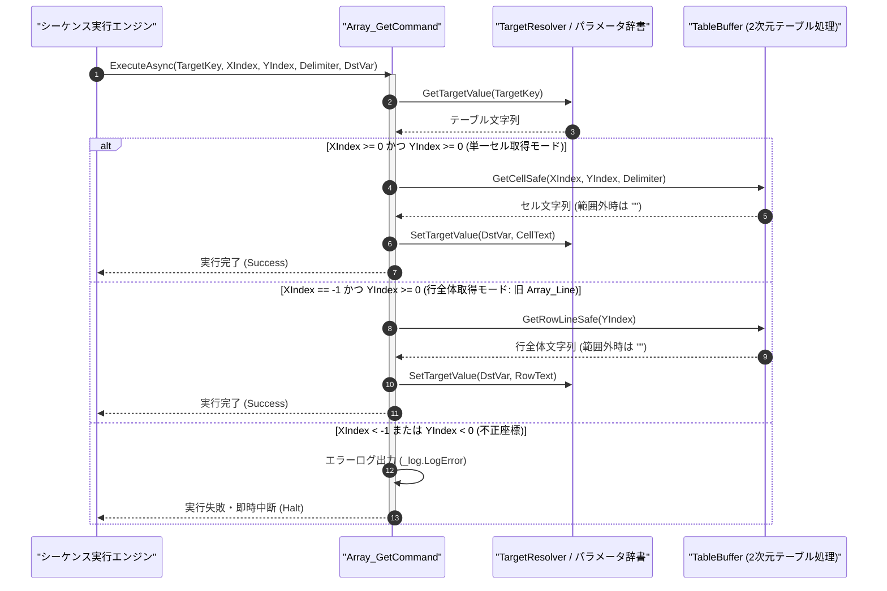

# コマンドリファレンス：Array_Get

## 概要

`Array_Get` は、指定された 2 次元テキストテーブル（`<TargetKey>`）から、指定座標（`<XIndex>`, `<YIndex>`）の単一セル値、または指定行全体のテキストを抽出し、格納先パラメータ（`<DstVar>`）へ格納する共通配列操作系コマンドです。  
列インデックス `<XIndex>` に `0` 以上の整数を指定した場合は該当セル値を取得し、**`<XIndex>` に `-1` を指定した場合は指定行（`<YIndex>`）の行全体テキストを取得**します（旧 `Array_Line` コマンドを完全統合）。

> 💡 **補足**  
> 本コマンドは 共通基盤コマンドです。範囲外の座標が指定された場合は例外を投げず、安全に空文字列 `""` を格納します。

---

## 💡 書式・パラメータ仕様

### コマンド構文

```csv
,SEQUENCE, [ステップキー], Array_Get, "[取得元テーブルキー]", "[列番号(XIndex: -1で行全体)]", "[行番号(YIndex)]", "[区切り文字(Delimiter)]", "[格納先キー(DstVar)]"
```

### パラメータ（引数）一覧

| 引数位置 | 引数名 | 説明 | 指定方法 / 有効な入力値 |
| :--- | :--- | :--- | :--- |
| 引数1 | TargetKey | 取得元の 2 次元テーブルを保持するパラメータキー名（必須）。 | 自コマンド内の `PARAM` キー名（例: `"DATA_TABLE"`, `"1"`） |
| 引数2 | XIndex | 取得する列インデックス（0 始まり）、または行全体取得を示す `-1`（必須）。 | `0` 以上の整数（単一セル取得）または `"-1"`（行全体取得） |
| 引数3 | YIndex | 取得する行インデックス（0 始まり・必須）。 | `0` 以上の整数（例: `"0"`, `"1"`）または `$PARAM$` 置換 |
| 引数4 | Delimiter | 列区切りデリミタ文字列（`<XIndex> = -1` の場合は省略可・既定値: `","`）。 | `","`（カンマ）、`"\t"`（タブ）等 |
| 引数5 | DstVar | 抽出した文字列を格納する対象パラメータキー名（必須）。 | 自コマンド内の `PARAM` キー名（例: `"CELL_VAL"`, `"ROW_TEXT"`） |

---

## 🔄 特殊置換規約・分岐規約の適用

本コマンドの引数における特殊記法および解釈ルールです。
* **動的置換（`$`）**: 引数内で `$PARAMキー$` のように記述すると、実行時に変数プール（PARAM）の値へ動的置換されます。（適用可能な引数: 全引数対応）
* **ジャンプ先指定（`#`）**: 本コマンドはジャンプ制御を行わないため適用されません。（適用可能な引数: 非適用）
* **共通コマンド指定（`@`）**: 本コマンドは外部マクロを呼び出さないため適用されません。（適用可能な引数: 非適用）
* **カンマのエスケープ**: 引数 4 にカンマを指定する場合は、必ず `","` と二重引用符で囲んで記述します。
* **エイリアス（別名）**: `ArrayGet`, `Array_Line`, `ArrayLine`, `Analysis_Term_Array_Line`

---

## 💡 動作例（正しい構文での記述例）

### スクリプト記述例

※COMMAND ブロック配下の子要素行（PARAM, SEQUENCE）は必ず行頭カンマから開始し、スペースインデントや行末コメント（`;`）は記述しないでください。

```csv
COMMAND, "READ_TABLE_SAMPLE", "CELL_OUT"
,PARAM, "DATA_TABLE", Text, "入力テーブル", "CH1,5.01,PASS"
,PARAM, "CELL_OUT", Work, "セル抽出結果", ""
,PARAM, "LINE_OUT", Work, "行全体抽出結果", ""
; 1. 単一セル取得：(X=1, Y=0) のセル値 "5.01" を "CELL_OUT" に取得
,SEQUENCE, 010, Array_Get, "DATA_TABLE", 1, 0, ",", "CELL_OUT"
; 2. 行全体取得（XIndex = -1）：0行目全体 "CH1,5.01,PASS" を "LINE_OUT" に取得
,SEQUENCE, 020, Array_Get, "DATA_TABLE", -1, 0, ",", "LINE_OUT"
```

### 実行時の挙動・変数変化

* **実行前の状態**: `"DATA_TABLE"` の 0 行目に `"CH1,5.01,PASS"` が格納されている状態。
* **実行後の状態**: ステップ `010` で `"CELL_OUT"` に `"5.01"` が格納され、ステップ `020`（`XIndex = -1`）で `"LINE_OUT"` に行全体の `"CH1,5.01,PASS"` が格納されます。

---

## 🔄 動作フロー（シーケンス図）

本コマンド実行時における、シーケンス実行エンジン、コマンドクラス（`Array_GetCommand`）、および `TableBuffer` 間のインタラクションを示すシーケンス図です。



---

## 🚫 エラーハンドリング・安全設計（仕様制限）

入力データの異常や実行時エラーに対し、解析・実行エンジンが実行するセーフティ規約です。

1. **テーブルサイズを超える正のインデックス指定時（安全空文字返却）**:
   - 存在する行数・列数を超える `XIndex` / `YIndex` が指定された場合は、例外で停止させず安全に空文字 `""` を `<DstVar>` に格納して処理を継続します。
2. **不正な負数インデックス指定（`XIndex < -1` または `YIndex < 0`）**:
   - `-1` 未満の列インデックスや負の行インデックスが指定された場合は、構文・引数エラーとして `_log.LogError` を出力し安全停止します。

---

## 🧪 ユニットテスト仕様

本コマンドクラス（`Array_GetCommand.cs`）に実装されている `RunUnitTest()` メソッドが検証するユニットテストの仕様です。

### テスト実行前提条件

* **実行トリガー**: `RunUnitTest()` メソッドの呼び出し
* **有効化条件**: システム全体の最小ログレベル（`ErrorLogger.MinimumLevel`）が `LogLevel.Test` であること（それ以外の場合は無効化ガードにより早期リターン）
* **検証結果出力**: `_log.LogTest` によるログ出力。検証失敗時は `_log.LogError`、予期せぬ例外発生時は `_log.LogCritical` で記録。

### テストケース一覧

| No | テストカテゴリ | テスト条件（入力値） | 期待される結果（出力値） | 検証の目的 / 観点 |
| :---: | :--- | :--- | :--- | :--- |
| **1** | 正常系 | 単一セル取得（`X=1, Y=0`） | 0行目・1列目のセル文字列が `<DstVar>` に格納される | セル値抽出の基本動作検証 |
| **2** | 正常系 | 行全体取得（`X=-1, Y=1`） | 1行目の行テキスト全体が `<DstVar>` に格納される | 旧 `Array_Line` 統合機能の検証 |
| **3** | 正常系 | 範囲外座標指定（`X=99, Y=99`） | 例外を投げず `<DstVar>` に空文字 `""` が格納される | 範囲外アクセス時の安全空文字返却検証 |
| **4** | 異常系 | 不正負数指定（`X=-2, Y=-1`） | エラーログが出力され `Failure` で安全停止する | 不正負数インデックスガードの検証 |

