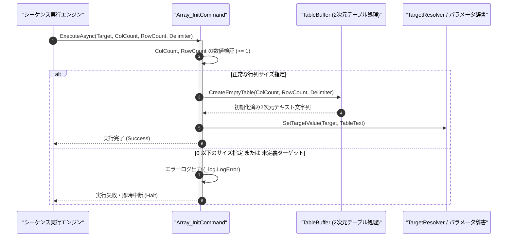

# コマンドリファレンス：Array_Init

## 概要

`Array_Init` は、指定されたターゲットパラメータ内に、改行（`\r\n`）を行区切り・指定デリミタを列区切りとする指定サイズ（列数 `<ColCount>` × 行数 `<RowCount>`）の 2 次元テキストテーブル領域を初期化確保する共通配列操作系コマンドです。  
測定データや検査結果を表形式で格納する前のテーブル初期化に使用します。

> 💡 **補足**  
> 本コマンドは 共通基盤コマンドです。

---

## 💡 書式・パラメータ仕様

### コマンド構文

```csv
,SEQUENCE, [ステップキー], Array_Init, "[対象キー]", "[列数(ColCount)]", "[行数(RowCount)]", "[区切り文字(Delimiter)]"
```

### パラメータ（引数）一覧

| 引数位置 | 引数名 | 説明 | 指定方法 / 有効な入力値 |
| :--- | :--- | :--- | :--- |
| 引数1 | Target | 2 次元テーブル領域を初期化する対象パラメータキー名（必須）。 | 自コマンド内の `PARAM` キー名（例: `"TABLE_BUF"`, `"1"`） |
| 引数2 | ColCount | 確保する列数（X 軸サイズ・必須）。 | 1 以上の整数（例: `"3"`, `"0x04"`）または `$PARAM$` 置換 |
| 引数3 | RowCount | 確保する行数（Y 軸サイズ・必須）。 | 1 以上の整数（例: `"10"`）または `$PARAM$` 置換 |
| 引数4 | Delimiter | 列を区切るデリミタ文字列（任意・省略可・既定値: `","`）。 | `","`（カンマ）、`"\t"`（タブ）、`" "`（空白）等 |

---

## 🔄 特殊置換規約・分岐規約の適用

本コマンドの引数における特殊記法および解釈ルールです。
* **動的置換（`$`）**: 引数内で `$PARAMキー$` のように記述すると、実行時に変数プール（PARAM）の値へ動的置換されます。（適用可能な引数: 全引数対応）
* **ジャンプ先指定（`#`）**: 本コマンドはジャンプ制御を行わないため適用されません。（適用可能な引数: 非適用）
* **共通コマンド指定（`@`）**: 本コマンドは外部マクロを呼び出さないため適用されません。（適用可能な引数: 非適用）
* **カンマのエスケープ**: 引数 4 にカンマ自体を指定する場合は、必ず `","` と二重引用符で囲んで記述します。
* **エイリアス（別名）**: `ArrayInit`, `GpibArray_Init`, `Analysis_Term_Array_Init`

---

## 💡 動作例（正しい構文での記述例）

### スクリプト記述例

※COMMAND ブロック配下の子要素行（PARAM, SEQUENCE）は必ず行頭カンマから開始し、スペースインデントや行末コメント（`;`）は記述しないでください。

```csv
COMMAND, "INIT_MEAS_TABLE", "DATA_TABLE"
,PARAM, "DATA_TABLE", Work, "測定結果テーブル", ""
,PARAM, "COLS", Number, "列数", "3"
,PARAM, "ROWS", Number, "行数", "2"
; 3列×2行のカンマ区切り2次元テーブルを "DATA_TABLE" に初期化生成
,SEQUENCE, 010, Array_Init, "DATA_TABLE", "$COLS$", "$ROWS$", ","
```

### 実行時の挙動・変数変化

* **実行前の状態**: `"DATA_TABLE"` が空文字列 `""`、`"COLS"` が `"3"`、`"ROWS"` が `"2"` の状態。
* **実行後の状態**: `"DATA_TABLE"` に 3 列（空セル 3 個分のカンマ 2 個 `",,"`）× 2 行（`"\r\n"` 区切り）の空テーブル文字列 `",,"\r\n",,"` が生成・格納されます。

---

## 🔄 動作フロー（シーケンス図）

本コマンド実行時における、シーケンス実行エンジン、コマンドクラス（`Array_InitCommand`）、および 2 次元テーブルヘルパー（`TableBuffer`）間のインタラクションを示すシーケンス図です。



---

## 🚫 エラーハンドリング・安全設計（仕様制限）

入力データの異常や実行時エラーに対し、解析・実行エンジンが実行するセーフティ規約です。

1. **列数または行数に 0 以下・非数値が指定された場合**:
   - 不正な配列サイズとして検出し、エラーログ（`_log.LogError`）を記録して直ちにシーケンスを安全停止（Halt）します。
2. **過大サイズ確保に対するメモリ保護ガード**:
   - 上限（例: 10,000 列 × 100,000 行）を超える極端なサイズ指定に対しては `OutOfMemoryException` を防ぐため上限ガードでエラー停止します。

---

## 🧪 ユニットテスト仕様

本コマンドクラス（`Array_InitCommand.cs`）に実装されている `RunUnitTest()` メソッドが検証するユニットテストの仕様です。

### テスト実行前提条件

* **実行トリガー**: `RunUnitTest()` メソッドの呼び出し
* **有効化条件**: システム全体の最小ログレベル（`ErrorLogger.MinimumLevel`）が `LogLevel.Test` であること（それ以外の場合は無効化ガードにより早期リターン）
* **検証結果出力**: `_log.LogTest` によるログ出力。検証失敗時は `_log.LogError`、予期せぬ例外発生時は `_log.LogCritical` で記録。

### テストケース一覧

| No | テストカテゴリ | テスト条件（入力値） | 期待される結果（出力値） | 検証の目的 / 観点 |
| :---: | :--- | :--- | :--- | :--- |
| **1** | 正常系 | 3列×2行・カンマ区切り（`"TBL", "3", "2", ","`） | `",,"\r\n",,"` が格納され `Success` 返却 | 2次元テーブル初期化の基本動作検証 |
| **2** | 正常系 | デリミタ省略時（`"TBL", "2", "1"`） | 既定のカンマ区切り `","` で初期化される | 省略時既定デリミタの検証 |
| **3** | 異常系 | 列数または行数に `"0"` または `"-1"` を指定 | エラーログが出力され `Failure` で安全停止する | 不正サイズ指定に対するガード検証 |

