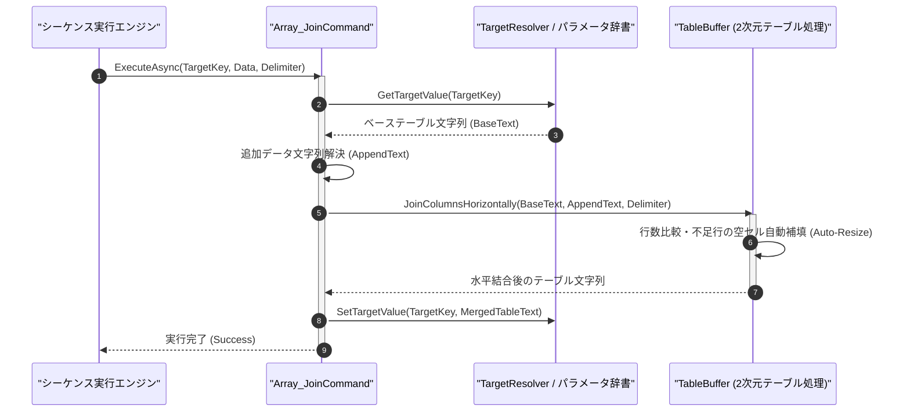

# コマンドリファレンス：Array_Join

## 概要

`Array_Join` は、対象の 2 次元テキストテーブル（`<TargetKey>`）の各行末尾に対して、追加テーブルデータ（`<Data>`）の各行を指定デリミタ（`<Delimiter>`）で水平方向に列結合（マージ）する共通配列操作系コマンドです。  
ベース側の行数が追加データ側の行数より少ない場合は、自動的にベース側の行を空セルで拡張（Auto-Resize）した上で安全に水平結合します。

> 💡 **補足**  
> 本コマンドは 共通基盤コマンドです。複数回測定した列データを既存のテーブルへ横方向に順次連結していく用途に最適です。

---

## 💡 書式・パラメータ仕様

### コマンド構文

```csv
,SEQUENCE, [ステップキー], Array_Join, "[結合先テーブルキー(TargetKey)]", "[追加データまたはキー(Data)]", "[区切り文字(Delimiter)]"
```

### パラメータ（引数）一覧

| 引数位置 | 引数名 | 説明 | 指定方法 / 有効な入力値 |
| :--- | :--- | :--- | :--- |
| 引数1 | TargetKey | 水平結合先となるベース 2 次元テーブルのパラメータキー名（必須）。 | 自コマンド内の `PARAM` キー名（例: `"MAIN_TABLE"`, `"1"`） |
| 引数2 | Data | 各行の末尾へ追加結合する 2 次元テキストデータまたはパラメータキー（必須）。 | パラメータキー名、`$PARAM$` 置換、または文字列リテラル |
| 引数3 | Delimiter | 列間を結合するデリミタ文字列（任意・省略可・既定値: `","`）。 | `","`（カンマ）、`"\t"`（タブ）等 |

---

## 🔄 特殊置換規約・分岐規約の適用

本コマンドの引数における特殊記法および解釈ルールです。
* **動的置換（`$`）**: 引数内で `$PARAMキー$` のように記述すると、実行時に変数プール（PARAM）の値へ動的置換されます。（適用可能な引数: 全引数対応）
* **ジャンプ先指定（`#`）**: 本コマンドはジャンプ制御を行わないため適用されません。（適用可能な引数: 非適用）
* **共通コマンド指定（`@`）**: 本コマンドは外部マクロを呼び出さないため適用されません。（適用可能な引数: 非適用）
* **カンマのエスケープ**: 引数 3 にカンマを指定する場合は、必ず `","` と二重引用符で囲んで記述します。
* **エイリアス（別名）**: `ArrayJoin`, `Analysis_Term_Array_Join`

---

## 💡 動作例（正しい構文での記述例）

### スクリプト記述例

※COMMAND ブロック配下の子要素行（PARAM, SEQUENCE）は必ず行頭カンマから開始し、スペースインデントや行末コメント（`;`）は記述しないでください。

```csv
COMMAND, "MERGE_COLUMNS", "BASE_TBL"
,PARAM, "BASE_TBL", Text, "ベース表", "CH1\r\nCH2"
,PARAM, "NEW_COL", Text, "追加測定列", "5.01\r\n4.99"
; BASE_TBL の各行末に NEW_COL の各行をカンマ区切りで水平結合
,SEQUENCE, 010, Array_Join, "BASE_TBL", "$NEW_COL$", ","
```

### 実行時の挙動・変数変化

* **実行前の状態**: `"BASE_TBL"` が `"CH1\r\nCH2"`（1 列×2 行）、`"NEW_COL"` が `"5.01\r\n4.99"`（1 列×2 行）の状態。
* **実行後の状態**: ステップ `010` の `Array_Join` 実行により、各行が水平連結され、`"BASE_TBL"` が `"CH1,5.01\r\nCH2,4.99"`（2 列×2 行）に更新されます。

---

## 🔄 動作フロー（シーケンス図）

本コマンド実行時における、シーケンス実行エンジン、コマンドクラス（`Array_JoinCommand`）、および `TableBuffer` 間のインタラクションを示すシーケンス図です。



---

## 🚫 エラーハンドリング・安全設計（仕様制限）

入力データの異常や実行時エラーに対し、解析・実行エンジンが実行するセーフティ規約です。

1. **ベース表と追加データの行数不一致時の自動行拡張**:
   - 追加データ `<Data>` の行数がベース表 `<TargetKey>` の行数より多い場合でもデータを切り捨てず、ベース表の不足行を既存列数分の空セルで自動パディングした上で全行を安全に結合します。
2. **未定義のターゲットパラメータキー指定**:
   - `<TargetKey>` が `PARAM` で定義されていない場合はエラーログ（`_log.LogError`）を記録して直ちに安全停止（Halt）します。

---

## 🧪 ユニットテスト仕様

本コマンドクラス（`Array_JoinCommand.cs`）に実装されている `RunUnitTest()` メソッドが検証するユニットテストの仕様です。

### テスト実行前提条件

* **実行トリガー**: `RunUnitTest()` メソッドの呼び出し
* **有効化条件**: システム全体の最小ログレベル（`ErrorLogger.MinimumLevel`）が `LogLevel.Test` であること（それ以外の場合は無効化ガードにより早期リターン）
* **検証結果出力**: `_log.LogTest` によるログ出力。検証失敗時は `_log.LogError`、予期せぬ例外発生時は `_log.LogCritical` で記録。

### テストケース一覧

| No | テストカテゴリ | テスト条件（入力値） | 期待される結果（出力値） | 検証の目的 / 観点 |
| :---: | :--- | :--- | :--- | :--- |
| **1** | 正常系 | 同行数テーブルの水平結合（`"A\r\nB"` + `"1\r\n2"`） | `"A,1\r\nB,2"` に更新される | 基本的な行末列結合の検証 |
| **2** | 正常系 | 追加データ側が行数過多の場合（1行ベース + 2行追加） | ベース2行目が空セル補完され2行テーブルとして結合される | 自動行拡張マージ（Auto-Resize）の検証 |
| **3** | 異常系 | 未定義の `<TargetKey>` を指定 | エラーログが出力され `Failure` で安全停止する | 未定義キーアクセス防御の検証 |

