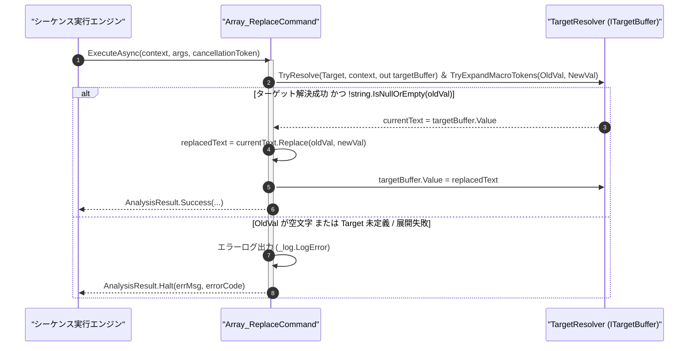

# コマンドリファレンス：Array_Replace

## 概要

`Array_Replace` は、指定されたターゲットパラメータ（`<Target>`）内の配列・テーブル文字列に含まれる特定の検索文字列（`<OldVal>`）を、指定された置換文字列（`<NewVal>`）へ一括置換する共通配列操作系コマンドです。  
デリミタ記号の変換や、不要な単位記号・制御文字の一括除去・置換に使用します。

> 💡 **補足**  
> 本コマンドは共通基盤コマンドです。置換は完全一致のリテラル文字列置換（`string.Replace`）として動作し、正規表現パターンによる置換は行いません。

---

## 💡 書式・パラメータ仕様

### コマンド構文

```csv
,SEQUENCE, [ステップキー], Array_Replace, "[対象キー(Target)]", "[検索文字列(OldVal)]", "[置換文字列(NewVal)]"
```

### パラメータ（引数）一覧

| 引数位置 | 引数名 | 説明 | 指定方法 / 有効な入力値 |
| :--- | :--- | :--- | :--- |
| 引数1 | `Target` | 置換処理を行う対象の配列・テキストパラメータキー名（必須）。 | 自コマンド内の `PARAM` キー名（例: `"DATA_TABLE"`, `"1"`） |
| 引数2 | `OldVal` | 検索する置換前のリテラル文字列（必須・空文字不可）。 | 任意の文字列（例: `"ERROR"`, `"V"`）または `$PARAM$` 置換 |
| 引数3 | `NewVal` | 置換後の新しい文字列（任意・省略可・既定値: `""`［空文字による部分文字列削除］）。 | 任意の文字列（例: `"0.0"`, `""`）、`$PARAM$` 置換、または省略 |

---

## 🔄 特殊置換規約・分岐規約の適用

本コマンドの引数における特殊記法および解釈ルールです。
* **動的置換（`$`）**: 引数内で `$PARAMキー$` のように記述すると、実行時に変数プール（PARAM）の値へ動的置換されます。（適用可能な引数: 全引数対応）
* **ジャンプ先指定（`#`）**: 本コマンドはジャンプ制御を行わないため適用されません。（適用可能な引数: 非適用）
* **共通コマンド指定（`@`）**: 本コマンドは外部マクロを呼び出さないため適用されません。（適用可能な引数: 非適用）
* **カンマのエスケープ**: `<OldVal>` や `<NewVal>` にカンマを含める場合は、必ず `","` と二重引用符で囲んで記述します。
* **エイリアス（別名）**: `Gpib_Array_Replace`, `Term_Array_Replace`, `Analysis_Term_Array_Replace`

---

## 💡 動作例（正しい構文での記述例）

### スクリプト記述例

※COMMAND ブロック配下の子要素行（PARAM, SEQUENCE）は必ず行頭カンマから開始し、スペースインデントや行末コメント（`;`）は記述しないでください。

```csv
COMMAND, "CLEAN_TABLE_UNIT", "DATA_TABLE"
,PARAM, "DATA_TABLE", Work, "測定テーブル", ""
; 1. 2列×2行の測定テーブル ("CH1,5.01VDC\r\nCH2,3.30VDC") を構築
,SEQUENCE, 010, Array_Set, "DATA_TABLE", 0, 0, ",", "CH1"
,SEQUENCE, 020, Array_Set, "DATA_TABLE", 1, 0, ",", "5.01VDC"
,SEQUENCE, 030, Array_Set, "DATA_TABLE", 0, 1, ",", "CH2"
,SEQUENCE, 040, Array_Set, "DATA_TABLE", 1, 1, ",", "3.30VDC"
; 2. テーブル内の単位文字列 "VDC" を空文字 "" に一括置換して数値のみに整形
,SEQUENCE, 050, Array_Replace, "DATA_TABLE", "VDC", ""
```

### 実行時の挙動・変数変化

* **実行前の状態**: ステップ `010`〜`040` により `"DATA_TABLE"` に `"CH1,5.01VDC\r\nCH2,3.30VDC"` が格納されている状態。
* **実行後の状態**: ステップ `050` の `Array_Replace` 実行により、すべての `"VDC"` が除去され、`"DATA_TABLE"` が `"CH1,5.01\r\nCH2,3.30"` に更新されます。

---

## 🔄 動作フロー（シーケンス図）

本コマンド実行時における、シーケンス実行エンジン、コマンドクラス（`Array_ReplaceCommand`）、およびパラメータ辞書間のインタラクションを示すシーケンス図です。



---

## 🚫 エラーハンドリング・安全設計（仕様制限）

入力データの異常や実行時エラーに対し、解析・実行エンジンが実行するセーフティ規約です。

1. **検索文字列 `<OldVal>` に空文字が指定された場合**:
   - `.NET` の `string.Replace("", ...)` による `ArgumentException` を防止するため、`<OldVal>` が空文字の場合はエラーログ（`_log.LogError`）を記録して安全停止します。
2. **対象文字列に `<OldVal>` が含まれない場合**:
   - エラーとはせず、元のテーブル文字列をそのまま維持して正常完了（`Success`）します。

---

## 🧪 ユニットテスト仕様

本コマンドクラス（`Array_ReplaceCommand.cs`）に実装されている `RunUnitTest()` メソッドが検証するユニットテストの仕様です。

### テスト実行前提条件

* **実行トリガー**: `RunUnitTest()` メソッドの呼び出し
* **有効化条件**: システム全体の最小ログレベル（`ErrorLogger.MinimumLevel`）が `LogLevel.Test` であること（それ以外の場合は無効化ガードにより早期リターン）
* **検証結果出力**: `_log.LogTest` によるログ出力。検証失敗時は `_log.LogError`、予期せぬ例外発生時は `_log.LogCritical` で記録。

### テストケース一覧

| No | テストカテゴリ | テスト条件（入力値） | 期待される結果（出力値） | 検証の目的 / 観点 |
| :---: | :--- | :--- | :--- | :--- |
| **1** | 正常系 | `"DATA_TABLE" = "CH1,5.01VDC,ERR\r\nCH2,3.30VDC,ERR"` に対し複数箇所一括置換 `("DATA_TABLE", "ERR", "0")` を実行 | `"DATA_TABLE"` が `"CH1,5.01VDC,0\r\nCH2,3.30VDC,0"` に更新され `Success` が返る | 複数箇所の文字列一括置換の基本動作検証 |
| **2** | 正常系 | 上記 `"DATA_TABLE"` に対し空文字への置換 `("DATA_TABLE", "VDC", "")` を実行 | 不要な単位文字列が除去され `"CH1,5.01,0\r\nCH2,3.30,0"` に更新される | 空文字置換による部分文字列除去の検証 |
| **3** | 異常系 | `OldVal` に直接空文字 `""` を指定 `("DATA_TABLE", "", "X")` | パイプライン検証失敗または即時 `Halt` で安全停止する | リテラル空検索文字列に対する防御検証 |
| **4** | 異常系 | 展開結果が空文字となるマクロ参照 `OldVal = "$EMPTY_SEARCH$"`（`EMPTY_SEARCH = ""`）を指定 `("DATA_TABLE", "$EMPTY_SEARCH$", "X")` | `ExecuteAsync` 内の空文字検証によりエラーログが出力され即時 `Halt` で安全停止する | マクロ展開後の空検索文字列に対する防御検証 |

