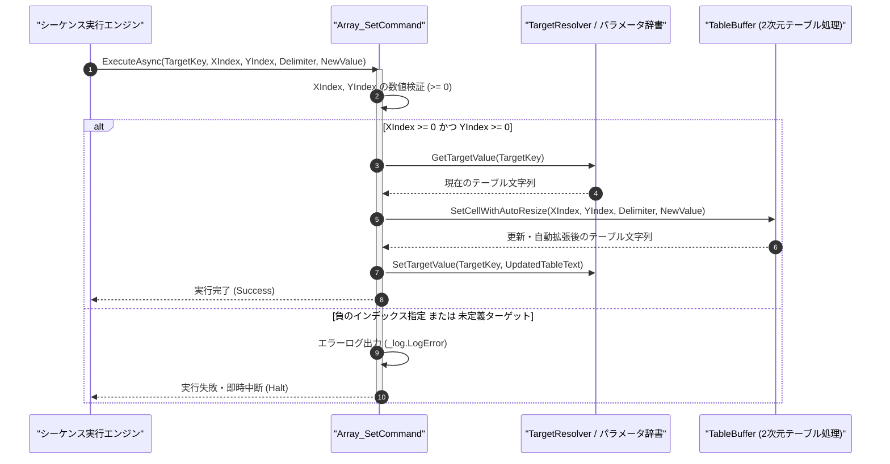

# コマンドリファレンス：Array_Set

## 概要

`Array_Set` は、指定されたターゲットパラメータ内の 2 次元テキストテーブルに対し、指定された座標（列インデックス `<XIndex>`, 行インデックス `<YIndex>`: 0 始まり）のセルへ新しい値を設定する共通配列操作系コマンドです。  
現在のテーブルサイズを超える座標が指定された場合は、自動的に不足する行・列を空文字セルで拡張（Auto-Resize）した上で安全に値を格納します。

> 💡 **補足**  
> 本コマンドは 共通基盤コマンドです。

---

## 💡 書式・パラメータ仕様

### コマンド構文

```csv
,SEQUENCE, [ステップキー], Array_Set, "[対象キー]", "[列番号(XIndex)]", "[行番号(YIndex)]", "[区切り文字(Delimiter)]", "[設定値(NewValue)]"
```

### パラメータ（引数）一覧

| 引数位置 | 引数名 | 説明 | 指定方法 / 有効な入力値 |
| :--- | :--- | :--- | :--- |
| 引数1 | TargetKey | 操作対象の 2 次元テーブルを保持するパラメータキー名（必須）。 | 自コマンド内の `PARAM` キー名（例: `"DATA_TABLE"`, `"1"`） |
| 引数2 | XIndex | 設定先の列インデックス（0 始まり・必須）。 | 0 以上の整数（例: `"0"`, `"2"`）または `$PARAM$` 置換 |
| 引数3 | YIndex | 設定先の行インデックス（0 始まり・必須）。 | 0 以上の整数（例: `"0"`, `"1"`）または `$PARAM$` 置換 |
| 引数4 | Delimiter | 列区切りデリミタ文字列（必須）。 | `","`（カンマ）、`"\t"`（タブ）等 |
| 引数5 | NewValue | 指定セルへ書き込む文字列または数値（必須）。 | 任意の文字列・数値または `$PARAM$` 置換 |

---

## 🔄 特殊置換規約・分岐規約の適用

本コマンドの引数における特殊記法および解釈ルールです。
* **動的置換（`$`）**: 引数内で `$PARAMキー$` のように記述すると、実行時に変数プール（PARAM）の値へ動的置換されます。（適用可能な引数: 全引数対応）
* **ジャンプ先指定（`#`）**: 本コマンドはジャンプ制御を行わないため適用されません。（適用可能な引数: 非適用）
* **共通コマンド指定（`@`）**: 本コマンドは外部マクロを呼び出さないため適用されません。（適用可能な引数: 非適用）
* **カンマのエスケープ**: 引数 4 にカンマを指定する場合や、引数 5 の値にカンマを含める場合は、必ず `","` と二重引用符で囲んで記述します。
* **エイリアス（別名）**: `ArraySet`, `GpibArray_Set`, `Analysis_Term_Array_Set`

---

## 💡 動作例（正しい構文での記述例）

### スクリプト記述例

※COMMAND ブロック配下の子要素行（PARAM, SEQUENCE）は必ず行頭カンマから開始し、スペースインデントや行末コメント（`;`）は記述しないでください。

```csv
COMMAND, "RECORD_CELL_DATA", "DATA_TABLE"
,PARAM, "DATA_TABLE", Work, "2次元データ表", ""
,PARAM, "MEAS_VAL", Text, "測定値", "5.012"
; 1. 2列×2行で初期化
,SEQUENCE, 010, Array_Init, "DATA_TABLE", 2, 2, ","
; 2. (X=0, Y=0) に項目名 "CH1"、(X=1, Y=0) に測定値 "$MEAS_VAL$" を格納
,SEQUENCE, 020, Array_Set, "DATA_TABLE", 0, 0, ",", "CH1"
,SEQUENCE, 030, Array_Set, "DATA_TABLE", 1, 0, ",", "$MEAS_VAL$"
```

### 実行時の挙動・変数変化

* **実行前の状態**: ステップ `010` により `"DATA_TABLE"` が `","\r\n","`（2 列×2 行の空テーブル）の状態。
* **実行後の状態**: ステップ `020`・`030` の実行により、1 行目（Y=0）の 1 列目（X=0）が `"CH1"`、2 列目（X=1）が `"5.012"` となり、`"DATA_TABLE"` は `"CH1,5.012\r\n,"` に更新されます。

---

## 🔄 動作フロー（シーケンス図）

本コマンド実行時における、シーケンス実行エンジン、コマンドクラス（`Array_SetCommand`）、および `TableBuffer` 間のインタラクションを示すシーケンス図です。



---

## 🚫 エラーハンドリング・安全設計（仕様制限）

入力データの異常や実行時エラーに対し、解析・実行エンジンが実行するセーフティ規約です。

1. **範囲外インデックス指定時の自動拡張（Auto-Resize）**:
   - 現在の列数・行数を超える正の座標（`XIndex`, `YIndex`）が指定された場合、`IndexOutOfRangeException` を発生させず、不足する行および列を空文字で自動補完して値を格納します。
2. **負の座標指定（`XIndex < 0` または `YIndex < 0`）**:
   - 負のインデックスが指定された場合は不正座標エラーとして `_log.LogError` に記録し、直ちに安全停止（Halt）します。

---

## 🧪 ユニットテスト仕様

本コマンドクラス（`Array_SetCommand.cs`）に実装されている `RunUnitTest()` メソッドが検証するユニットテストの仕様です。

### テスト実行前提条件

* **実行トリガー**: `RunUnitTest()` メソッドの呼び出し
* **有効化条件**: システム全体の最小ログレベル（`ErrorLogger.MinimumLevel`）が `LogLevel.Test` であること（それ以外の場合は無効化ガードにより早期リターン）
* **検証結果出力**: `_log.LogTest` によるログ出力。検証失敗時は `_log.LogError`、予期せぬ例外発生時は `_log.LogCritical` で記録。

### テストケース一覧

| No | テストカテゴリ | テスト条件（入力値） | 期待される結果（出力値） | 検証の目的 / 観点 |
| :---: | :--- | :--- | :--- | :--- |
| **1** | 正常系 | 既存範囲内セルへの設定（`X=1, Y=0, Val="OK"`） | 該当セルが `"OK"` に更新され他セルは保持される | 2次元セル代入の基本動作検証 |
| **2** | 正常系 | 空テーブルに対する範囲外座標設定（`X=2, Y=1, Val="EXT"`） | 3列×2行へ自動拡張され `(2, 1)` に `"EXT"` が格納される | Auto-Resize（自動拡張）機能の検証 |
| **3** | 異常系 | 負のインデックス指定（`X=-1, Y=0`） | エラーログが出力され `Failure` で安全停止する | 不正インデックス防御の検証 |

