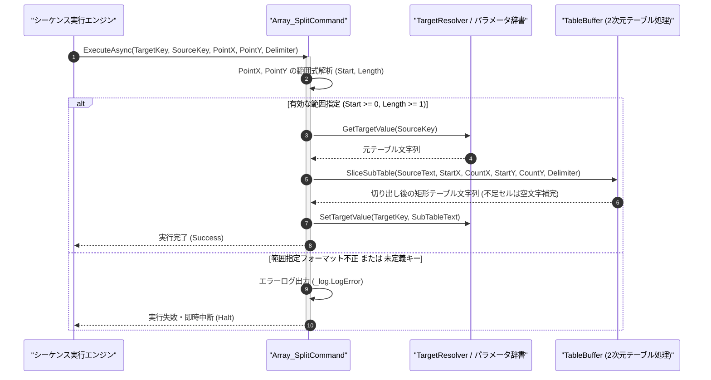

# コマンドリファレンス：Array_Split

## 概要

`Array_Split` は、取得元の 2 次元テキストテーブル（`<SourceKey>`）から、指定された矩形領域（X 軸の開始列・列数 `<PointX>`、Y 軸の開始行・行数 `<PointY>`）を切り出し（スライス / SubArray）、格納先パラメータ（`<TargetKey>`）へ新しい 2 次元テーブルとして格納する共通配列操作系コマンドです。  
元テーブルの範囲を超える領域が指定された場合は、超過分のセルを空文字で自動補完して指定サイズの矩形テーブルを生成します。

> 💡 **補足**  
> 本コマンドは 共通基盤コマンドです。

---

## 💡 書式・パラメータ仕様

### コマンド構文

```csv
,SEQUENCE, [ステップキー], Array_Split, "[格納先キー(TargetKey)]", "[取得元キー(SourceKey)]", "[X範囲(開始列-列数)]", "[Y範囲(開始行-行数)]", "[区切り文字(Delimiter)]"
```

### パラメータ（引数）一覧

| 引数位置 | 引数名 | 説明 | 指定方法 / 有効な入力値 |
| :--- | :--- | :--- | :--- |
| 引数1 | TargetKey | 切り出した 부분テーブルを格納するパラメータキー名（必須）。 | 自コマンド内の `PARAM` キー名（例: `"SUB_TABLE"`, `"2"`） |
| 引数2 | SourceKey | 切り出し元の 2 次元テーブルを保持するパラメータキー名（必須）。 | 自コマンド内の `PARAM` キー名（例: `"RAW_TABLE"`, `"1"`） |
| 引数3 | PointX | X 軸（列方向）の切り出し範囲 `"<開始列>-<列数>"` または単一列番号（必須）。 | `"1-2"`（1列目から2列分）または `"1"`（1列目のみ、0始まり） |
| 引数4 | PointY | Y 軸（行方向）の切り出し範囲 `"<開始行>-<行数>"` または単一行番号（必須）。 | `"0-3"`（0行目から3行分）または `"0"`（0行目のみ、0始まり） |
| 引数5 | Delimiter | 列区切りデリミタ文字列（任意・省略可・既定値: `","`）。 | `","`（カンマ）、`"\t"`（タブ）等 |

---

## 🔄 特殊置換規約・分岐規約の適用

本コマンドの引数における特殊記法および解釈ルールです。
* **動的置換（`$`）**: 引数内で `$PARAMキー$` のように記述すると、実行時に変数プール（PARAM）の値へ動的置換されます。（適用可能な引数: 全引数対応）
* **ジャンプ先指定（`#`）**: 本コマンドはジャンプ制御を行わないため適用されません。（適用可能な引数: 非適用）
* **共通コマンド指定（`@`）**: 本コマンドは外部マクロを呼び出さないため適用されません。（適用可能な引数: 非適用）
* **カンマのエスケープ**: 引数 5 にカンマを指定する場合は、必ず `","` と二重引用符で囲んで記述します。
* **エイリアス（別名）**: `ArraySplit`, `GpibArray_Split`, `Analysis_Term_Array_Split`

---

## 💡 動作例（正しい構文での記述例）

### スクリプト記述例

※COMMAND ブロック配下の子要素行（PARAM, SEQUENCE）は必ず行頭カンマから開始し、スペースインデントや行末コメント（`;`）は記述しないでください。

```csv
COMMAND, "SLICE_TABLE_DATA", "SUB_TBL"
,PARAM, "FULL_TBL", Text, "全体テーブル", ""
,PARAM, "SUB_TBL", Work, "切り出しテーブル", ""
; FULL_TBL から 列1〜2列分 ("1-2")、行0〜2行分 ("0-2") の矩形領域を SUB_TBL へ切り出す
,SEQUENCE, 010, Array_Split, "SUB_TBL", "FULL_TBL", "1-2", "0-2", ","
```

### 実行時の挙動・変数変化

* **実行前の状態**: `"FULL_TBL"` に 4 列×3 行のテーブルデータが格納されている状態。
* **実行後の状態**: ステップ `010` の実行により、列インデックス `1` から `2` 列分、行インデックス `0` から `2` 行分の $2 \times 2$ 部分テーブルが切り出され、`"SUB_TBL"` に格納されます。

---

## 🔄 動作フロー（シーケンス図）

本コマンド実行時における、シーケンス実行エンジン、コマンドクラス（`Array_SplitCommand`）、および `TableBuffer` 間のインタラクションを示すシーケンス図です。



---

## 🚫 エラーハンドリング・安全設計（仕様制限）

入力データの異常や実行時エラーに対し、解析・実行エンジンが実行するセーフティ規約です。

1. **元テーブルの範囲を超えるスライス指定時の自動補完**:
   - 指定された切り出し範囲が元テーブルの行数・列数を超えている場合でも、例外で停止せず超過部分を空セル（`""`）でパディングして指定サイズの矩形テーブルを安全に生成します。
2. **不正な範囲指定書式（負数や非数値）**:
   - `<PointX>` または `<PointY>` が `"開始-個数"`（または非負整数）として解釈できない場合は、エラーログ（`_log.LogError`）を記録して安全停止します。

---

## 🧪 ユニットテスト仕様

本コマンドクラス（`Array_SplitCommand.cs`）に実装されている `RunUnitTest()` メソッドが検証するユニットテストの仕様です。

### テスト実行前提条件

* **実行トリガー**: `RunUnitTest()` メソッドの呼び出し
* **有効化条件**: システム全体の最小ログレベル（`ErrorLogger.MinimumLevel`）が `LogLevel.Test` であること（それ以外の場合は無効化ガードにより早期リターン）
* **検証結果出力**: `_log.LogTest` によるログ出力。検証失敗時は `_log.LogError`、予期せぬ例外発生時は `_log.LogCritical` で記録。

### テストケース一覧

| No | テストカテゴリ | テスト条件（入力値） | 期待される結果（出力値） | 検証の目的 / 観点 |
| :---: | :--- | :--- | :--- | :--- |
| **1** | 正常系 | 3×3 テーブルから `PointX="1-2", PointY="0-2"` を切り出し | 指定された 2×2 部分テーブルが `<TargetKey>` に格納される | 矩形スライスの基本動作検証 |
| **2** | 正常系 | 元テーブルサイズを超える範囲（`PointX="2-3"`）を指定 | 超過列が空セルで補完された 3 列テーブルが生成される | 範囲外自動パディングの検証 |
| **3** | 異常系 | 不正な範囲文字列（`PointX="INVALID"`）を指定 | エラーログが出力され `Failure` で安全停止する | 範囲式パースエラー時の防御検証 |

