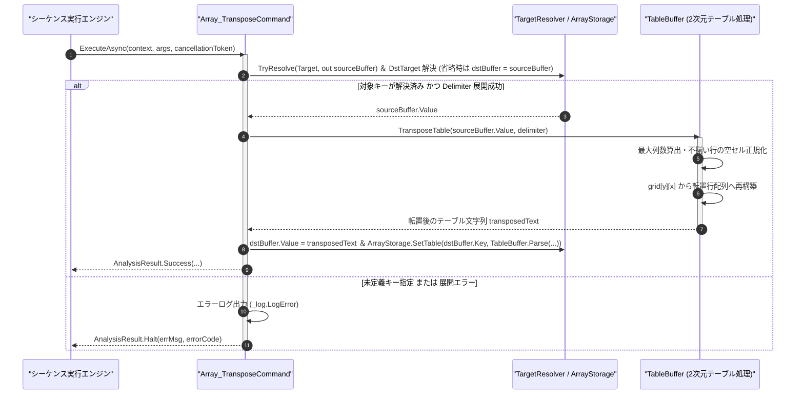

# コマンドリファレンス：Array_Transpose

## 概要

`Array_Transpose` は、指定された 2 次元テキストテーブル（`<Target>`）の行（Row）と列（Column）を入れ替え（行列転置：$M \text{ 列} \times N \text{ 行} \to N \text{ 列} \times M \text{ 行}$）、指定された格納先（`<DstTarget>`、省略時は `<Target>` 自身に上書き）へ格納する共通配列操作系コマンドです。  
横方向に蓄積した時系列データを縦方向の CSV レポート形式へ変換する際などに使用します。

> 💡 **補足**  
> 本コマンドは 共通基盤コマンドです。各行の列数が不揃い（ジャグ配列状態）の場合は、最大列数に合わせて不足セルを空文字で自動補完した上で正確に転置します。

---

## 💡 書式・パラメータ仕様

### コマンド構文

```csv
,SEQUENCE, [ステップキー], Array_Transpose, "[対象テーブルキー(Target)]", "[格納先キー(DstTarget)]", "[区切り文字(Delimiter)]"
```

### パラメータ（引数）一覧

| 引数位置 | 引数名 | 説明 | 指定方法 / 有効な入力値 |
| :--- | :--- | :--- | :--- |
| 引数1 | Target | 転置元の 2 次元テーブルを保持するパラメータキー名（必須）。 | 自コマンド内の `PARAM` キー名（例: `"SRC_TABLE"`, `"1"`） |
| 引数2 | DstTarget | 転置後のテーブルを格納するパラメータキー名（任意・省略可）。 | 自コマンド内の `PARAM` キー名。省略時または空文字時は `<Target>` 自身へ上書き格納 |
| 引数3 | Delimiter | 列区切りデリミタ文字列（任意・省略可・既定値: `","`）。 | `","`（カンマ）、`"\t"`（タブ）等 |

---

## 🔄 特殊置換規約・分岐規約の適用

本コマンドの引数における特殊記法および解釈ルールです。
* **動的置換（`$`）**: 引数内で `$PARAMキー$` のように記述すると、実行時に変数プール（PARAM）の値へ動的置換されます。（適用可能な引数: 全引数対応）
* **ジャンプ先指定（`#`）**: 本コマンドはジャンプ制御を行わないため適用されません。（適用可能な引数: 非適用）
* **共通コマンド指定（`@`）**: 本コマンドは外部マクロを呼び出さないため適用されません。（適用可能な引数: 非適用）
* **カンマのエスケープ**: 引数 3 にカンマを指定する場合は、必ず `","` と二重引用符で囲んで記述します。
* **エイリアス（別名）**: `Transpose`, `Gpib_Array_Transpose`, `Term_Array_Transpose`, `Analysis_Term_Array_Transpose`

---

## 💡 動作例（正しい構文での記述例）

### スクリプト記述例

※COMMAND ブロック配下の子要素行（PARAM, SEQUENCE）は必ず行頭カンマから開始し、スペースインデントや行末コメント（`;`）は記述しないでください。

```csv
COMMAND, "TRANSPOSE_REPORT", "TRANSPOSED_TBL"
,PARAM, "RAW_TBL", Work, "元テーブル(3列×2行)", ""
,PARAM, "TRANSPOSED_TBL", Work, "転置後テーブル(2列×3行)", ""
; 1. 3列×2行テーブル ("CH1,CH2,CH3\r\n5.0,3.3,1.8") を構築
,SEQUENCE, 010, Array_Set, "RAW_TBL", 0, 0, ",", "CH1"
,SEQUENCE, 020, Array_Set, "RAW_TBL", 1, 0, ",", "CH2"
,SEQUENCE, 030, Array_Set, "RAW_TBL", 2, 0, ",", "CH3"
,SEQUENCE, 040, Array_Set, "RAW_TBL", 0, 1, ",", "5.0"
,SEQUENCE, 050, Array_Set, "RAW_TBL", 1, 1, ",", "3.3"
,SEQUENCE, 060, Array_Set, "RAW_TBL", 2, 1, ",", "1.8"
; 2. RAW_TBL の行と列を転置し、TRANSPOSED_TBL へ格納
,SEQUENCE, 070, Array_Transpose, "RAW_TBL", "TRANSPOSED_TBL", ","
```

### 実行時の挙動・変数変化

* **実行前の状態**: ステップ `010`〜`060` により `"RAW_TBL"` が `"CH1,CH2,CH3\r\n5.0,3.3,1.8"`（3 列×2 行）に構築された状態。
* **実行後の状態**: ステップ `070` の `Array_Transpose` 実行により、行と列が入れ替わり、`"TRANSPOSED_TBL"` に `"CH1,5.0\r\nCH2,3.3\r\nCH3,1.8"`（2 列×3 行）が格納されます。

---

## 🔄 動作フロー（シーケンス図）

本コマンド実行時における、シーケンス実行エンジン、コマンドクラス（`Array_TransposeCommand`）、および `TableBuffer` 間のインタラクションを示すシーケンス図です。



---

## 🚫 エラーハンドリング・安全設計（仕様制限）

入力データの異常や実行時エラーに対し、解析・実行エンジンが実行するセーフティ規約です。

1. **行ごとに列数が異なる不揃いテーブル（ジャグ配列）の安全な正規化**:
   - 一部の行で列数が少ない場合でも `IndexOutOfRangeException` を発生させず、テーブル全体の最大列数に合わせて不足セルを空文字 `""` で補完してから転置を行います。
2. **空テーブルに対する転置実行および未定義キー防御**:
   - 転置元 `<Target>` が空文字列 `""` の場合はエラーとせず空文字列 `""` を設定して正常終了し、未定義キーが指定された場合は `_log.LogError` を記録して安全停止（Halt）します。

---

## 🧪 ユニットテスト仕様

本コマンドクラス（`Array_TransposeCommand.cs`）に実装されている `RunUnitTest()` メソッドが検証するユニットテストの仕様です。

### テスト実行前提条件

* **実行トリガー**: `RunUnitTest()` メソッドの呼び出し
* **有効化条件**: システム全体の最小ログレベル（`ErrorLogger.MinimumLevel`）が `LogLevel.Test` であること（それ以外の場合は無効化ガードにより早期リターン）
* **検証結果出力**: `_log.LogTest` によるログ出力。検証失敗時は `_log.LogError`、予期せぬ例外発生時は `_log.LogCritical` で記録。

### テストケース一覧

| No | テストカテゴリ | テスト条件（入力値） | 期待される結果（出力値） | 検証の目的 / 観点 |
| :---: | :--- | :--- | :--- | :--- |
| **1** | 正常系 | 3 列×2 行テーブル `"RAW_TBL" = "CH1,CH2,CH3\r\n5.0,3.3,1.8"` を別パラメータへ転置 `("RAW_TBL", "TRANSPOSED_TBL", ",")` | `"TRANSPOSED_TBL"` に `"CH1,5.0\r\nCH2,3.3\r\nCH3,1.8"`（2 列×3 行）が格納され `Success` が返る | 行列転置および別ターゲット出力の基本動作検証 |
| **2** | 正常系 | `"RAW_TBL"` に対し `<DstTarget>` 省略でインプレース転置 `("RAW_TBL")` を実行 | `"RAW_TBL"` 自身が `"CH1,5.0\r\nCH2,3.3\r\nCH3,1.8"` で上書き更新される | 省略時インプレース更新の検証 |
| **3** | 正常系 | 列数が不揃いなジャグテーブル `"JAGGED_TBL" = "A,B,C\r\n1"` に対し `("JAGGED_TBL", "", ",")` を実行 | 不足セルが空文字補完されて `"JAGGED_TBL"` が `"A,1\r\nB,\r\nC,"` に転置される | ジャグ配列に対する安全正規化の検証 |
| **4** | 異常系 | 未定義の `<Target>` キーを指定 `("UNDEFINED_TBL")` | エラーログが出力され `Halt` で安全停止する | 未定義キーアクセス防御の検証 |

