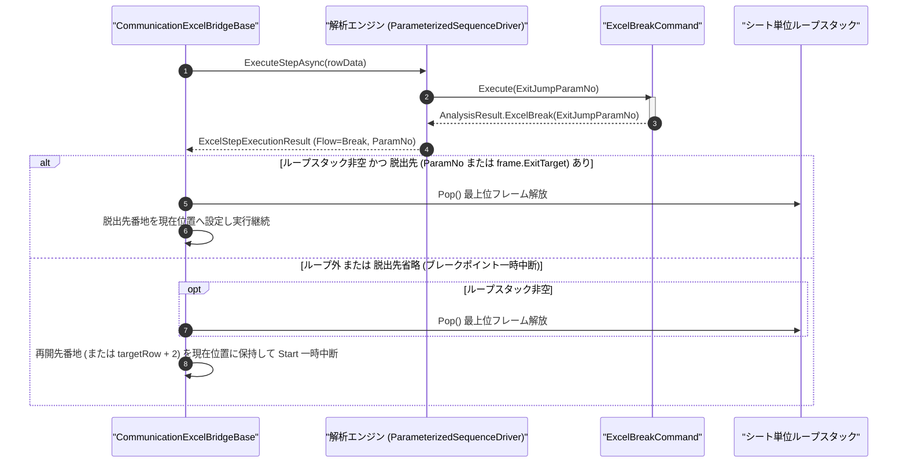

# コマンドリファレンス：Excel_Break

## 概要

`Excel_Break` は、実行コンテキストに応じて **① シート行反復ループ（[`Excel_Loop`](./Excel_Loop.Md) 〜 [`Excel_Next`](./Excel_Next.Md)）からのスタック解放付き早期脱出** 、または **② `Start` 一括実行中のブレークポイント一時中断（`Stepping` 待機状態への遷移）** を行う Excel エクステンション共通コマンドです。

> [!NOTE]
> ループ途中で [`Excel_Jump`](./Excel_Jump.Md) によりループ外へ飛び出すとループフレームがスタックに残りますが、`Excel_Break` を使用することで最上位フレームを確実に Pop 解放して外側のループ構造を正しく保ちます。また、ループ外で実行した場合は再開先番地を `現在位置` に保持したまま `Start` 連続実行を一時中断するため、実機状態を確認してから `Step` または `Start` でそのまま再開できます。

---

## 💡 書式・パラメータ仕様

### コマンド構文

```csv
,SEQUENCE, [ステップキー], Excel_Break, "[ExitJumpParamNo]"
```

### パラメータ（引数）一覧

| 引数位置 | 引数名 | 説明 | 指定方法 / 有効な入力値 |
| :--- | :--- | :--- | :--- |
| 引数1 | `ExitJumpParamNo` | 脱出先または再開先のシート行を保持する公開パラメータ番号（任意・省略可）。 | `1` 以上の整数（`"1"`, `"2"`, ...、`$PARAMキー$` 置換可）または省略 |

---

## 🔄 特殊置換規約・Excel シート連携規約の適用

本コマンドにおける実行コンテキスト別の動作ルールです。
* **ループ実行中かつ脱出先が解決可能な場合**: 最上位のループフレームを Pop 解放し（多重ネスト時は最も内側のループのみ脱出）、`ExitJumpParamNo` の解決番地（省略時は [`Excel_Loop`](./Excel_Loop.Md) の第 2 引数で登録された既定脱出先番地）へ `現在位置` を更新して実行を継続します。
* **ループ外または脱出先未指定の場合（ブレークポイント一時中断）**: ループ中であれば最上位フレームを Pop したうえで、再開先番地（`ExitJumpParamNo` 指定時はその解決番地、省略時は直下の次行 `targetRow + 2`）を `現在位置` に設定し、`Start` 連続ループのみを一時中断します。
* **入力規則ドロップダウンの自動付与**: 引数 1 `ExitJumpParamNo` に定数パラメータ番号を指定した場合、シート配置時に該当パラメータ列へ遷移先候補ドロップダウンが自動付与されます。

---

## 💡 動作例（正しい構文での記述例）

### スクリプト記述例

※ `COMMAND` ブロック配下の子要素行（`PARAM`, `SEQUENCE`）は必ず行頭カンマから開始し、スペースインデントや行末コメント（`;`）は記述しないでください。

```csv
COMMAND, "POLL_READY_OR_BREAK", "RESP"
,PARAM, "EXIT_DEST", String, "完了時脱出先", "POST_LOOP"
,PARAM, "RESP", Work, "受信応答", ""
,SEQUENCE, 010, Com_Send, "STATUS?"
,SEQUENCE, 020, Judge, "NEQ", "$RESP$", "READY", #CONTINUE_LOOP#
,SEQUENCE, 030, Excel_Break, 1
,SEQUENCE, #CONTINUE_LOOP#, Exit
```

### 実行時の挙動・シート状態変化

* **応答が `"READY"` 以外のとき**: ステップ `020` で `#CONTINUE_LOOP#` へ分岐して `Flow = Next` で完了し、後続の [`Excel_Next`](./Excel_Next.Md) 行によってポーリングループが継続されます。
* **応答が `"READY"` になったとき**: ステップ `030` の `Excel_Break, 1` が実行されてループフレームが Pop 解放され、第 1 パラメータ（`"POST_LOOP"`）のシート行へ即座に脱出します。

---

## 🔄 動作フロー（シーケンス図）

本コマンド実行時における、解析エンジン・`ExcelBreakCommand`・Excel ブリッジ間のインタラクションを示すシーケンス図です。



---

## 🚫 エラーハンドリング・安全設計（仕様制限）

入力データの異常に対し、解析エンジンおよびブリッジ層が実行するセーフティ規約です。

1. **不正なパラメータ番号の指定**:
   - `ExitJumpParamNo` に `0` 以下の整数や非数値文字列が指定された場合、`_log.LogError` に記録し `ExcelSequenceFlow.Halt` で安全停止します。
2. **指定された脱出先セルが解決不能な場合**:
   - `ExitJumpParamNo`（または `Excel_Loop` 側の既定脱出先）に未定義の名前や空行番地が入力されている場合、ブリッジ層でエラーログを記録し安全停止（`Halt`）します。

---

## 🧪 ユニットテスト仕様

本コマンドクラス（`ExcelBreakCommand.cs`）に実装されている `RunUnitTest()` メソッドが検証するユニットテストの仕様です。

### テスト実行前提条件

* **実行トリガー**: `RunUnitTest()` メソッドの呼び出し
* **有効化条件**: システム全体の最小ログレベル（`ErrorLogger.MinimumLevel`）が `LogLevel.Test` であること
* **検証結果出力**: `_log.LogTest` によるログ出力。検証失敗時は `_log.LogError`、予期せぬ例外発生時は `_log.LogCritical` で記録

### テストケース一覧

| No | テストカテゴリ | テスト条件（入力値） | 期待される結果（出力値） | 検証の目的 / 観点 |
| :---: | :--- | :--- | :--- | :--- |
| **1** | 正常系 | 引数省略で実行 | `Flow = Break` かつ `TargetParamNumber = 0` が返る | ブレークポイント中断・既定脱出の基本検証 |
| **2** | 正常系 | 脱出先番号指定（`"2"`） | `Flow = Break` かつ `TargetParamNumber = 2` が返る | 明示脱出先パラメータ番号指定の検証 |
| **3** | 異常系 | `0` 指定（`"0"`）または非数値指定（`"XYZ"`） | エラーログが出力され `Flow = Halt` が返る | 不正パラメータ番号に対する防御検証 |
