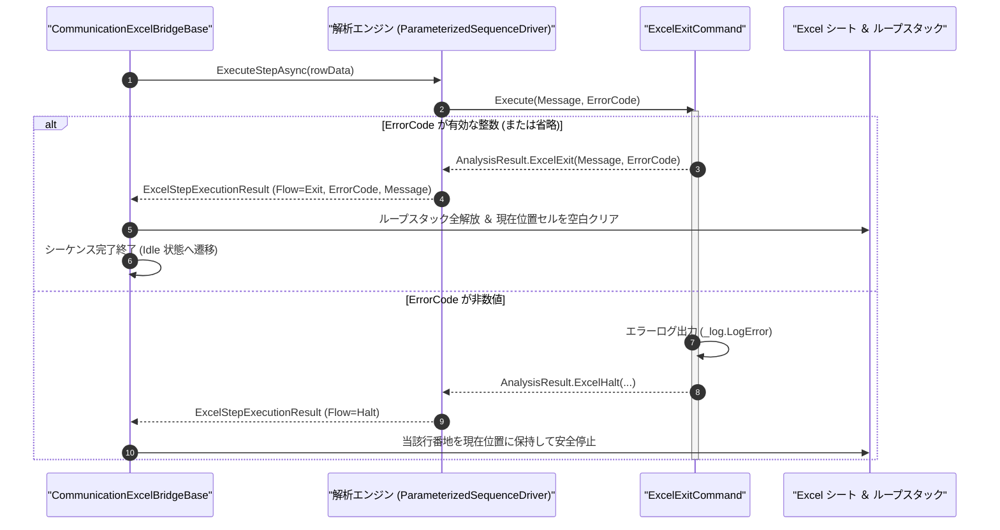

# コマンドリファレンス：Excel_Exit

## 概要

`Excel_Exit` は、分岐先の終了処理ステップや良品早期完了ポイントにおいて、残りの後続 Excel シート行を実行することなく **Excel シーケンス全体を正式完了終了（`Exit`）** させる Excel エクステンション共通コマンドです。  
実行完了時、Excel ブリッジ層は当該シートのループスタックをすべて解放し、制御ブロックの `現在位置`（`col + 3` 下段）を空白にクリアして初期待機状態（`Idle`）へ復帰させます。

> [!NOTE]
> **安全停止（`Halt`）との役割の違い**: 通信エラーや規格外判定による `Halt` が「異常発生行の番地を `現在位置` に残して原因確認や途中再開を可能にする」のに対し、`Excel_Exit`（`Exit`）は「予定された終了点に到達したため `現在位置` をクリアして検査シーケンス全体を完了させる」役割を担います。

---

## 💡 書式・パラメータ仕様

### コマンド構文

```csv
,SEQUENCE, [ステップキー], Excel_Exit, "[Message]", "[ErrorCode]"
```

### パラメータ（引数）一覧

| 引数位置 | 引数名 | 説明 | 指定方法 / 有効な入力値 |
| :--- | :--- | :--- | :--- |
| 引数1 | `Message` | 完了時にログ記録または結果メッセージとして保持する文字列（任意・省略可）。 | 任意の文字列または `$PARAMキー$` 置換（省略時は空文字） |
| 引数2 | `ErrorCode` | 終了ステータスコード（任意・省略可）。 | 整数値（省略時の既定値: `"0"`＝正常完了、非 `0`＝ステータスコード付き完了） |

---

## 🔄 特殊置換規約・Excel シート連携規約の適用

本コマンドにおける制御ルールです。
* **動的置換（`$`）**: 引数 1 `Message` および引数 2 `ErrorCode` の双方で `$PARAMキー$` 置換を利用できます。
* **ミニシーケンスの即時完了**: 同一ミニシーケンス内で `Excel_Exit` の後ろに別ステップが存在していても、本コマンド実行時点で直ちにミニシーケンスを完了し、`ExcelSequenceFlow.Exit` を上位へ返却します。
* **シート状態のリセット**: `Step` 実行中・`Start` 一括実行中のいずれで到達した場合でも、対象シートのループスタックを全解放し、制御ブロックの `現在位置` を空白にクリアして完了します（単体実行ボタン押下時は制御ブロックを変更しません）。

---

## 💡 動作例（正しい構文での記述例）

### スクリプト記述例

※ `COMMAND` ブロック配下の子要素行（`PARAM`, `SEQUENCE`）は必ず行頭カンマから開始し、スペースインデントや行末コメント（`;`）は記述しないでください。

```csv
COMMAND, "SEQUENCE_EARLY_FINISH", "FINAL_MSG"
,PARAM, "FINAL_MSG", String, "終了メッセージ", "PASS_COMPLETE"
,SEQUENCE, 010, Gpib_Send, "OUTP OFF"
,SEQUENCE, 020, Excel_Exit, "$FINAL_MSG$", 0
```

### 実行時の挙動・シート状態変化

* **シート構成例**:
  * `A16` 行：通常完了処理（`SEQUENCE_EARLY_FINISH`） ➔ 後続の `A18` 行（NG 専用退避処理）を実行せずにここでシーケンス完了
  * `A18` 行：`NG_HANDLE`（[`Excel_Judge`](./Excel_Judge.Md) で NG 時のみジャンプしてくる異常終了処理）
* **`Step` / `Start` 実行後の状態**: `A16` 行で電源出力を OFF にしたのち `Excel_Exit` により `Flow = Exit` が返却され、`Result` 出力先に `"PASS_COMPLETE"` が書き込まれ、制御ブロックの `現在位置` が空白にクリアされて `A18` 行を実行することなく全シーケンスが完了します。

---

## 🔄 動作フロー（シーケンス図）

本コマンド実行時における、解析エンジン・`ExcelExitCommand`・Excel ブリッジ間のインタラクションを示すシーケンス図です。



---

## 🚫 エラーハンドリング・安全設計（仕様制限）

入力データの異常に対し、解析エンジンが実行するセーフティ規約です。

1. **終了コードへの非数値指定**:
   - 引数 2 `ErrorCode` に整数として解釈できない文字列（例: `"ERR"`）が指定された場合、`_log.LogError` に記録し `ExcelSequenceFlow.Halt` で安全停止します。

---

## 🧪 ユニットテスト仕様

本コマンドクラス（`ExcelExitCommand.cs`）に実装されている `RunUnitTest()` メソッドが検証するユニットテストの仕様です。

### テスト実行前提条件

* **実行トリガー**: `RunUnitTest()` メソッドの呼び出し
* **有効化条件**: システム全体の最小ログレベル（`ErrorLogger.MinimumLevel`）が `LogLevel.Test` であること
* **検証結果出力**: `_log.LogTest` によるログ出力。検証失敗時は `_log.LogError`、予期せぬ例外発生時は `_log.LogCritical` で記録

### テストケース一覧

| No | テストカテゴリ | テスト条件（入力値） | 期待される結果（出力値） | 検証の目的 / 観点 |
| :---: | :--- | :--- | :--- | :--- |
| **1** | 正常系 | 引数省略で実行 | `Flow = Exit` かつ `ErrorCode = 0` が返る | 既定の即時正常完了動作検証 |
| **2** | 正常系 | メッセージ・終了コード指定（`"DONE", "1"`） | `Flow = Exit`, `Message = "DONE"`, `ErrorCode = 1` が返る | メッセージおよびステータスコード保持の検証 |
| **3** | 異常系 | 非数値終了コード指定（`"DONE", "INVALID"`） | エラーログが出力され `Flow = Halt` が返る | 不正終了コードに対する防御検証 |
