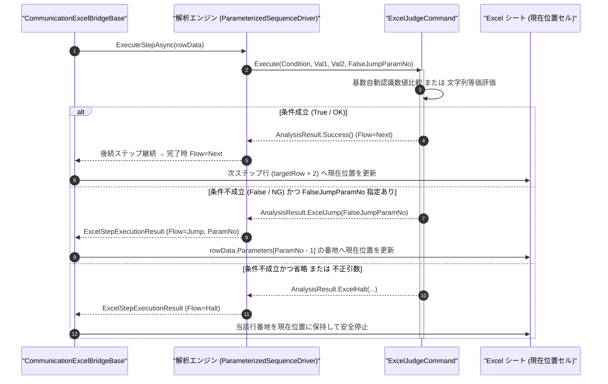

# コマンドリファレンス：Excel_Judge

## 概要

`Excel_Judge` は、測定値や受信応答などの 2 つの値（`<Val1>` と `<Val2>`：数値および文字列の双方に対応）を比較演算子（`<Condition>`：`GE`, `GT`, `LE`, `LT`, `EQU`, `NEQ`）で評価し、 **条件成立（真 / OK）時は次へ継続進行（`Next`）し、条件不成立（偽 / NG）時は指定パラメータ番号の Excel シート行へ分岐ジャンプ（`Jump`）または安全停止（`Halt`）** する Excel エクステンション共通コマンドです。  
ミニシーケンス内部ラベルへ分岐する [`Judge`](../Sequence/Judge.Md) と共通の基数自動認識（10 進、16 進 `0x` / `&H`、2 進 `0b`）および大文字小文字無視の文字列等価比較を備え、判定結果に応じて Excel シート上の別シーケンス行へ直接分岐できます。

> [!NOTE]
> 条件成立（真 / OK）時は `SequenceFlow = Next` を返すため、同一ミニシーケンス内で下限判定と上限判定を連続ステップとして記述できます。不成立になった時点で即座にミニシーケンスを完了し、`FalseJumpParamNo` 指定時は該当シート行へジャンプ、省略時は規格外停止（`Halt`）します。

---

## 💡 書式・パラメータ仕様

### コマンド構文

```csv
,SEQUENCE, [ステップキー], Excel_Judge, "<Condition>", "<Val1>", "<Val2>", "[FalseJumpParamNo]"
```

### パラメータ（引数）一覧

| 引数位置 | 引数名 | 説明 | 指定方法 / 有効な入力値 |
| :--- | :--- | :--- | :--- |
| 引数1 | `Condition` | 比較条件演算子（必須）。<br/>・`GE` (`>=`): 以上<br/>・`GT` (`>`): より大きい<br/>・`LE` (`<=`): 以下<br/>・`LT` (`<`): 未満<br/>・`EQU` (`==`): 等しい（数値または文字列等価）<br/>・`NEQ` (`!=`): 等しくない | `"GE"`, `"GT"`, `"LE"`, `"LT"`, `"EQU"`, `"NEQ"`（記号表記 `">="`, `">"`, `"<="`, `"<"`, `"=="`, `"!="` も可） |
| 引数2 | `Val1` | 左辺の比較対象値（数値または文字列・必須）。 | 数値リテラル（`"5.0"`, `"0x1A"`）、文字列、または `$PARAMキー$` 置換 |
| 引数3 | `Val2` | 右辺の比較基準値（数値または文字列・必須）。 | 数値リテラル、文字列、または `$PARAMキー$` 置換 |
| 引数4 | `FalseJumpParamNo` | 条件不成立（偽 / NG）時の遷移先を保持するシート側公開パラメータ番号（任意・省略可）。 | `1` 以上の整数（`"1"`, `"2"`, ...）または省略（省略時は不成立時に `Halt` 停止） |

---

## 🔄 特殊置換規約・Excel シート連携規約の適用

本コマンドの引数およびシート展開における解釈ルールです。
* **動的置換（`$`）**: 全引数において `$PARAMキー$` 記述による実行時変数置換が適用されます。通信受信値を格納した `Work` 型変数（例: `$MEAS_V$`）とシート公開パラメータ（例: `$LOWER_V$`）を直接比較できます。
* **公開パラメータ番号指定（`Work` 型除外）**: 引数 4 `FalseJumpParamNo` には、`Work` 型を除いた外部公開パラメータの定義順番号（`1`〜`N`）を指定します。
* **入力規則ドロップダウンの自動付与**: 引数 4 に定数パラメータ番号が記述されている場合、シート配置時に該当パラメータ列の下段セルへシーケンス行番地および Excel 名前定義のドロップダウンリストが自動付与されます。
* **カンマのエスケープ**: 比較対象文字列にカンマを含む場合は `","` のように二重引用符で囲んで記述します。

---

## 💡 動作例（正しい構文での記述例）

### スクリプト記述例

※ `COMMAND` ブロック配下の子要素行（`PARAM`, `SEQUENCE`）は必ず行頭カンマから開始し、スペースインデントや行末コメント（`;`）は記述しないでください。

```csv
COMMAND, "GPIB_VOLT_JUDGE", "MEAS_V"
,PARAM, "LOWER_V", Number, "下限電圧(V)", "4.80"
,PARAM, "UPPER_V", Number, "上限電圧(V)", "5.20"
,PARAM, "NG_DEST", String, "NG時ジャンプ先", "NG_HANDLE"
,PARAM, "MEAS_V", Work, "測定電圧値", ""
,SEQUENCE, 010, Gpib_Send, "MEAS:VOLT:DC?"
,SEQUENCE, 020, Gpib_Receive, "MEAS_V"
,SEQUENCE, 030, Excel_Judge, "GE", "$MEAS_V$", "$LOWER_V$", 3
,SEQUENCE, 040, Excel_Judge, "LE", "$MEAS_V$", "$UPPER_V$", 3
```

### 実行時の挙動・シート状態変化

* **シート配置時の状態**: 内部作業用の `MEAS_V`（`Work` 型）はシート列へ展開されず、第 1 列 `"下限電圧(V)"`、第 2 列 `"上限電圧(V)"`、第 3 列 `"NG時ジャンプ先"`（遷移先ドロップダウン付き）の 3 列が展開されます。
* **規格内（例: `5.01` V）の挙動**: ステップ `030`・`040` ともに成立（`Flow = Next`）し、測定値 `"5.01"` が `Result` 指定セルへ出力されたのち、シート上の直下の次行へ進みます。
* **規格外（例: `4.50` V）の挙動**: ステップ `030` が不成立となり、ステップ `040` を実行せず `Flow = Jump`（`TargetParamNumber = 3`）で完了します。測定値 `"4.50"` を出力したうえで、第 3 パラメータ（`"NG_HANDLE"`）が指すシート行へ `現在位置` が遷移します。

---

## 🔄 動作フロー（シーケンス図）

本コマンド実行時における、解析エンジン・`ExcelJudgeCommand`・Excel ブリッジ間のインタラクションを示すシーケンス図です。



---

## 🚫 エラーハンドリング・安全設計（仕様制限）

入力データの異常や実行時エラーに対し、解析エンジンおよびブリッジ層が実行するセーフティ規約です。

1. **非数値文字列に対する大小比較（`GE`, `GT`, `LE`, `LT`）指定**:
   - `EQU` / `NEQ` 以外の大小比較演算子で数値変換できない文字列が渡された場合、不正比較エラーを `_log.LogError` に記録し `ExcelSequenceFlow.Halt` で安全停止します。
2. **未定義の比較演算子または不正なジャンプ先パラメータ番号**:
   - 規定外の `<Condition>` や `0` 以下の `FalseJumpParamNo` が指定された場合、エラーログを記録して安全停止します。

---

## 🧪 ユニットテスト仕様

本コマンドクラス（`ExcelJudgeCommand.cs`）に実装されている `RunUnitTest()` メソッドが検証するユニットテストの仕様です。

### テスト実行前提条件

* **実行トリガー**: `RunUnitTest()` メソッドの呼び出し
* **有効化条件**: システム全体の最小ログレベル（`ErrorLogger.MinimumLevel`）が `LogLevel.Test` であること
* **検証結果出力**: `_log.LogTest` によるログ出力。検証失敗時は `_log.LogError`、予期せぬ例外発生時は `_log.LogCritical` で記録

### テストケース一覧

| No | テストカテゴリ | テスト条件（入力値） | 期待される結果（出力値） | 検証の目的 / 観点 |
| :---: | :--- | :--- | :--- | :--- |
| **1** | 正常系 | 数値比較成立（`"GE", "5.0", "4.8", "3"`） | `Flow = Next` が返る | 条件成立時の継続進行検証 |
| **2** | 正常系 | 数値比較不成立・分岐あり（`"LE", "5.5", "5.2", "3"`） | `Flow = Jump` かつ `TargetParamNumber = 3` が返る | 条件不成立時のパラメータ番号分岐検証 |
| **3** | 正常系 | 16 進数・文字列比較（`"EQU", "0x10", "16"` / `"EQU", "ok", "OK"`） | `Flow = Next` が返る | 基数自動認識および大文字小文字無視比較の検証 |
| **4** | 異常系 | 不成立かつ分岐省略（`"GT", "1.0", "2.0"`）または非数値大小比較 | `Flow = Halt` が返る | 分岐省略時および不正入力時の安全停止検証 |
