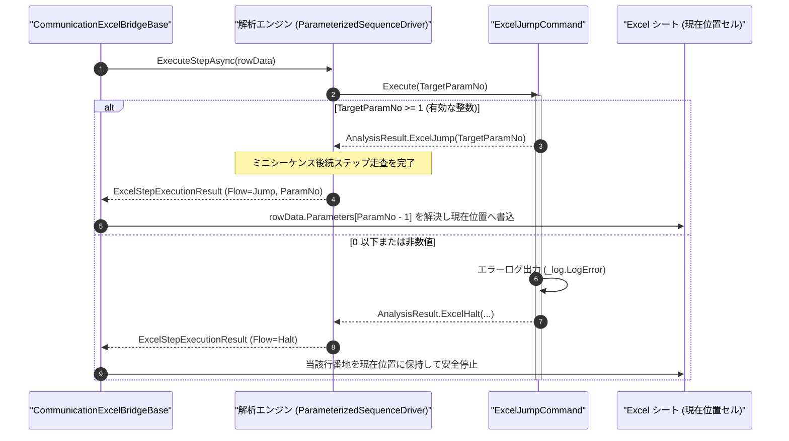

# コマンドリファレンス：Excel_Jump

## 概要

`Excel_Jump` は、実行中のミニシーケンスを完了し、指定された公開パラメータ番号（`<TargetParamNo>`）に対応する Excel シート上のパラメータセルへ入力された遷移先（セル番地または Excel 名前定義）へ `現在位置`（プログラムカウンタ）を無条件に遷移させる Excel エクステンション共通コマンドです。  
検査モード別の処理スキップ、異常処理後の合流点への遷移、および条件分岐後の共通終了ステップへの移動などに使用します。

> [!NOTE]
> 本コマンドは Excel Interop 非依存の共通コマンドアセンブリ（`Common.Commands.Excel`）として実装されており、解析エンジン層からはフロー制御識別子（`ExcelSequenceFlow.Jump`）と対象パラメータ番号（`TargetParamNumber`）のみを単方向で返却します。実際のセル番地・名前定義の解決および `現在位置` セルの更新は Excel ブリッジ層（`CommunicationExcelBridgeBase`）が担当します。

---

## 💡 書式・パラメータ仕様

### コマンド構文

```csv
,SEQUENCE, [ステップキー], Excel_Jump, "<TargetParamNo>"
```

### パラメータ（引数）一覧

| 引数位置 | 引数名 | 説明 | 指定方法 / 有効な入力値 |
| :--- | :--- | :--- | :--- |
| 引数1 | `TargetParamNo` | 遷移先（セル番地または Excel 名前定義）が入力されているシート側公開パラメータの番号（必須）。 | `1` 以上の整数（`"1"`, `"2"`, ...、16 進 `0x` / 2 進 `0b` 可）または `$PARAMキー$` 置換 |

---

## 🔄 特殊置換規約・Excel シート連携規約の適用

本コマンドの引数およびシート展開における解釈ルールです。
* **動的置換（`$`）**: 引数内で `$PARAMキー$` のように記述すると、実行時に変数プール（`PARAM`）の値へ動的置換されたうえで整数パースされます。（適用可能な引数: 引数 1 `TargetParamNo`）
* **公開パラメータ番号指定（`Work` 型除外）**: `COMMAND` ブロック内の `,PARAM` 定義のうち、内部作業用の `Work` 型を除いた外部公開パラメータの定義順（`1` 番目、`2` 番目、...、`N` 番目）がそのままシート上のパラメータ列（`baseCol + 4` 以降）および `<TargetParamNo>` に対応します。
* **シート側でのセル番地・名前定義指定**: 対応するシート上のパラメータ下段セルには、遷移先シーケンス行のセル番地（例: `A12`, `$A$12`）または Excel 名前定義（例: `FINAL_STEP`, `RETRY_MEAS`）を指定します。
* **入力規則ドロップダウンの自動付与**: 本コマンドを含むマクロコマンドをシートへ配置すると、`<TargetParamNo>` が指すパラメータ列の下段セルに対し、シート内の単体実行ボタン行番地一覧と有効な Excel 名前定義一覧を統合したドロップダウンリストが自動設定されます。
* **単体実行ボタン押下時の非干渉**: 各行先頭の単体実行（`実行`）ボタンから実行された場合は、制御ブロックの `開始位置`・`現在位置` およびループスタックは変更されません（`Step` 実行および `Start` 一括実行時のみ遷移します）。

---

## 💡 動作例（正しい構文での記述例）

### スクリプト記述例

※ `COMMAND` ブロック配下の子要素行（`PARAM`, `SEQUENCE`）は必ず行頭カンマから開始し、スペースインデントや行末コメント（`;`）は記述しないでください。

```csv
COMMAND, "FLOW_JUMP_FINISH", ""
,PARAM, "DEST_ROW", String, "ジャンプ先セル/名前定義", "FINAL_STEP"
,SEQUENCE, 010, Excel_Jump, 1
```

### 実行時の挙動・シート状態変化

* **シート配置時の状態**: `baseCol + 4`（第 1 公開パラメータ列）の上段セルに `"ジャンプ先セル/名前定義"`、下段セルに初期値 `"FINAL_STEP"` と遷移先候補ドロップダウンが展開されます。
* **`Step` / `Start` 実行後の状態**: `Excel_Jump, 1` により `SequenceFlow = Jump`（`TargetParamNumber = 1`）が返却され、第 1 パラメータに入力された `"FINAL_STEP"`（または `"A20"` 等）の基準セル番地へ制御ブロックの `現在位置` が更新されます。

---

## 🔄 動作フロー（シーケンス図）

本コマンド実行時における、解析エンジン・`ExcelJumpCommand`・Excel ブリッジ間のインタラクションを示すシーケンス図です。



---

## 🚫 エラーハンドリング・安全設計（仕様制限）

入力データの異常や実行時エラーに対し、解析エンジンおよびブリッジ層が実行するセーフティ規約です。

1. **不正なパラメータ番号の指定**:
   - 引数未指定、`0` 以下の整数、または数値変換できない文字列が指定された場合、`_log.LogError` に記録し `ExcelSequenceFlow.Halt` で直ちに安全停止します。
2. **シート側遷移先の未入力または解決不能**:
   - 指定されたパラメータ番号が公開パラメータ列数を超えている場合、または該当セルに入力された番地・名前定義が有効なシーケンス行（下段コマンドセルが非空）を指していない場合、ブリッジ層でエラーログを記録し、発生行番地を `現在位置` に保持したまま安全停止（`Halt`）します。
3. **後方ジャンプによる無限ループ防御**:
   - `Start` 一括実行中に後方行へのジャンプが繰り返された場合でも、`Setting.xml` の `[Sequence] MaxExecutionSteps`（既定値 `10000`）または中断ダイアログ（`CancelDialog`）により確実に停止できます。

---

## 🧪 ユニットテスト仕様

本コマンドクラス（`ExcelJumpCommand.cs`）に実装されている `RunUnitTest()` メソッドが検証するユニットテストの仕様です。

### テスト実行前提条件

* **実行トリガー**: `RunUnitTest()` メソッドの呼び出し
* **有効化条件**: システム全体の最小ログレベル（`ErrorLogger.MinimumLevel`）が `LogLevel.Test` であること
* **検証結果出力**: `_log.LogTest` によるログ出力。検証失敗時は `_log.LogError`、予期せぬ例外発生時は `_log.LogCritical` で記録

### テストケース一覧

| No | テストカテゴリ | テスト条件（入力値） | 期待される結果（出力値） | 検証の目的 / 観点 |
| :---: | :--- | :--- | :--- | :--- |
| **1** | 正常系 | 有効なパラメータ番号指定（`"2"`） | `Flow = Jump` かつ `TargetParamNumber = 2` が返る | 無条件シート行ジャンプの基本動作検証 |
| **2** | 異常系 | `0` 指定（`"0"`）または非数値指定（`"ABC"`） | エラーログが出力され `Flow = Halt` が返る | 不正パラメータ番号に対する防御検証 |
| **3** | 異常系 | 引数省略（空配列） | エラーログが出力され `Flow = Halt` が返る | 必須引数欠落時の安全停止検証 |
