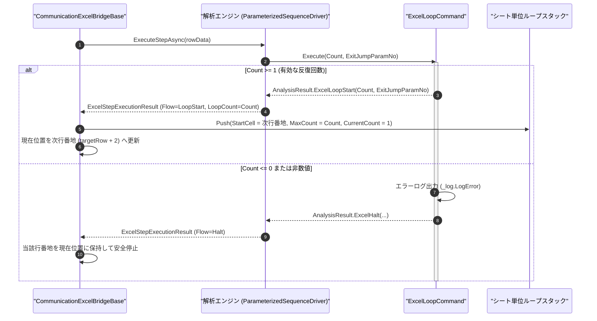

# コマンドリファレンス：Excel_Loop

## 概要

`Excel_Loop` は、Excel シート上の複数シーケンス行（異なるアドインの通信行が混在する区間を含む）を指定回数（`<Count>`）だけ反復実行するためのループを開始する Excel エクステンション共通コマンドです。  
本コマンド配置行の直下の次シーケンス行（`targetRow + 2`）を反復先頭番地（`StartCell`）としてシート単位ループスタックへ Push 登録し、対になる [`Excel_Next`](./Excel_Next.Md) および [`Excel_Break`](./Excel_Break.Md) と連携して動作します（多重ネストループ完全対応）。

> [!NOTE]
> ループスタックは Excel ブリッジ層において **ワークシート単位で隔離管理** されます。そのため、1 つのループ区間内に `TermAddIn`（`P1:Com_Send` 等）と `GpibAddIn`（`GPIB_Meas` 等）の行を混在させて反復実行でき、同時に開いている別シートや別ブックのループ状態とも干渉しません。

---

## 💡 書式・パラメータ仕様

### コマンド構文

```csv
,SEQUENCE, [ステップキー], Excel_Loop, "<Count>", "[ExitJumpParamNo]"
```

### パラメータ（引数）一覧

| 引数位置 | 引数名 | 説明 | 指定方法 / 有効な入力値 |
| :--- | :--- | :--- | :--- |
| 引数1 | `Count` | ループ区間を繰り返す最大反復回数（必須）。 | `1` 以上の整数（10 進 `"5"`、16 進 `"0x0A"`、2 進 `"0b101"`）または `$PARAMキー$` 置換 |
| 引数2 | `ExitJumpParamNo` | ループ途中で引数省略の [`Excel_Break`](./Excel_Break.Md) が実行された際の既定脱出先を保持するシート側公開パラメータ番号（任意・省略可）。 | `1` 以上の整数（`"1"`, `"2"`, ...）または省略 |

---

## 🔄 特殊置換規約・Excel シート連携規約の適用

本コマンドの引数およびシート展開における解釈ルールです。
* **動的置換（`$`）**: 引数 1 `Count` および引数 2 `ExitJumpParamNo` の双方で `$PARAMキー$` による変数置換を利用できます。シート公開パラメータに反復回数を割り当てれば、Excel シート上から試験回数を自由に変更できます。
* **ミニシーケンス内でのフロー保持**: 同一ミニシーケンス内で `Excel_Loop` の後ろに初期化用の通常ステップ（`Flow = Next`）が続く場合でも、ドライバ（`ParameterizedSequenceDriver`）は `LoopStart` フロー情報を上書き消失させずにブリッジ層へ伝播します。
* **既定脱出先ドロップダウンの自動付与**: 引数 2 `ExitJumpParamNo` に定数パラメータ番号を指定した場合、シート配置時に該当パラメータ列の下段セルへ遷移先候補ドロップダウンが自動付与されます。

---

## 💡 動作例（正しい構文での記述例）

### スクリプト記述例

※ `COMMAND` ブロック配下の子要素行（`PARAM`, `SEQUENCE`）は必ず行頭カンマから開始し、スペースインデントや行末コメント（`;`）は記述しないでください。

```csv
COMMAND, "EXCEL_LOOP_BEGIN", ""
,PARAM, "REPEAT_CNT", Number, "反復回数", "5"
,PARAM, "BREAK_DEST", String, "Break時脱出先", ""
,SEQUENCE, 010, Excel_Loop, "$REPEAT_CNT$", 2
```

### 実行時の挙動・シート状態変化

* **シート構成例**:
  * `A4` 行：`EXCEL_LOOP_BEGIN`（第 1 パラメータ `"5"`、第 2 パラメータ `"A12"`）
  * `A6` 行：`P1:Com_Send`（条件変更コマンド送信）
  * `A8` 行：`GPIB_VOLT_MEAS`（DMM 測定）
  * `A10` 行：`EXCEL_LOOP_END`（内部で [`Excel_Next`](./Excel_Next.Md) を実行）
  * `A12` 行：後続の終了処理行
* **`Step` / `Start` 実行後の状態**: `A4` 行の実行により、当該シートのループスタックへフレーム（`StartCell = "A6"`, `MaxCount = 5`, `CurrentCount = 1`, `ExitTarget = "A12"`）が Push され、`現在位置` がループ本体先頭の `"A6"` へ進みます。

---

## 🔄 動作フロー（シーケンス図）

本コマンド実行時における、解析エンジン・`ExcelLoopCommand`・Excel ブリッジ間のインタラクションを示すシーケンス図です。



---

## 🚫 エラーハンドリング・安全設計（仕様制限）

入力データの異常や実行時エラーに対し、解析エンジンおよびブリッジ層が実行するセーフティ規約です。

1. **反復回数 `0` 以下または非数値の指定**:
   - `<Count>` に `0` 以下の値や非数値が指定された場合、`_log.LogError` に記録し `ExcelSequenceFlow.Halt` で直ちに安全停止します。
2. **直下のループ本体行が空の場合**:
   - `Excel_Loop` 配置行の直下（`targetRow + 2`）に有効なコマンド行が存在しない場合、ブリッジ層は空ループエラーを記録して安全停止（`Halt`）します。
3. **新規開始時のスタック自動初期化**:
   - `現在位置` が空白の状態（`Idle`）から新規に `Start` または `Step` を開始する際、前回中断時の残存ループフレームは自動的にクリアされてから開始されます。

---

## 🧪 ユニットテスト仕様

本コマンドクラス（`ExcelLoopCommand.cs`）に実装されている `RunUnitTest()` メソッドが検証するユニットテストの仕様です。

### テスト実行前提条件

* **実行トリガー**: `RunUnitTest()` メソッドの呼び出し
* **有効化条件**: システム全体の最小ログレベル（`ErrorLogger.MinimumLevel`）が `LogLevel.Test` であること
* **検証結果出力**: `_log.LogTest` によるログ出力。検証失敗時は `_log.LogError`、予期せぬ例外発生時は `_log.LogCritical` で記録

### テストケース一覧

| No | テストカテゴリ | テスト条件（入力値） | 期待される結果（出力値） | 検証の目的 / 観点 |
| :---: | :--- | :--- | :--- | :--- |
| **1** | 正常系 | 反復回数のみ指定（`"5"`） | `Flow = LoopStart`, `LoopCount = 5`, `TargetParamNumber = 0` が返る | 基本ループ開始動作の検証 |
| **2** | 正常系 | 脱出先番号付き指定（`"3", "2"`） | `Flow = LoopStart`, `LoopCount = 3`, `TargetParamNumber = 2` が返る | 既定脱出先パラメータ番号保持の検証 |
| **3** | 異常系 | `0` 回指定（`"0"`）または不正脱出先番号（`"3", "0"`） | エラーログが出力され `Flow = Halt` が返る | 不正引数に対する安全停止検証 |
