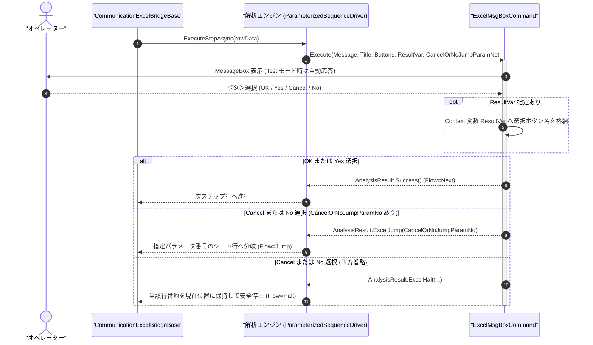

# コマンドリファレンス：Excel_Msg_Box

## 概要

`Excel_Msg_Box` は、ケーブル差し替え指示・治具設定確認・目視外観判定などのオペレーター対話ポップアップダイアログを表示し、選択されたボタン結果に応じて **継続進行（`Next`）** 、 **指定パラメータ番号の Excel シート行への分岐ジャンプ（`Jump`）** 、または **作業中止による安全停止（`Halt`）** を制御する Excel エクステンション共通コマンドです。  
既存の [`Msg_Box`](../Sequence/Msg_Box.Md) と同様、ヘッドレス自動テスト実行時（`ErrorLogger.MinimumLevel == LogLevel.Test`）にはモーダル待機でブロックしない自動承認ガードが作動します。

> [!NOTE]
> `Buttons` に `"OKCancel"` または `"YesNo"` を指定し、第 5 引数 `CancelOrNoJumpParamNo` に公開パラメータ番号を指定すると、オペレーターが `Cancel` または `No` を選択した際に再試行行や NG 処理行へ直接分岐できます。

---

## 💡 書式・パラメータ仕様

### コマンド構文

```csv
,SEQUENCE, [ステップキー], Excel_Msg_Box, "<Message>", "[Title]", "[Buttons]", "[ResultVar]", "[CancelOrNoJumpParamNo]"
```

### パラメータ（引数）一覧

| 引数位置 | 引数名 | 説明 | 指定方法 / 有効な入力値 |
| :--- | :--- | :--- | :--- |
| 引数1 | `Message` | ダイアログ本文に表示するメッセージ文字列（必須）。 | 任意の文字列または `$PARAMキー$` 置換 |
| 引数2 | `Title` | ダイアログウィンドウのタイトル文字列（任意・省略可）。 | 任意の文字列（省略時の既定値: `"確認"`）、`$PARAMキー$` 置換可 |
| 引数3 | `Buttons` | 表示するボタン構成（任意・省略可）。 | `"OK"`（既定値）、`"OKCancel"`、`"YesNo"` |
| 引数4 | `ResultVar` | 押下されたボタン名（`"OK"`, `"Cancel"`, `"Yes"`, `"No"`）を格納する `PARAM` キー名（任意・省略可）。 | 定義済みの `PARAM` キー名（`COMMAND` の `ResultItem` に指定することでシート側へも出力可能） |
| 引数5 | `CancelOrNoJumpParamNo` | `Cancel` または `No` が選択された際の遷移先シート行を保持する公開パラメータ番号（任意・省略可）。 | `1` 以上の整数（`"1"`, `"2"`, ...）または省略 |

---

## 🔄 特殊置換規約・Excel シート連携規約の適用

ボタン応答別の拡張戻り値およびシート制御ルールです。
* **`OK` または `Yes` が選択された場合**: `ResultVar`（指定時）へ `"OK"` または `"Yes"` を格納し、`ExcelSequenceFlow.Next` で後続ステップおよび直下の次シート行へ進行します。
* **`Cancel` または `No` が選択された場合**:
  1. **`CancelOrNoJumpParamNo` 指定あり**: `ResultVar`（指定時）を更新したうえで `AnalysisResult.ExcelJump(CancelOrNoJumpParamNo)`（`Flow = Jump`）を返却し、該当パラメータ列が指すシート行へ分岐します。
  2. **`CancelOrNoJumpParamNo` 省略・`ResultVar` 指定あり**: `ResultVar` に `"Cancel"` または `"No"` を格納し、`Flow = Next` で後続ステップの条件判定へ委ねます。
  3. **`CancelOrNoJumpParamNo`・`ResultVar` ともに省略**: オペレーターによる検査中止要求として `Flow = Halt` を返却し、当該行番地を `現在位置` に保持して安全停止します。
* **入力規則ドロップダウンの自動付与**: 引数 5 `CancelOrNoJumpParamNo` に定数パラメータ番号を指定した場合、シート配置時に該当パラメータ列へ遷移先候補ドロップダウンが自動付与されます。

---

## 💡 動作例（正しい構文での記述例）

### スクリプト記述例

※ `COMMAND` ブロック配下の子要素行（`PARAM`, `SEQUENCE`）は必ず行頭カンマから開始し、スペースインデントや行末コメント（`;`）は記述しないでください。

```csv
COMMAND, "VISUAL_CHECK_LED", "BTN_RES"
,PARAM, "NG_ROW", String, "目視NG時ジャンプ先", "LED_NG_PROC"
,PARAM, "BTN_RES", Work, "目視判定結果", ""
,SEQUENCE, 010, Excel_Msg_Box, "緑色LEDが点灯していますか？", "外観目視検査", "YesNo", "BTN_RES", 1
```

### 実行時の挙動・シート状態変化

* **オペレーターが `Yes` を押下した場合**: `BTN_RES` に `"Yes"` が格納されて `Result` 出力先へ書き込まれ、直下の次シート行へ進行します。
* **オペレーターが `No` を押下した場合**: `BTN_RES` に `"No"` が格納されて `Result` 出力先へ書き込まれ、第 1 パラメータ（`"LED_NG_PROC"`）が指すシート行へ `現在位置` が分岐ジャンプします。

---

## 🔄 動作フロー（シーケンス図）

本コマンド実行時における、オペレーター・`ExcelMsgBoxCommand`・Excel ブリッジ間のインタラクションを示すシーケンス図です。



---

## 🚫 エラーハンドリング・安全設計（仕様制限）

入力データの異常に対し、解析エンジンが実行するセーフティ規約です。

1. **本文メッセージ未指定または不正なボタン種別・パラメータ番号**:
   - 引数 1 `Message` が省略された場合、未対応の `Buttons` 文字列が指定された場合、または `CancelOrNoJumpParamNo` に `0` 以下の値や非数値が指定された場合は `_log.LogError` に記録し `ExcelSequenceFlow.Halt` で安全停止します。
2. **ヘッドレス単体テスト時の非ブロッキング保証**:
   - `ErrorLogger.MinimumLevel == LogLevel.Test` 環境下ではモーダルダイアログを表示せず既定応答で即時通過するため、CI/CD コンソールテストが停止しません。

---

## 🧪 ユニットテスト仕様

本コマンドクラス（`ExcelMsgBoxCommand.cs`）に実装されている `RunUnitTest()` メソッドが検証するユニットテストの仕様です。

### テスト実行前提条件

* **実行トリガー**: `RunUnitTest()` メソッドの呼び出し
* **有効化条件**: システム全体の最小ログレベル（`ErrorLogger.MinimumLevel`）が `LogLevel.Test` であること
* **検証結果出力**: `_log.LogTest` によるログ出力。検証失敗時は `_log.LogError`、予期せぬ例外発生時は `_log.LogCritical` で記録

### テストケース一覧

| No | テストカテゴリ | テスト条件（入力値） | 期待される結果（出力値） | 検証の目的 / 観点 |
| :---: | :--- | :--- | :--- | :--- |
| **1** | 正常系 | `Test` モードでの OK 応答・`ResultVar` 格納検証 | モーダル待機せず `ResultVar = "OK"` かつ `Flow = Next` が返る | ヘッドレス自動承認および変数格納の検証 |
| **2** | 正常系 | `Cancel` / `No` 応答時の分岐・変数格納・`Halt` 判定検証 | 分岐指定時は `Flow = Jump`、両方省略時は `Flow = Halt` が返る | 選択結果別の 3 分岐ロジック検証 |
| **3** | 異常系 | 不正な `CancelOrNoJumpParamNo`（`"0"`）または未定義 `Buttons` 指定 | エラーログが出力され `Flow = Halt` が返る | 不正引数に対する防御検証 |
