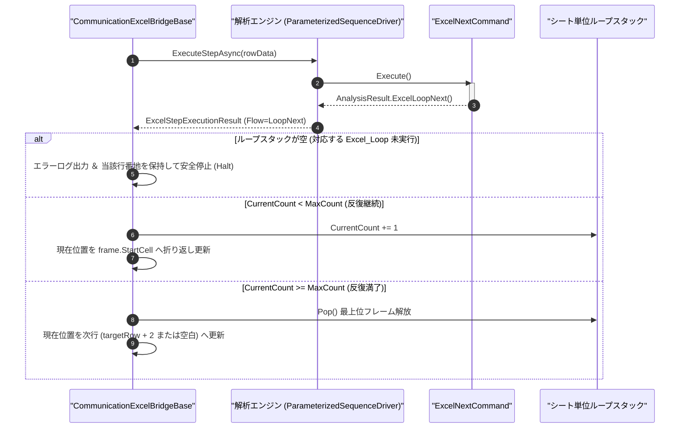

# コマンドリファレンス：Excel_Next

## 概要

`Excel_Next` は、直近の [`Excel_Loop`](./Excel_Loop.Md) によって開始された Excel シート行反復ループの終端を示し、実行回数が最大回数に達するまでループ先頭行へ `現在位置` を折り返す Excel エクステンション共通コマンドです。  
指定回数分の反復が完了した時点でシート単位ループスタックの最上位フレームを解放（Pop）し、直下の次シーケンス行（`targetRow + 2`）へ進行します。

> [!NOTE]
> 戻り先のセル番地（`StartCell`）および現在の反復回数（`CurrentCount` / `MaxCount`）はすべてシート単位ループスタックの最上位フレームから自動解決されるため、`Excel_Next` 自体に引数は不要です。外側ループと内側ループを重ねた多重ネストループにも対応しています。

---

## 💡 書式・パラメータ仕様

### コマンド構文

```csv
,SEQUENCE, [ステップキー], Excel_Next
```

### パラメータ（引数）一覧

引数はありません（戻り先番地および残り回数はシート単位ループスタックから自動解決されます）。

---

## 🔄 特殊置換規約・Excel シート連携規約の適用

本コマンドにおける制御ルールです。
* **多重ネストループ対応**: 内側の [`Excel_Loop`](./Excel_Loop.Md) 〜 `Excel_Next` は常にスタック最上位（LIFO）のフレームを参照・更新するため、例えば「電源電圧 3 水準 × 各 5 回測定」のような二重・三重ループをシート上でそのまま構成できます。
* **単体実行ボタン押下時の非干渉**: 各行先頭の単体実行（`実行`）ボタンから実行された場合は、制御ブロックの `現在位置` やシート単位ループスタックは変更されず、スタック空による停止も発生しません。

---

## 💡 動作例（正しい構文での記述例）

### スクリプト記述例

※ `COMMAND` ブロック配下の子要素行（`PARAM`, `SEQUENCE`）は必ず行頭カンマから開始し、スペースインデントや行末コメント（`;`）は記述しないでください。

```csv
COMMAND, "EXCEL_LOOP_END", ""
,SEQUENCE, 010, Excel_Next
```

### 実行時の挙動・シート状態変化

* **反復継続中（例: `CurrentCount = 1`, `MaxCount = 5`）**: `CurrentCount` が `2` に加算され、フレームに記録された反復先頭番地（例: `"A6"`）へ制御ブロックの `現在位置` が折り返されます。
* **反復満了時（例: `CurrentCount = 5`, `MaxCount = 5`）**: 最上位フレームが Pop 解放され、`Excel_Next` 配置行の直下の次ステップ行（`targetRow + 2`、末尾空行の場合は空白クリア）へ `現在位置` が更新されます。

---

## 🔄 動作フロー（シーケンス図）

本コマンド実行時における、解析エンジン・`ExcelNextCommand`・Excel ブリッジ間のインタラクションを示すシーケンス図です。



---

## 🚫 エラーハンドリング・安全設計（仕様制限）

実行時の構造不整合に対し、ブリッジ層が実行するセーフティ規約です。

1. **対応する `Excel_Loop` が存在しない状態での実行**:
   - `Step` 実行または `Start` 一括実行において、シート単位ループスタックが空の状態で `Excel_Next` に到達した場合、ループ構造不整合エラーを `_log.LogError` に記録し、当該行番地を `現在位置` に保持したまま安全停止（`Halt`）します。
2. **累積ステップ上限による無限ループ防御**:
   - 多重ループの回数設定過大等により総実行ステップ数が `MaxExecutionSteps`（既定値 `10000`）を超えた場合、自動的にループを安全停止します。

---

## 🧪 ユニットテスト仕様

本コマンドクラス（`ExcelNextCommand.cs`）に実装されている `RunUnitTest()` メソッドが検証するユニットテストの仕様です。

### テスト実行前提条件

* **実行トリガー**: `RunUnitTest()` メソッドの呼び出し
* **有効化条件**: システム全体の最小ログレベル（`ErrorLogger.MinimumLevel`）が `LogLevel.Test` であること
* **検証結果出力**: `_log.LogTest` によるログ出力。検証失敗時は `_log.LogError`、予期せぬ例外発生時は `_log.LogCritical` で記録

### テストケース一覧

| No | テストカテゴリ | テスト条件（入力値） | 期待される結果（出力値） | 検証の目的 / 観点 |
| :---: | :--- | :--- | :--- | :--- |
| **1** | 正常系 | 引数なしで実行 | `Flow = LoopNext` を持つ成功結果が返る | ループ折り返し識別子返却の基本検証 |
