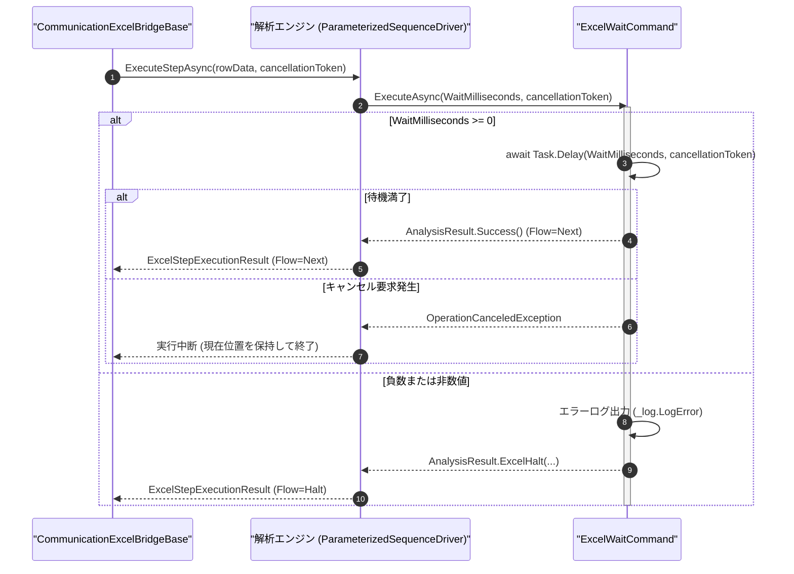

# コマンドリファレンス：Excel_Wait

## 概要

`Excel_Wait` は、指定されたミリ秒間（`<WaitMilliseconds>`）、Excel の UI スレッドおよび通信ポート監視をブロックすることなく非同期タイマー待機（`await Task.Delay`）を実行する Excel エクステンション共通コマンドです。  
Excel シート各行の `Wait(ms)` 列（コマンド完了後の固定待機）とは別に、ミニシーケンス内の特定ステップ間での電源整定待ちや、シート上の独立した待機専用ステップ行（パラメータで待機時間を切り替え可能な行）として使用します。

> [!NOTE]
> 待機中は `CancellationToken` が監視されるため、`Start` 一括実行中に共通中断ダイアログ（`CancelDialog`）から停止操作が行われた場合は、待機満了を待たずに即座に待機を解除して安全に中断します。

---

## 💡 書式・パラメータ仕様

### コマンド構文

```csv
,SEQUENCE, [ステップキー], Excel_Wait, "<WaitMilliseconds>"
```

### パラメータ（引数）一覧

| 引数位置 | 引数名 | 説明 | 指定方法 / 有効な入力値 |
| :--- | :--- | :--- | :--- |
| 引数1 | `WaitMilliseconds` | 待機する時間（ミリ秒単位・必須）。 | `0` 以上の整数（10 進 `"1000"`、16 進 `"0x3E8"`、2 進 `"0b1010"`）または `$PARAMキー$` 置換 |

---

## 🔄 特殊置換規約・Excel シート連携規約の適用

本コマンドの引数における解釈ルールです。
* **動的置換（`$`）**: 引数 1 `WaitMilliseconds` に `$SETTLE_MS$` のような公開パラメータ参照を指定すると、Excel シート上のパラメータセルから待機ミリ秒を動的に読み取って待機します。
* **基数自動認識**: 10 進整数に加え、`0x` / `&H`（16 進）および `0b`（2 進）表記にも対応しています。
* **完了後のフロー遷移**: 正常満了時は `ExcelSequenceFlow.Next` を返却し、同一ミニシーケンスの後続ステップまたは直下の次シート行（`targetRow + 2`）へ進みます。

---

## 💡 動作例（正しい構文での記述例）

### スクリプト記述例

※ `COMMAND` ブロック配下の子要素行（`PARAM`, `SEQUENCE`）は必ず行頭カンマから開始し、スペースインデントや行末コメント（`;`）は記述しないでください。

```csv
COMMAND, "POWER_ON_SETTLE", ""
,PARAM, "SETTLE_MS", Number, "安定待ち時間(ms)", "1500"
,SEQUENCE, 010, Gpib_Send, "OUTP ON"
,SEQUENCE, 020, Excel_Wait, "$SETTLE_MS$"
```

### 実行時の挙動・シート状態変化

* **実行前の状態**: シート上の第 1 パラメータ `"安定待ち時間(ms)"` に `"1500"` が入力された状態。
* **実行後の状態**: 電源出力 ON コマンド送信後に `1500` ms の非同期待機を実行し、満了後に `Flow = Next` で次シーケンス行へ進行します。

---

## 🔄 動作フロー（シーケンス図）

本コマンド実行時における、解析エンジン・`ExcelWaitCommand`・中断トークン間のインタラクションを示すシーケンス図です。



---

## 🚫 エラーハンドリング・安全設計（仕様制限）

入力データの異常に対し、解析エンジンが実行するセーフティ規約です。

1. **負数または非数値の待機時間指定**:
   - 引数未指定、負の整数（`"-10"` 等）、または非数値文字列が指定された場合、`_log.LogError` に記録し `ExcelSequenceFlow.Halt` で直ちに安全停止します。
2. **キャンセル要求への即時応答**:
   - 長時間待機（例: 60 秒エージング待機）中であっても、中断ダイアログからのキャンセル要求により即座に `Task.Delay` が解除されます。

---

## 🧪 ユニットテスト仕様

本コマンドクラス（`ExcelWaitCommand.cs`）に実装されている `RunUnitTest()` メソッドが検証するユニットテストの仕様です。

### テスト実行前提条件

* **実行トリガー**: `RunUnitTest()` メソッドの呼び出し
* **有効化条件**: システム全体の最小ログレベル（`ErrorLogger.MinimumLevel`）が `LogLevel.Test` であること
* **検証結果出力**: `_log.LogTest` によるログ出力。検証失敗時は `_log.LogError`、予期せぬ例外発生時は `_log.LogCritical` で記録

### テストケース一覧

| No | テストカテゴリ | テスト条件（入力値） | 期待される結果（出力値） | 検証の目的 / 観点 |
| :---: | :--- | :--- | :--- | :--- |
| **1** | 正常系 | 短時間待機指定（`"5"` ms および `"0"` ms） | 非同期待機が完了し `Flow = Next` が返る | 非同期タイマー待機の基本動作検証 |
| **2** | 異常系 | 負数指定（`"-1"`）または非数値指定（`"ABC"`） | エラーログが出力され `Flow = Halt` が返る | 不正待機時間に対する防御検証 |
| **3** | 異常系 | キャンセル済み `CancellationToken` での実行 | 即座にキャンセル検知して待機を中断する | キャンセルトークン即時応答の検証 |
