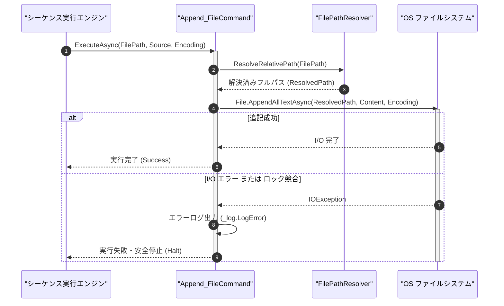

# コマンドリファレンス：Append_File

## 概要

`Append_File` は、指定されたソースデータまたはパラメータ値（`<Source>`）を、指定されたファイル（`<FilePath>`）の末尾へ追記保存する共通ファイル制御系コマンドです。  
対象ファイルがまだ存在しない場合は新規作成して書き込み、既に存在する場合は既存データを保持したまま末尾へテキストを追加します。

> 💡 **補足**  
> 本コマンドは 共通基盤コマンドです。内部的には [`Write_File`](./Write_File.Md) の `"Append"` モードと共通の永続化エンジンで動作します。

---

## 💡 書式・パラメータ仕様

### コマンド構文

```csv
,SEQUENCE, [ステップキー], Append_File, "[ファイルパス(FilePath)]", "[追記データまたはキー(Source)]", "[文字コード(Encoding)]"
```

### パラメータ（引数）一覧

| 引数位置 | 引数名 | 説明 | 指定方法 / 有効な入力値 |
| :--- | :--- | :--- | :--- |
| 引数1 | FilePath | 追記先ファイルのパス（必須）。 | 相対パス（例: `"./log/history.log"`）または `$PARAM$` 置換 |
| 引数2 | Source | ファイル末尾へ追記する文字列データまたはパラメータキー名（必須）。 | パラメータキー名、`$PARAM$` 置換、または文字列リテラル |
| 引数3 | Encoding | 保存時の文字エンコーディング名（任意・省略可・既定値: `"UTF-8"`）。 | `"UTF-8"`, `"Shift_JIS"`（または `"CP932"`）, `"ASCII"` |

---

## 🔄 特殊置換規約・分岐規約の適用

本コマンドの引数における特殊記法および解釈ルールです。
* **動的置換（`$`）**: 引数内で `$PARAMキー$` のように記述すると、実行時に変数プール（PARAM）の値へ動的置換されます。（適用可能な引数: 全引数対応）
* **ジャンプ先指定（`#`）**: 本コマンドはジャンプ制御を行わないため適用されません。（適用可能な引数: 非適用）
* **共通コマンド指定（`@`）**: 本コマンドは外部マクロを呼び出さないため適用されません。（適用可能な引数: 非適用）
* **カンマのエスケープ**: `<Source>` 文字列自体にカンマを含める場合は、必ず `","` と二重引用符で囲んで記述します。
* **エイリアス（別名）**: `AppendFile`

---

## 💡 動作例（正しい構文での記述例）

### スクリプト記述例

※COMMAND ブロック配下の子要素行（PARAM, SEQUENCE）は必ず行頭カンマから開始し、スペースインデントや行末コメント（`;`）は記述しないでください。

```csv
COMMAND, "APPEND_MEAS_LOG", "LOG_LINE"
,PARAM, "LOG_FILE", Text, "ログファイルパス", "./log/daily_meas.csv"
,PARAM, "LOG_LINE", Text, "追記レコード", "2026-10-30,CH1,5.001,PASS\r\n"
; daily_meas.csv の末尾へ LOG_LINE を追記保存
,SEQUENCE, 010, Append_File, "$LOG_FILE$", "$LOG_LINE$", "UTF-8"
```

### 実行時の挙動・変数変化

* **実行前の状態**: `./log/daily_meas.csv` にヘッダ行 `"Date,Channel,Value,Status\r\n"` が記録されている状態。
* **実行後の状態**: 既存のヘッダ行を消去することなく、ファイル末尾に `"2026-10-30,CH1,5.001,PASS\r\n"` が追記されます。

---

## 🔄 動作フロー（シーケンス図）

本コマンド実行時における、シーケンス実行エンジン、コマンドクラス（`Append_FileCommand`）、およびファイルシステム間のインタラクションを示すシーケンス図です。



---

## 🚫 エラーハンドリング・安全設計（仕様制限）

入力データの異常や実行時エラーに対し、解析・実行エンジンが実行するセーフティ規約です。

1. **既存データの完全保全（上書き消去の防止）**:
   - 常に `FileMode.Append` でストリームを開くため、既存のログファイル内容を誤って初期化・上書き消去することがありません。
2. **ファイルロック・書き込み異常時の安全停止**:
   - 対象ファイルが他プロセスによって排他ロックされている場合は例外クラッシュを防ぎ、エラーログ（`_log.LogError`）を記録して安全停止します。

---

## 🧪 ユニットテスト仕様

本コマンドクラス（`Append_FileCommand.cs`）に実装されている `RunUnitTest()` メソッドが検証するユニットテストの仕様です。

### テスト実行前提条件

* **実行トリガー**: `RunUnitTest()` メソッドの呼び出し
* **有効化条件**: システム全体の最小ログレベル（`ErrorLogger.MinimumLevel`）が `LogLevel.Test` であること（それ以外の場合は無効化ガードにより早期リターン）
* **検証結果出力**: `_log.LogTest` によるログ出力。検証失敗時は `_log.LogError`、予期せぬ例外発生時は `_log.LogCritical` で記録。

### テストケース一覧

| No | テストカテゴリ | テスト条件（入力値） | 期待される結果（出力値） | 検証の目的 / 観点 |
| :---: | :--- | :--- | :--- | :--- |
| **1** | 正常系 | 新規ファイルへ2回連続 `Append_File` 実行 | 1回目と2回目の文字列が連結された状態で保存される | 末尾追記動作の検証 |
| **2** | 正常系 | テスト完了後のテンポラリファイル確認 | `finally` ブロックによりテスト用一時ファイルが完全削除される | クリーンアップ規程遵守の検証 |
| **3** | 異常系 | 無効なファイルパス指定 | エラーログが出力され `Failure` が返却される | I/O 異常時のセーフティ検証 |

