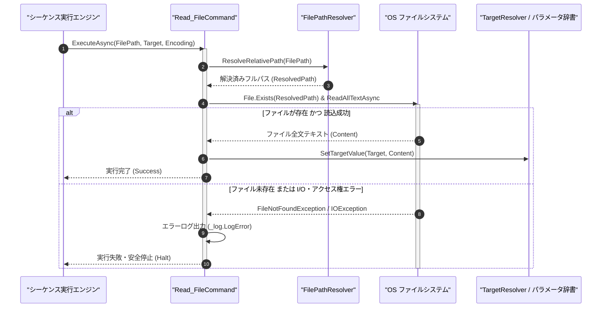

# コマンドリファレンス：Read_File

## 概要

`Read_File` は、指定されたファイル（`<FilePath>`）のテキスト内容全体を一括で読み込み、指定されたターゲットパラメータ（`<Target>`）へ格納する共通ファイル制御系コマンドです。  
設定データファイルや既存の CSV テーブルデータをメモリ上のパラメータへロードする際などに使用します。

> 💡 **補足**  
> 本コマンドは 共通基盤コマンドです。ファイルパスに相対パスが指定された場合は、`FilePathResolver` により現在ロード中の設定ファイル配置ディレクトリを起点として自動解決されます。

---

## 💡 書式・パラメータ仕様

### コマンド構文

```csv
,SEQUENCE, [ステップキー], Read_File, "[ファイルパス(FilePath)]", "[格納先キー(Target)]", "[文字コード(Encoding)]"
```

### パラメータ（引数）一覧

| 引数位置 | 引数名 | 説明 | 指定方法 / 有効な入力値 |
| :--- | :--- | :--- | :--- |
| 引数1 | FilePath | 読み込む対象ファイルのパス（必須）。 | 相対パス（例: `"./config/init_table.csv"`）または `$PARAM$` 置換 |
| 引数2 | Target | 読み込んだファイル全文を格納するパラメータキー名（必須）。 | 自コマンド内の `PARAM` キー名（例: `"FILE_BUF"`, `"1"`） |
| 引数3 | Encoding | 読み込み時の文字エンコーディング名（任意・省略可・既定値: `"UTF-8"`）。 | `"UTF-8"`, `"Shift_JIS"`（または `"CP932"`）, `"ASCII"` |

---

## 🔄 特殊置換規約・分岐規約の適用

本コマンドの引数における特殊記法および解釈ルールです。
* **動的置換（`$`）**: 引数内で `$PARAMキー$` のように記述すると、実行時に変数プール（PARAM）の値へ動的置換されます。（適用可能な引数: 全引数対応）
* **ジャンプ先指定（`#`）**: 本コマンドはジャンプ制御を行わないため適用されません。（適用可能な引数: 非適用）
* **共通コマンド指定（`@`）**: 本コマンドは外部マクロを呼び出さないため適用されません。（適用可能な引数: 非適用）
* **カンマのエスケープ**: ファイルパス自体にカンマを含める場合は、必ず `","` と二重引用符で囲んで記述します。
* **エイリアス（別名）**: `ReadFile`, `Analysis_Term_ReadFile`

---

## 💡 動作例（正しい構文での記述例）

### スクリプト記述例

※COMMAND ブロック配下の子要素行（PARAM, SEQUENCE）は必ず行頭カンマから開始し、スペースインデントや行末コメント（`;`）は記述しないでください。

```csv
COMMAND, "LOAD_REF_TABLE", "REF_DATA"
,PARAM, "FILE_PATH", Text, "参照テーブルパス", "./data/reference.csv"
,PARAM, "REF_DATA", Work, "読込データ格納用", ""
,PARAM, "FIRST_VAL", Work, "先頭セル値", ""
; 1. UTF-8 でファイル全文を REF_DATA へ読み込み
,SEQUENCE, 010, Read_File, "$FILE_PATH$", "REF_DATA", "UTF-8"
; 2. 読み込んだ2次元テーブルの (0, 0) セル値を抽出
,SEQUENCE, 020, Array_Get, "REF_DATA", 0, 0, ",", "FIRST_VAL"
```

### 実行時の挙動・変数変化

* **実行前の状態**: `./data/reference.csv` に `"CH1,5.00\r\nCH2,3.30"` が保存されており、`"REF_DATA"` が空文字列 `""` の状態。
* **実行後の状態**: ステップ `010` の `Read_File` 実行により、`"REF_DATA"` に `"CH1,5.00\r\nCH2,3.30"` が一括格納され、ステップ `020` で `"FIRST_VAL"` に `"CH1"` が抽出されます。

---

## 🔄 動作フロー（シーケンス図）

本コマンド実行時における、シーケンス実行エンジン、コマンドクラス（`Read_FileCommand`）、およびファイルシステム間のインタラクションを示すシーケンス図です。



---

## 🚫 エラーハンドリング・安全設計（仕様制限）

入力データの異常や実行時エラーに対し、解析・実行エンジンが実行するセーフティ規約です。

1. **指定ファイルが存在しない場合（`FileNotFoundException`）**:
   - 未処理例外によるアプリケーションクラッシュを防止し、解決後のファイルパスを含むエラーログ（`_log.LogError`）を記録して直ちにシーケンスを安全停止（Halt）します。
2. **他プロセスによるファイル排他ロック時**:
   - 共有読み取りモード（`FileShare.ReadWrite`）でのオープンを試行し、それでもアクセス拒否された場合は I/O エラーログを記録して安全停止します。

---

## 🧪 ユニットテスト仕様

本コマンドクラス（`Read_FileCommand.cs`）に実装されている `RunUnitTest()` メソッドが検証するユニットテストの仕様です。

### テスト実行前提条件

* **実行トリガー**: `RunUnitTest()` メソッドの呼び出し
* **有効化条件**: システム全体の最小ログレベル（`ErrorLogger.MinimumLevel`）が `LogLevel.Test` であること（それ以外の場合は無効化ガードにより早期リターン）
* **検証結果出力**: `_log.LogTest` によるログ出力。検証失敗時は `_log.LogError`、予期せぬ例外発生時は `_log.LogCritical` で記録。

### テストケース一覧

| No | テストカテゴリ | テスト条件（入力値） | 期待される結果（出力値） | 検証の目的 / 観点 |
| :---: | :--- | :--- | :--- | :--- |
| **1** | 正常系 | 一時テストファイルの読み込み（UTF-8） | ファイル内容が `<Target>` に格納され、テスト後一時ファイルは削除される | ファイル全文読込の基本動作検証 |
| **2** | 正常系 | 相対パス指定（`"./test_read.txt"`） | `FilePathResolver` により正しくパス解決されて読み込まれる | 相対パス自動解決の検証 |
| **3** | 異常系 | 存在しないファイルパス（`"./no_such_file.txt"`） | エラーログが出力され `Failure` で安全停止する | ファイル未存在時のクラッシュ防御検証 |

