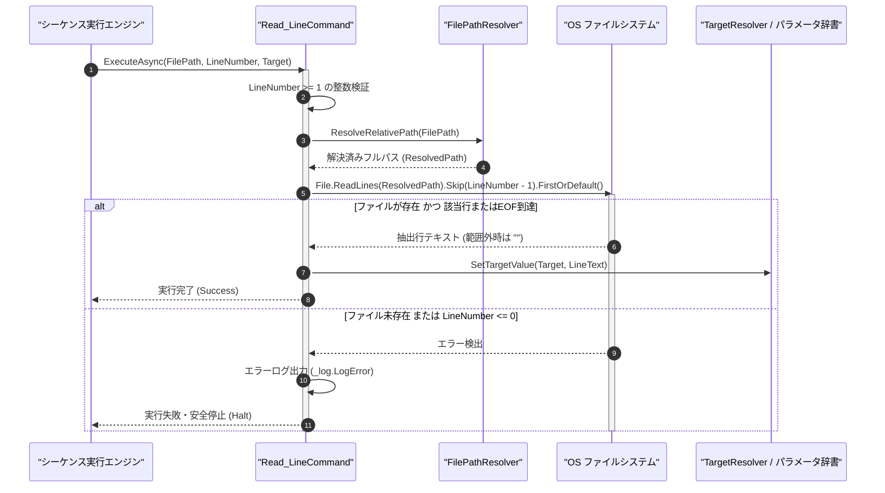

# コマンドリファレンス：Read_Line

## 概要

`Read_Line` は、指定されたテキストファイル（`<FilePath>`）から指定された行番号（`<LineNumber>`: 1 始まり）の 1 行テキストを抽出し、格納先パラメータ（`<Target>`）へ格納する共通ファイル制御系コマンドです。  
設定ファイルや補正係数リストの特定行のみを読み出す際に使用します。

> 💡 **補足**  
> 本コマンドは 共通基盤コマンドです。

---

## 💡 書式・パラメータ仕様

### コマンド構文

```csv
,SEQUENCE, [ステップキー], Read_Line, "[ファイルパス(FilePath)]", "[行番号(LineNumber)]", "[格納先キー(Target)]"
```

### パラメータ（引数）一覧

| 引数位置 | 引数名 | 説明 | 指定方法 / 有効な入力値 |
| :--- | :--- | :--- | :--- |
| 引数1 | FilePath | 読み込む対象ファイルのパス（必須）。 | 相対パス（例: `"./config/calib_list.txt"`）または `$PARAM$` 置換 |
| 引数2 | LineNumber | 抽出する行番号（1 始まり・必須）。 | 1 以上の整数（例: `"1"`, `"5"`）または `$PARAM$` 置換 |
| 引数3 | Target | 抽出した 1 行テキストを格納するパラメータキー名（必須）。 | 自コマンド内の `PARAM` キー名（例: `"LINE_TEXT"`, `"1"`） |

---

## 🔄 特殊置換規約・分岐規約の適用

本コマンドの引数における特殊記法および解釈ルールです。
* **動的置換（`$`）**: 引数内で `$PARAMキー$` のように記述すると、実行時に変数プール（PARAM）の値へ動的置換されます。（適用可能な引数: 全引数対応）
* **ジャンプ先指定（`#`）**: 本コマンドはジャンプ制御を行わないため適用されません。（適用可能な引数: 非適用）
* **共通コマンド指定（`@`）**: 本コマンドは外部マクロを呼び出さないため適用されません。（適用可能な引数: 非適用）
* **カンマのエスケープ**: 引数文字列自体にカンマを含める場合は、必ず `","` と二重引用符で囲んで記述します。
* **エイリアス（別名）**: `ReadLine`

---

## 💡 動作例（正しい構文での記述例）

### スクリプト記述例

※COMMAND ブロック配下の子要素行（PARAM, SEQUENCE）は必ず行頭カンマから開始し、スペースインデントや行末コメント（`;`）は記述しないでください。

```csv
COMMAND, "READ_CALIB_LINE", "LINE_DATA"
,PARAM, "TARGET_LINE", Number, "読込行番号", "2"
,PARAM, "LINE_DATA", Work, "抽出行データ", ""
; ./data/calib.csv の 2 行目を抽出し LINE_DATA へ格納
,SEQUENCE, 010, Read_Line, "./data/calib.csv", "$TARGET_LINE$", "LINE_DATA"
```

### 実行時の挙動・変数変化

* **実行前の状態**: `./data/calib.csv` の 1 行目が `"HEADER"`、2 行目が `"OFFSET=+0.0012"`、3 行目が `"GAIN=1.0005"` の状態。
* **実行後の状態**: ステップ `010` の `Read_Line` 実行により、2 行目の `"OFFSET=+0.0012"`（改行コード除去済み）が `"LINE_DATA"` に格納されます。

---

## 🔄 動作フロー（シーケンス図）

本コマンド実行時における、シーケンス実行エンジン、コマンドクラス（`Read_LineCommand`）、およびファイルシステム間のインタラクションを示すシーケンス図です。



---

## 🚫 エラーハンドリング・安全設計（仕様制限）

入力データの異常や実行時エラーに対し、解析・実行エンジンが実行するセーフティ規約です。

1. **総行数を超える行番号指定時の安全処理**:
   - ファイルの総行数を超える正の `<LineNumber>` が指定された場合、例外で停止させず安全に空文字列 `""` を `<Target>` に格納します。
2. **0 以下の行番号またはファイル未存在時**:
   - `<LineNumber>` に `0` 以下の値が指定された場合や対象ファイルが存在しない場合は、エラーログ（`_log.LogError`）を記録して直ちに安全停止（Halt）します。

---

## 🧪 ユニットテスト仕様

本コマンドクラス（`Read_LineCommand.cs`）に実装されている `RunUnitTest()` メソッドが検証するユニットテストの仕様です。

### テスト実行前提条件

* **実行トリガー**: `RunUnitTest()` メソッドの呼び出し
* **有効化条件**: システム全体の最小ログレベル（`ErrorLogger.MinimumLevel`）が `LogLevel.Test` であること（それ以外の場合は無効化ガードにより早期リターン）
* **検証結果出力**: `_log.LogTest` によるログ出力。検証失敗時は `_log.LogError`、予期せぬ例外発生時は `_log.LogCritical` で記録。

### テストケース一覧

| No | テストカテゴリ | テスト条件（入力値） | 期待される結果（出力値） | 検証の目的 / 観点 |
| :---: | :--- | :--- | :--- | :--- |
| **1** | 正常系 | 3行あるテストファイルの2行目指定（`LineNumber="2"`） | 2行目の文字列が `<Target>` に格納される | 指定行抽出の基本動作検証 |
| **2** | 正常系 | 総行数を超える行番号指定（`LineNumber="99"`） | `<Target>` に空文字列 `""` が格納され `Success` 返却 | EOF 超過時の安全空文字返却検証 |
| **3** | 異常系 | 0以下の行番号指定（`LineNumber="0"`） | エラーログが出力され `Failure` で安全停止する | 不正行番号ガードの検証 |

