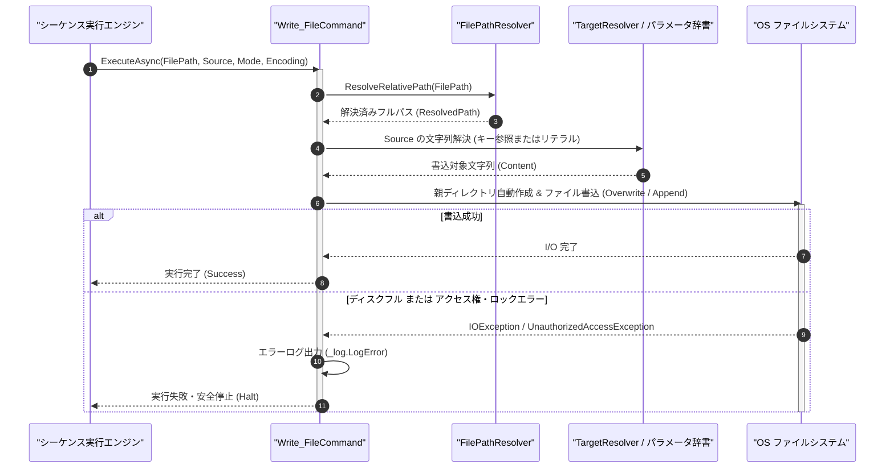

# コマンドリファレンス：Write_File

## 概要

`Write_File` は、指定されたソースデータまたはパラメータ値（`<Source>`）を、指定されたファイル（`<FilePath>`）へ書き込む（既定では上書き保存 `Overwrite`、モード指定で追記 `Append` にも対応）共通ファイル制御系コマンドです。  
2 次元テーブル（`Array_*`）に蓄積した測定データや受信テキストを一括でファイルへ永続化する際に使用します。

> 💡 **補足**  
> 本コマンドは 共通基盤コマンドです。出力先フォルダが存在しない場合は、親ディレクトリを自動生成した上で安全にファイルを保存します。

---

## 💡 書式・パラメータ仕様

### コマンド構文

```csv
,SEQUENCE, [ステップキー], Write_File, "[ファイルパス(FilePath)]", "[出力データまたはキー(Source)]", "[書込モード(Mode)]", "[文字コード(Encoding)]"
```

### パラメータ（引数）一覧

| 引数位置 | 引数名 | 説明 | 指定方法 / 有効な入力値 |
| :--- | :--- | :--- | :--- |
| 引数1 | FilePath | 保存先ファイルのパス（必須）。 | 相対パス（例: `"./output/result.csv"`）または `$PARAM$` 置換 |
| 引数2 | Source | 書き込む文字列データまたは取得元パラメータキー名（必須）。 | パラメータキー名（`"DATA_TABLE"`）、`$PARAM$` 置換、または文字列リテラル |
| 引数3 | Mode | 書き込みモード（任意・省略可・既定値: `"Overwrite"`）。 | `"Overwrite"`（上書き保存）または `"Append"`（末尾追記） |
| 引数4 | Encoding | 保存時の文字エンコーディング名（任意・省略可・既定値: `"UTF-8"`）。 | `"UTF-8"`, `"Shift_JIS"`（または `"CP932"`）, `"ASCII"` |

---

## 🔄 特殊置換規約・分岐規約の適用

本コマンドの引数における特殊記法および解釈ルールです。
* **動的置換（`$`）**: 引数内で `$PARAMキー$` のように記述すると、実行時に変数プール（PARAM）の値へ動的置換されます。（適用可能な引数: 全引数対応）
* **ジャンプ先指定（`#`）**: 本コマンドはジャンプ制御を行わないため適用されません。（適用可能な引数: 非適用）
* **共通コマンド指定（`@`）**: 本コマンドは外部マクロを呼び出さないため適用されません。（適用可能な引数: 非適用）
* **カンマのエスケープ**: `<Source>` の文字列自体にカンマを含める場合は、必ず `","` と二重引用符で囲んで記述します。
* **エイリアス（別名）**: `WriteFile`, `GpibWriteFile`, `Analysis_Term_WriteFile`

---

## 💡 動作例（正しい構文での記述例）

### スクリプト記述例

※COMMAND ブロック配下の子要素行（PARAM, SEQUENCE）は必ず行頭カンマから開始し、スペースインデントや行末コメント（`;`）は記述しないでください。

```csv
COMMAND, "SAVE_REPORT_CSV", "OUT_PATH"
,PARAM, "OUT_PATH", Text, "出力ファイルパス", "./log/meas_report.csv"
,PARAM, "REPORT_TBL", Text, "出力テーブルデータ", "No,Voltage,Result\r\n1,5.002,PASS"
; REPORT_TBL の内容を UTF-8 で ./log/meas_report.csv に上書き保存
,SEQUENCE, 010, Write_File, "$OUT_PATH$", "REPORT_TBL", "Overwrite", "UTF-8"
```

### 実行時の挙動・変数変化

* **実行前の状態**: `"REPORT_TBL"` に `"No,Voltage,Result\r\n1,5.002,PASS"` が格納されている状態。
* **実行後の状態**: 設定ファイル配置ディレクトリ基準の `./log/meas_report.csv` が作成（既存時は上書き）され、`"REPORT_TBL"` の全文が UTF-8 で書き込まれます。

---

## 🔄 動作フロー（シーケンス図）

本コマンド実行時における、シーケンス実行エンジン、コマンドクラス（`Write_FileCommand`）、およびファイルシステム間のインタラクションを示すシーケンス図です。



---

## 🚫 エラーハンドリング・安全設計（仕様制限）

入力データの異常や実行時エラーに対し、解析・実行エンジンが実行するセーフティ規約です。

1. **出力先親ディレクトリ未存在時の自動作成**:
   - 指定されたパスの親フォルダが存在しない場合、`DirectoryNotFoundException` を防ぐため `Directory.CreateDirectory` で親フォルダを自動生成してから書き込みます。
2. **書き込み権限不足・ファイルロック時の安全停止**:
   - 読み取り専用ファイルや他アプリ（Excel 等）で排他ロックされているファイルへの書き込み失敗時は、例外クラッシュを防ぎエラーログ（`_log.LogError`）を出力して安全停止します。

---

## 🧪 ユニットテスト仕様

本コマンドクラス（`Write_FileCommand.cs`）に実装されている `RunUnitTest()` メソッドが検証するユニットテストの仕様です。

### テスト実行前提条件

* **実行トリガー**: `RunUnitTest()` メソッドの呼び出し
* **有効化条件**: システム全体の最小ログレベル（`ErrorLogger.MinimumLevel`）が `LogLevel.Test` であること（それ以外の場合は無効化ガードにより早期リターン）
* **検証結果出力**: `_log.LogTest` によるログ出力。検証失敗時は `_log.LogError`、予期せぬ例外発生時は `_log.LogCritical` で記録。

### テストケース一覧

| No | テストカテゴリ | テスト条件（入力値） | 期待される結果（出力値） | 検証の目的 / 観点 |
| :---: | :--- | :--- | :--- | :--- |
| **1** | 正常系 | 上書きモードでのファイル出力（`"Overwrite"`） | 指定内容でファイルが生成され、テスト終了時（`finally`）に自動削除される | 上書き保存の基本動作および一時ファイルクリーンアップの検証 |
| **2** | 正常系 | 追記モードでのファイル出力（`"Append"`） | 既存内容の末尾にデータが付加される | 追記モード動作の検証 |
| **3** | 異常系 | 不正なパス文字を含むファイルパス指定 | エラーログが出力され `Failure` で安全停止する | パス検証・I/O 例外防御の検証 |

