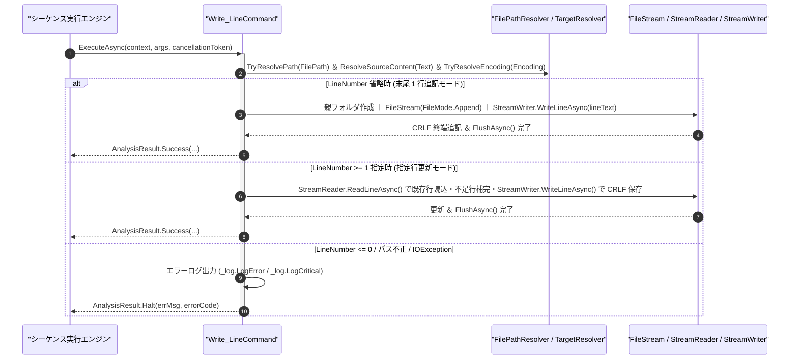

# コマンドリファレンス：Write_Line

## 概要

`Write_Line` は、指定されたテキストファイル（`<FilePath>`）の末尾（または指定された行番号 `<LineNumber>`: 1 始まりの位置）へ 1 行のテキスト（`<Text>`）を書き込む共通ファイル制御系コマンドです。  
ループ内で 1 測定ごとに結果レコードを 1 行ずつファイルへ記録していく場合や、設定ファイルの特定行を書き換える場合に使用します。

> 💡 **補足**  
> 本コマンドは 共通基盤コマンドです。

---

## 💡 書式・パラメータ仕様

### コマンド構文

```csv
,SEQUENCE, [ステップキー], Write_Line, "[ファイルパス(FilePath)]", "[書込行テキスト(Text)]", "[行番号(LineNumber)]", "[文字コード(Encoding)]"
```

### パラメータ（引数）一覧

| 引数位置 | 引数名 | 説明 | 指定方法 / 有効な入力値 |
| :--- | :--- | :--- | :--- |
| 引数1 | `FilePath` | 書き込み先ファイルのパス（必須）。 | 相対パス（例: `"./log/step_result.csv"`）または `$PARAM$` 置換 |
| 引数2 | `Text` | 書き込む 1 行分のテキスト文字列（必須・末尾の改行 `\r\n` は自動付与）。 | 任意の文字列または `$PARAM$` 置換 |
| 引数3 | `LineNumber` | 書き込む行番号（1 始まり・任意・省略可）。 | 省略時はファイル末尾へ 1 行追記。1 以上の整数指定時は該当行を更新（不足行は空行補完） |
| 引数4 | `Encoding` | ファイル書込時の文字エンコーディング（任意・省略時既定値: `"SJIS"`）。 | `"SJIS"`, `"UTF8"`, `"UTF8BOM"`, `"ASCII"` 等または `$PARAM$` 置換 |

---

## 🔄 特殊置換規約・分岐規約の適用

本コマンドの引数における特殊記法および解釈ルールです。
* **動的置換（`$`）**: 引数内で `$PARAMキー$` のように記述すると、実行時に変数プール（PARAM）の値へ動的置換されます。（適用可能な引数: 全引数対応）
* **ジャンプ先指定（`#`）**: 本コマンドはジャンプ制御を行わないため適用されません。（適用可能な引数: 非適用）
* **共通コマンド指定（`@`）**: 本コマンドは外部マクロを呼び出さないため適用されません。（適用可能な引数: 非適用）
* **カンマのエスケープ**: `<Text>` に CSV のカンマ区切り文字列を指定する場合は、必ず `"CH1,5.01,PASS"` のように二重引用符で囲んで記述します。
* **エイリアス（別名）**: `FileWriteLine`, `Gpib_WriteLine`, `Term_WriteLine`, `Analysis_Term_WriteLine`

---

## 💡 動作例（正しい構文での記述例）

### スクリプト記述例

※COMMAND ブロック配下の子要素行（PARAM, SEQUENCE）は必ず行頭カンマから開始し、スペースインデントや行末コメント（`;`）は記述しないでください。

```csv
COMMAND, "WRITE_STEP_LOG", "MEAS_VAL"
,PARAM, "LOG_PATH", Text, "ログ保存先", "./log/seq_log.csv"
,PARAM, "MEAS_VAL", Text, "測定値", "5.004"
; 1. 1行目にヘッダ行を書き込み
,SEQUENCE, 010, Write_Line, "$LOG_PATH$", "Channel,Voltage", 1
; 2. ファイル末尾（行番号省略）へ測定データ行を追記
,SEQUENCE, 020, Write_Line, "$LOG_PATH$", "CH1,$MEAS_VAL$"
```

### 実行時の挙動・変数変化

* **実行前の状態**: `"MEAS_VAL"` が `"5.004"` の状態。
* **実行後の状態**: ステップ `010` で `./log/seq_log.csv` の 1 行目に `"Channel,Voltage"` が書き込まれ、ステップ `020` で末尾（2 行目）に `"CH1,5.004"` が書き込まれます。

---

## 🔄 動作フロー（シーケンス図）

本コマンド実行時における、シーケンス実行エンジン、コマンドクラス（`Write_LineCommand`）、およびファイルシステム間のインタラクションを示すシーケンス図です。



---

## 🚫 エラーハンドリング・安全設計（仕様制限）

入力データの異常や実行時エラーに対し、解析・実行エンジンが実行するセーフティ規約です。

1. **改行コード（CRLF）の自動正規化**:
   - `<Text>` の末尾に改行が含まれていない場合は Windows 標準の `\r\n`（CRLF）を自動付与して 1 行レコードとして完結させます。
2. **不正な行番号（0 以下）または I/O 例外時の安全停止**:
   - `<LineNumber>` に 0 以下の数値が指定された場合やディスク書き込みエラー発生時は、`_log.LogError` を出力して直ちに安全停止（Halt）します。

---

## 🧪 ユニットテスト仕様

本コマンドクラス（`Write_LineCommand.cs`）に実装されている `RunUnitTest()` メソッドが検証するユニットテストの仕様です。

### テスト実行前提条件

* **実行トリガー**: `RunUnitTest()` メソッドの呼び出し
* **有効化条件**: システム全体の最小ログレベル（`ErrorLogger.MinimumLevel`）が `LogLevel.Test` であること（それ以外の場合は無効化ガードにより早期リターン）
* **検証結果出力**: `_log.LogTest` によるログ出力。検証失敗時は `_log.LogError`、予期せぬ例外発生時は `_log.LogCritical` で記録し、`finally` ブロックでテスト用一時ディレクトリを削除します。

### テストケース一覧

| No | テストカテゴリ | テスト条件（入力値） | 期待される結果（出力値） | 検証の目的 / 観点 |
| :---: | :--- | :--- | :--- | :--- |
| **1** | 正常系 | `"MEAS_VAL" = "5.004"` の状態で `"./seq_log.csv"` に行番号省略で `"LINE_1"` と `"CH1,$MEAS_VAL$"` を 2 回連続追記実行 | ファイル末尾に CRLF 付きで追記され内容が `"LINE_1\r\nCH1,5.004\r\n"` となる | 行番号省略時の末尾 1 行 CRLF 追記および `$PARAM$` 展開の検証 |
| **2** | 正常系 | `"./seq_log.csv"` に行番号指定での更新（`Text="UPDATED"`, `LineNumber="2"`）を実行 | 1 行目 `"LINE_1"` を維持したまま 2 行目が `"UPDATED"` に書き換わる | 指定行ピンポイント更新の検証 |
| **3** | 異常系 | 0 以下の行番号指定（`"./seq_log.csv"`, `Text="BAD_LINE"`, `LineNumber="0"`） | エラーログが出力され `Halt` で安全停止する | 不正行番号ガードの検証 |

