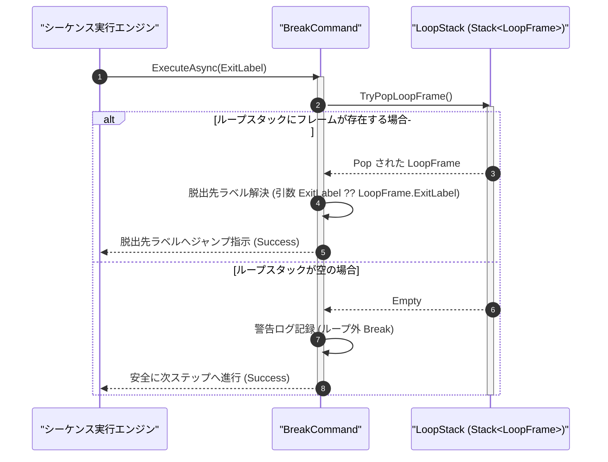

# コマンドリファレンス：Break

## 概要

`Break` は、現在実行中の [`Loop`](./Loop.Md) 〜 [`Next`](./Next.Md) ループブロックを強制中断し、ループスタック最上位から該当フレームを Pop 解放してループ外へ早期脱出する共通パラメータ・呼出・ループ制御系コマンドです。  
脱出先の行ラベル（`<ExitLabel>`）を引数で直接指定するか、または `Loop` 開始時に登録された `ExitLabel` へジャンプします。多重ネストされたループ内で実行した場合は、最も内側の直近ループのみを安全に脱出します。

> 💡 **補足**  
> 本コマンドは 共通基盤コマンドです。[`Jump`](../Sequence/Jump.Md) で直接ループ外へ飛び出す場合と異なり、ループスタック上の `LoopFrame` を確実に Pop 解放するため、スタック残留リークが発生しません。

---

## 💡 書式・パラメータ仕様

### コマンド構文

```csv
,SEQUENCE, [ステップキー], Break, "[脱出先行ラベル]"
```

### パラメータ（引数）一覧

| 引数位置 | 引数名 | 説明 | 指定方法 / 有効な入力値 |
| :--- | :--- | :--- | :--- |
| 引数1 | ExitLabel | ループ脱出後にジャンプする遷移先行ラベル（任意・省略可）。 | `#ラベル名#` 形式（例: `"#LOOP_EXIT#"`）。省略時は `Loop` 側で指定された `ExitLabel` または対応する `Next` の次行へ遷移 |

---

## 🔄 特殊置換規約・分岐規約の適用

本コマンドの引数における特殊記法および解釈ルールです。
* **動的置換（`$`）**: 引数内で `$PARAMキー$` のように記述すると、実行時に変数プール（PARAM）の値へ動的置換されます。（適用可能な引数: 引数 1 `ExitLabel`）
* **ジャンプ先指定（`#`）**: 脱出先のステップキーを指定する場合は、`#LOOP_EXIT#` のように `#` で囲んで指定します。（適用可能な引数: 引数 1 `ExitLabel`）
* **共通コマンド指定（`@`）**: 本コマンドは外部マクロを呼び出さないため適用されません。（適用可能な引数: 非適用）
* **カンマのエスケープ**: 引数文字列自体にカンマを含める場合は、必ず `","` と二重引用符で囲んで記述します。
* **エイリアス（別名）**: `BreakLoop`, `ExitLoop`

---

## 💡 動作例（正しい構文での記述例）

### スクリプト記述例

※COMMAND ブロック配下の子要素行（PARAM, SEQUENCE）は必ず行頭カンマから開始し、スペースインデントや行末コメント（`;`）は記述しないでください。

```csv
COMMAND, "POLLING_WAIT", "POLL_STATUS"
,PARAM, "IDX", Work, "試行回数", "0"
,PARAM, "STB_VAL", Work, "ステータスバイト", "0"
,PARAM, "POLL_STATUS", Work, "最終結果", "TIMEOUT"
; 最大 10 回までポーリングを繰り返すループ（脱出先 #POLL_DONE#）
,SEQUENCE, #POLL_LOOP#, Loop, 10, "IDX", "#POLL_DONE#"
,SEQUENCE, 020, Gpib_SPL, "22", "STB_VAL"
; STB_VAL が 0 以外（準備完了）なら #CONTINUE_LOOP# をスキップして Break 実行
,SEQUENCE, 030, Judge, NEQ, $STB_VAL$, 0, #CONTINUE_LOOP#
,SEQUENCE, 040, Param_Set, "POLLING_WAIT", "READY", "POLL_STATUS"
,SEQUENCE, 050, Break, "#POLL_DONE#"
,SEQUENCE, #CONTINUE_LOOP#, Wait, 500
,SEQUENCE, 070, Next, "IDX"
,SEQUENCE, #POLL_DONE#, Exit
```

### 実行時の挙動・変数変化

* **実行前の状態**: 3 回目のループ（`"IDX"` = `"3"`）で `"STB_VAL"` が `"16"`（非 0）となり、ステップ `050` の `Break` に到達した状態。
* **実行後の状態**: ループスタック最上位の `LoopFrame` が即座に Pop 解放され、残り 7 回分のループをスキップして `#POLL_DONE#` 行へジャンプします。

---

## 🔄 動作フロー（シーケンス図）

本コマンド実行時における、シーケンス実行エンジン、コマンドクラス（`BreakCommand`）、およびループスタック間のインタラクションを示すシーケンス図です。



---

## 🚫 エラーハンドリング・安全設計（仕様制限）

入力データの異常や実行時エラーに対し、解析・実行エンジンが実行するセーフティ規約です。

1. **ループ外（ループスタックが空の状態）での `Break` 実行**:
   - 例外クラッシュを発生させず、ループ外実行の警告ログを記録した上で、引数 `ExitLabel` が指定されていればそのラベルへ遷移し、未指定であれば安全に次行へ進行します。
2. **未定義の脱出先行ラベル指定**:
   - 指定された `#ラベル名#` が現在のコマンドシーケンス内に存在しない場合、未定義ラベルエラーとして `_log.LogError` を出力し安全に停止します。

---

## 🧪 ユニットテスト仕様

本コマンドクラス（`BreakCommand.cs`）に実装されている `RunUnitTest()` メソッドが検証するユニットテストの仕様です。

### テスト実行前提条件

* **実行トリガー**: `RunUnitTest()` メソッドの呼び出し
* **有効化条件**: システム全体の最小ログレベル（`ErrorLogger.MinimumLevel`）が `LogLevel.Test` であること（それ以外の場合は無効化ガードにより早期リターン）
* **検証結果出力**: `_log.LogTest` によるログ出力。検証失敗時は `_log.LogError`、予期せぬ例外発生時は `_log.LogCritical` で記録。

### テストケース一覧

| No | テストカテゴリ | テスト条件（入力値） | 期待される結果（出力値） | 検証の目的 / 観点 |
| :---: | :--- | :--- | :--- | :--- |
| **1** | 正常系 | ループ実行中に `Break, "#EXIT_LBL#"` を実行 | スタックが 1 段 Pop され、`#EXIT_LBL#` へのジャンプ指示が返る | ループ中断・スタック解放・ラベル遷移の検証 |
| **2** | 正常系 | 2 重ネストループの内側で `Break` を実行 | 内側フレームのみが Pop され、外側フレームはスタックに保持される | 多重ネスト時のスコープ隔離検証 |
| **3** | 異常系 | 存在しないラベル `"#NO_SUCH_LABEL#"` を指定して `Break` 実行 | 未定義ラベルエラーが記録され `Failure` が返却される | 不正ジャンプ先に対する安全停止検証 |

