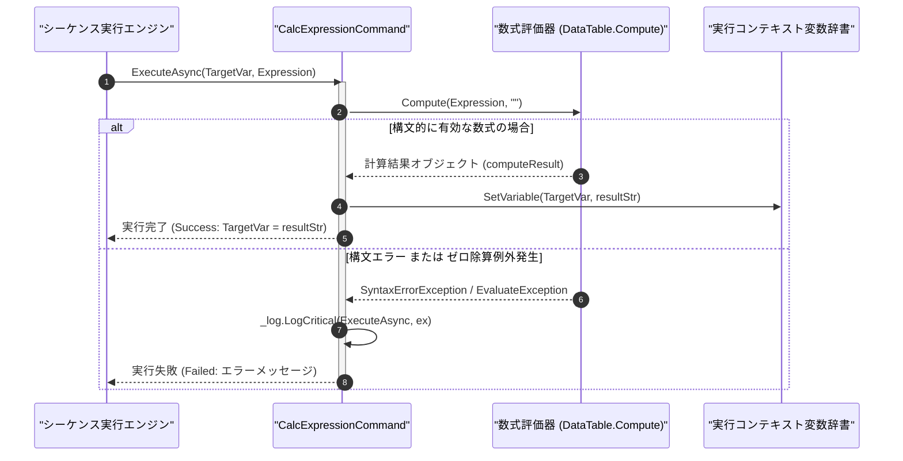

# コマンドリファレンス：CalcExpression

## 概要

`CalcExpression` は、四則演算・括弧・剰余を含む任意の数式文字列（`Expression`）を評価し、その計算結果を指定変数（`TargetVar`）へ格納する共通パラメータ・数式評価系コマンドです。  
スケーリング換算式（例: `"(RAW_VAL * 0.005) + 1.25"`）など、複数の演算を 1 ステップでまとめて計算する際に使用します。

> 💡 **補足**  
> 演算子の優先順位（`*`, `/`, `%` が `+`, `-` より優先）、丸括弧 `(...)` によるグルーピング、および数式内の `$KEY$` マクロ展開に標準対応しています。評価結果は指定変数および同名の `PARAM` パラメータへ自動的に書き戻されます。

---

## 💡 書式・パラメータ仕様

### コマンド構文

```csv
,SEQUENCE, [ステップキー], CalcExpression, "[格納先変数名(TargetVar)]", "[数式文字列(Expression)]"
```

### パラメータ（引数）一覧

| 引数位置 | 引数名 | 説明 | 指定方法 / 有効な入力値 |
| :--- | :--- | :--- | :--- |
| 引数1 | `TargetVar` | 数式の評価結果を格納する変数名（必須）。 | 変数識別子（例: `"CalcRes"`, `"SCALED_VOLT"`。前後の `$` 記号は自動除去され変数名として解釈、動的値置換は非適用） |
| 引数2 | `Expression` | 評価する算術数式文字列（必須）。 | 四則演算数式（例: `"10 + 20 * 3"`, `"($RAW$ - 4.0) * 6.25"`、`$PARAM$` 置換対応） |

---

## 🔄 特殊置換規約・分岐規約の適用

本コマンドの引数における特殊記法および解釈ルールです。
* **動的置換（`$`）**: 引数 2（`Expression`）内で `$PARAMキー$` のように記述すると、実行時に変数プール（PARAM）の値へ動的置換された後に数式評価されます。なお、引数 1（`TargetVar`）は格納先変数名そのものを指定する引数であり、`CleanParamKey` により前後の `$` 記号が自動除去されて変数名として扱われます（間接値置換は行われません）。（適用可能な引数: 引数 2 `Expression`）
* **ジャンプ先指定（`#`）**: 本コマンドはジャンプ制御を行わないため適用されません。（適用可能な引数: 非適用）
* **共通コマンド指定（`@`）**: 本コマンドは外部マクロを呼び出さないため適用されません。（適用可能な引数: 非適用）
* **カンマのエスケープ**: 引数文字列自体にカンマを含める場合は、必ず `","` と二重引用符で囲んで記述します。
* **エイリアス（別名）**: `Calc`, `Eval`, `ParamCalc`

---

## 💡 動作例（正しい構文での記述例）

### スクリプト記述例

※COMMAND ブロック配下の子要素行（PARAM, SEQUENCE）は必ず行頭カンマから開始し、スペースインデントや行末コメント（`;`）は記述しないでください。

```csv
COMMAND, "SCALE_SENSOR", "PHYS_VAL"
,PARAM, "ADC_RAW", Number, "AD変換生値", "20"
,PARAM, "PHYS_VAL", Work, "物理量換算値", "0"
; 10 + ADC_RAW * 3 を一括評価し PHYS_VAL に格納
,SEQUENCE, 010, CalcExpression, "PHYS_VAL", "10 + $ADC_RAW$ * 3"
,SEQUENCE, 020, Exit
```

### 実行時の挙動・変数変化

* **実行前の状態**: `"ADC_RAW"` が `"20"`、`"PHYS_VAL"` が `"0"` の状態。
* **実行後の状態**: ステップ `010` にて `"10 + 20 * 3"` が演算子優先順位に従って計算され、`"PHYS_VAL"` に `"70"` が格納されます。

---

## 🔄 動作フロー（シーケンス図）

本コマンド実行時における、シーケンス実行エンジン、`CalcExpressionCommand`、`DataTable.Compute` 数式エンジン、および変数辞書間のインタラクションを示すシーケンス図です。



---

## 🚫 エラーハンドリング・安全設計（仕様制限）

入力データの異常や実行時エラーに対し、解析・実行エンジンが実行するセーフティ規約です。

1. **不正数式構文・括弧不一致時の例外捕捉と安全停止**:
   - `"10 + * 5"` のような構文エラーが発生した場合、内部 `try-catch` で捕捉して `_log.LogCritical` に詳細を記録し、プロセスを落とさず `AnalysisResult.Failed` を返却します。
2. **`using var DataTable` による確実なリソース解放**:
   - 数式評価に使用する一時 `DataTable` インスタンスは `using var` スコープ終了時に即時破棄され、メモリリークを防止します。

---

## 🧪 ユニットテスト仕様

本コマンドクラス（`ParamSubCommand.cs` 内 `CalcExpressionCommand`）に実装されている `RunUnitTest()` メソッドが検証するユニットテストの仕様です。

### テスト実行前提条件

* **実行トリガー**: `RunUnitTest()` メソッドの呼び出し
* **有効化条件**: システム全体の最小ログレベル（`ErrorLogger.MinimumLevel`）が `LogLevel.Test` であること（それ以外の場合は無効化ガードにより早期リターン）
* **検証結果出力**: `_log.LogTest` によるログ出力。検証失敗時は `_log.LogError`、予期せぬ例外発生時は `_log.LogCritical` で記録。

### テストケース一覧

| No | テストカテゴリ | テスト条件（入力値） | 期待される結果（出力値） | 検証の目的 / 観点 |
| :---: | :--- | :--- | :--- | :--- |
| **1** | 正常系 | 引数 `("CalcRes", "10 + 20 * 3")` を指定して実行 | `"CalcRes"` に `"70"` が格納され `Success` を返却 | 四則演算優先順位と変数格納の検証 |
| **2** | 異常系 | 不正構文数式 `("CalcRes", "10 + * /")` 指定、および必須引数 `Expression` 省略 | 不正数式は `_log.LogCritical` 記録の上 `Failed` を返し、引数省略は `IsValid == false` で拒否される | 構文異常時の安全防護および必須引数検証 |

