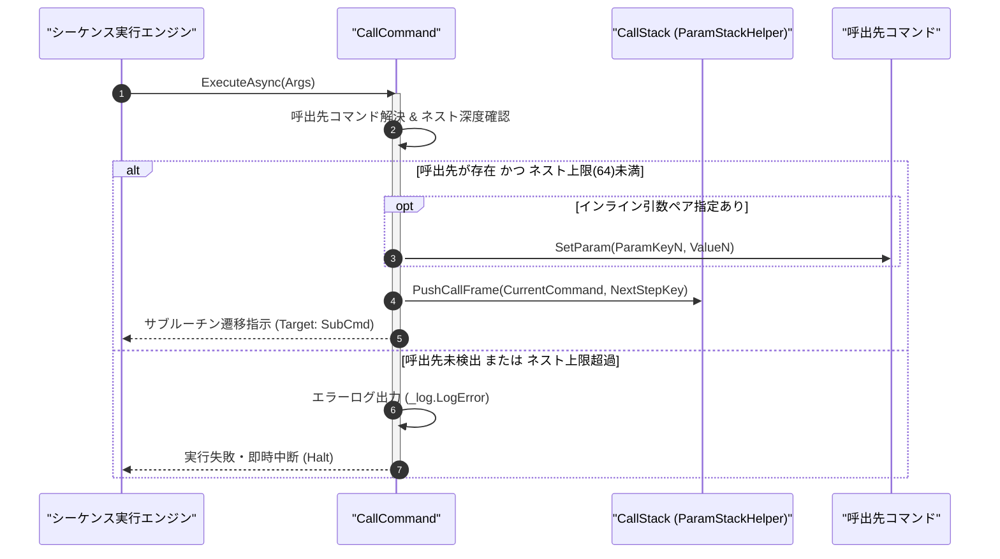

# コマンドリファレンス：Call

## 概要

`Call` は、現在のシーケンス実行位置（コマンド名および復帰行インデックス）をコールスタックへ退避した上で、指定された別のマクロコマンド（サブルーチン）を呼び出して実行する共通パラメータ・呼出・ループ制御系コマンドです。  
第 2 引数以降に `"[相手キー]", "[設定値]"` のペアを指定することで、[`Param_Set`](./Param_Set.Md) 相当の引数渡しをインラインで同時に実行することも可能です。呼出先で [`Exit`](./Exit.Md) が実行されると、退避された元のコマンドの次ステップへ自動復帰します。

> 💡 **補足**  
> 本コマンドは 共通基盤コマンドです。コールスタック（`Stack<CallFrame>`）は最大ネスト深度（64 階層）の安全ガードを備えており、無限再帰によるスタックオーバーフローを防止します。

---

## 💡 書式・パラメータ仕様

### コマンド構文

```csv
,SEQUENCE, [ステップキー], Call, "[呼出先コマンド名]", "[相手キー1]", "[設定値1]", "[相手キー2]", "[設定値2]"
```

### パラメータ（引数）一覧

| 引数位置 | 引数名 | 説明 | 指定方法 / 有効な入力値 |
| :--- | :--- | :--- | :--- |
| 引数1 | SubroutineCommandName | 呼び出す対象のマクロコマンド名（必須）。 | `COMMAND` で定義されたコマンド名（例: `"SUB_INIT"`, `"@COMMON_WAIT"`） |
| 引数2以降 | ParamKeyN, ValueN | 呼出先コマンドへインラインで引き渡す `[相手キーN], [設定値N]` のペア（任意・省略可）。 | 省略時は引数変更なしで呼出。指定時は 2 個 1 組のペア形式で連続指定可能 |

---

## 🔄 特殊置換規約・分岐規約の適用

本コマンドの引数における特殊記法および解釈ルールです。
* **動的置換（`$`）**: 引数内で `$PARAMキー$` のように記述すると、実行時に自コマンドの変数プール（PARAM）の値へ動的置換されます。（適用可能な引数: 全引数対応）
* **ジャンプ先指定（`#`）**: 本コマンドは行ラベルではなくマクロコマンド名を呼び出すため `#` は適用されません（行ラベルへのジャンプには [`Jump`](../Sequence/Jump.Md) を使用します）。（適用可能な引数: 非適用）
* **共通コマンド指定（`@`）**: 引数 1 の先頭に `@` を付与した場合（例: `"@SUB_DELAY"`）、機器スコープに関わらず最優先で共通基盤（`GENERAL`）のマクロコマンドを呼び出します。（適用可能な引数: 引数 1 `SubroutineCommandName`）
* **カンマのエスケープ**: 引数文字列自体にカンマを含める場合は、必ず `","` と二重引用符で囲んで記述します。
* **エイリアス（別名）**: `GpibCall`, `Gpib_Call`, `Analysis_Term_Call`, `Gosub`, `Subroutine`

---

## 💡 動作例（正しい構文での記述例）

### スクリプト記述例

※COMMAND ブロック配下の子要素行（PARAM, SEQUENCE）は必ず行頭カンマから開始し、スペースインデントや行末コメント（`;`）は記述しないでください。

```csv
COMMAND, "MEASURE_FLOW", "FINAL_RESULT"
,PARAM, "TARGET_VOLT", Text, "印加電圧", "5.0"
,PARAM, "FINAL_RESULT", Work, "最終測定結果", ""
; 1. インライン引数渡し付きでサブルーチン "SET_SOURCE_VOLT" を呼出
,SEQUENCE, 010, Call, "SET_SOURCE_VOLT", "VOLT_VAL", "$TARGET_VOLT$"
; 2. 共通機器マクロ "@COMMON_STABILIZE" を引数なしで呼出
,SEQUENCE, 020, Call, "@COMMON_STABILIZE"
; 3. 測定サブルーチンを呼び出し、Param_Get で結果を回収
,SEQUENCE, 030, Call, "READ_DMM"
,SEQUENCE, 040, Param_Get, "READ_DMM", "FINAL_RESULT", "DMM_OUT"
```

### 実行時の挙動・変数変化

* **実行前の状態**: `"MEASURE_FLOW"` のステップ `010` を実行中であり、コールスタックは空（深度 0）の状態。
* **実行後の状態**: コールスタックに復帰先フレーム（`"MEASURE_FLOW"`, 次ステップ `020`）が Push され、`"SET_SOURCE_VOLT"` の `"VOLT_VAL"` に `"5.0"` がセットされた上で `"SET_SOURCE_VOLT"` の先頭ステップへ制御が移ります。呼出先が終了するとステップ `020` へ復帰します。

---

## 🔄 動作フロー（シーケンス図）

本コマンド実行時における、シーケンス実行エンジン、コマンドクラス（`CallCommand`）、およびコールスタック間のインタラクションを示すシーケンス図です。



---

## 🚫 エラーハンドリング・安全設計（仕様制限）

入力データの異常や実行時エラーに対し、解析・実行エンジンが実行するセーフティ規約です。

1. **未定義サブルーチンコマンドの指定**:
   - 指定されたコマンド名がカレント機器および共通機器（`GENERAL`）のいずれにも存在しない場合、エラーログを記録して即時中断（Halt）します。
2. **コールスタックの最大ネスト深度（64 階層）超過**:
   - 自己再帰呼び出しや相互再帰によってコールスタック深度が上限（64）に達した場合、スタックオーバーフロー防止ガードが作動し、エラーログを出力して安全に実行を停止します。

---

## 🧪 ユニットテスト仕様

本コマンドクラス（`CallCommand.cs`）に実装されている `RunUnitTest()` メソッドが検証するユニットテストの仕様です。

### テスト実行前提条件

* **実行トリガー**: `RunUnitTest()` メソッドの呼び出し
* **有効化条件**: システム全体の最小ログレベル（`ErrorLogger.MinimumLevel`）が `LogLevel.Test` であること（それ以外の場合は無効化ガードにより早期リターン）
* **検証結果出力**: `_log.LogTest` によるログ出力。検証失敗時は `_log.LogError`、予期せぬ例外発生時は `_log.LogCritical` で記録。

### テストケース一覧

| No | テストカテゴリ | テスト条件（入力値） | 期待される結果（出力値） | 検証の目的 / 観点 |
| :---: | :--- | :--- | :--- | :--- |
| **1** | 正常系 | 引数なしサブルーチン呼出（`"SUB_TEST"`） | コールスタックに復帰フレームが Push され `"SUB_TEST"` へ遷移 | 基本サブルーチン呼出動作の検証 |
| **2** | 正常系 | インライン引数付き呼出（`"SUB_TEST", "P1", "VAL1"`） | `"SUB_TEST"` の `"P1"` に `"VAL1"` が代入された上で遷移 | インライン引数渡し機能の検証 |
| **3** | 異常系 | 最大ネスト深度（64 階層）を超える再帰 `Call` | スタック上限エラーが検出され `Failure` で安全停止 | 無限再帰・スタックオーバーフロー防護の検証 |

