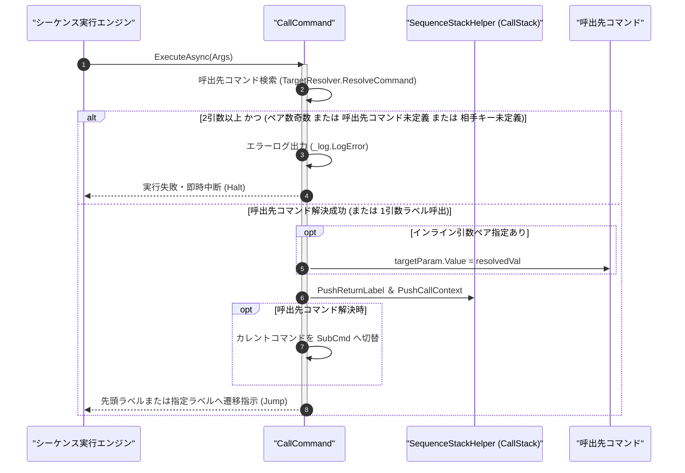

# コマンドリファレンス：Call

## 概要

`Call` は、現在のシーケンス実行位置（呼出元コマンド参照、アクティブデバイス名、および復帰先行ラベル）をコールスタック（`SequenceStackHelper`）へ退避した上で、指定された別のマクロコマンド（サブルーチン）または同一コマンド内の行ラベルを呼び出して実行する共通シーケンス・呼出制御系コマンド（`Common.Commands.Sequence.dll`）です。  
第 2 引数以降に `"[相手キー]", "[設定値]"` のペアを指定することで、[`Param_Set`](./Param_Set.Md) 相当の引数渡しをインラインで同時に実行することも可能です。呼出先で [`Return`](../Sequence/Return.Md) または [`Exit`](./Exit.Md) が実行されると、退避された元のコマンドの次ステップへ自動復帰します。

> 💡 **補足**  
> 本コマンドは共通基盤コマンドです。引数 1 のみ（1 引数）で呼び出し、指定された名前のマクロコマンドが未定義であった場合は、同一コマンド内の行ラベル（またはステップ番号）へのサブルーチンジャンプ（`Jump`）としてフォールバック動作します。

---

## 💡 書式・パラメータ仕様

### コマンド構文

```csv
,SEQUENCE, [ステップキー], Call, "[呼出先コマンド名またはラベル]", "[相手キー1]", "[設定値1]", "[相手キー2]", "[設定値2]"
```

### パラメータ（引数）一覧

| 引数位置 | 引数名 | 説明 | 指定方法 / 有効な入力値 |
| :--- | :--- | :--- | :--- |
| 引数1 | `SubroutineCommandName` | 呼び出す対象のマクロコマンド名、または 1 引数呼出時の同一コマンド内サブルーチン行ラベル（必須）。 | `COMMAND` で定義されたコマンド名（例: `"SUB_INIT"`, `"@COMMON_WAIT"`）、または 1 引数時は `#ラベル名#` |
| 引数2以降 | `ParamKeyN, ValueN` | 呼出先コマンドへインラインで引き渡す `[相手キーN], [設定値N]` のペア（任意・省略可）。 | 省略時は引数変更なしで呼出。指定時は 2 個 1 組のペア形式で連続指定可能（呼出先コマンドの実在が必須） |

---

## 🔄 特殊置換規約・分岐規約の適用

本コマンドの引数における特殊記法および解釈ルールです。
* **動的置換（`$`）**: 引数 2 以降の `[相手キーN], [設定値N]` ペア内で `$PARAMキー$` と記述すると、実行時に自コマンドの変数プール（PARAM）の値へ動的置換されます。（適用可能な引数: 引数 2 以降）
* **ジャンプ先指定（`#`）**: 1 引数指定で対象コマンドが未定義の場合、同一コマンド内の `#ラベル名#` へのサブルーチン呼出（コールスタック退避付きジャンプ）として機能します。（適用可能な引数: 1 引数時の引数 1）
* **共通コマンド指定（`@`）**: 引数 1 の先頭に `@` を付与した場合（例: `"@SUB_DELAY"`）、機器スコープに関わらず最優先で共通基盤（`GENERAL`）のマクロコマンドを呼び出します。（適用可能な引数: 引数 1 `SubroutineCommandName`）
* **カンマのエスケープ**: 引数文字列自体にカンマを含める場合は、必ず `","` と二重引用符で囲んで記述します。
* **エイリアス（別名）**: `Gosub`, `Subroutine`, `Gpib_Call`, `Analysis_Term_Call`

---

## 💡 動作例（正しい構文での記述例）

### スクリプト記述例

※COMMAND ブロック配下の子要素行（PARAM, SEQUENCE）は必ず行頭カンマから開始し、スペースインデントや行末コメント（`;`）は記述しないでください。

```csv
COMMAND, "SET_SOURCE_VOLT", ""
,PARAM, "VOLT_VAL", Text, "出力設定電圧", "0.0"
,SEQUENCE, 010, Return

COMMAND, "COMMON_STABILIZE", ""
,SEQUENCE, 010, Wait, 100
,SEQUENCE, 020, Return

COMMAND, "READ_DMM", "DMM_OUT"
,PARAM, "DMM_OUT", Work, "DMM測定値", "+5.0001E+00"
,SEQUENCE, 010, Return

COMMAND, "MEASURE_FLOW", "FINAL_RESULT"
,PARAM, "TARGET_VOLT", Text, "印加電圧", "5.0"
,PARAM, "FINAL_RESULT", Work, "最終測定結果", ""
; 1. インライン引数渡し付きでサブルーチン "SET_SOURCE_VOLT" を呼出
,SEQUENCE, 010, Call, "SET_SOURCE_VOLT", "VOLT_VAL", "$TARGET_VOLT$"
; 2. 安定化待機サブルーチン "COMMON_STABILIZE" を引数なしで呼出
,SEQUENCE, 020, Call, "COMMON_STABILIZE"
; 3. 測定サブルーチンを呼び出し、Param_Get で結果を回収
,SEQUENCE, 030, Call, "READ_DMM"
,SEQUENCE, 040, Param_Get, "READ_DMM", "FINAL_RESULT", "DMM_OUT"
```

### 実行時の挙動・変数変化

* **実行前の状態**: `"MEASURE_FLOW"` のステップ `010` を実行中であり、コールスタックは空（深度 0）の状態。
* **実行後の状態**: コールスタックに復帰先フレーム（`"MEASURE_FLOW"`, 次ステップ `020`）が Push され、`"SET_SOURCE_VOLT"` の `"VOLT_VAL"` に `"5.0"` がセットされた上で `"SET_SOURCE_VOLT"` の先頭ステップへ制御が移ります。呼出先が終了するとステップ `020` へ復帰します。

---

## 🔄 動作フロー（シーケンス図）

本コマンド実行時における、シーケンス実行エンジン、コマンドクラス（`CallCommand`）、およびコールスタック間のインタラクションを示すシーケンス図です。



---

## 🚫 エラーハンドリング・安全設計（仕様制限）

入力データの異常や実行時エラーに対し、解析・実行エンジンが実行するセーフティ規約です。

1. **インライン引数ペア指定時の未定義コマンド・未定義パラメータ防御**:
   - 第 2 引数以降に引数ペアを指定した状態で、呼出先コマンドが存在しない場合（エラーコード `-11`）や呼出先コマンド内に該当 `PARAM` キーが存在しない場合（`-12`）は、`_log.LogError` に記録して直ちに安全停止（`Halt`）します（一方、1 引数のみでコマンド未定義の場合は同一コマンド内の行ラベル `Jump` として動作します）。
2. **不完全なインライン引数ペア（偶数個の全引数）の拒否**:
   - 第 2 引数以降の `[相手キー], [設定値]` が 2 個 1 組になっていない場合は、エラーログを出力して安全に実行を停止（`Halt(-10)`）します。

---

## 🧪 ユニットテスト仕様

本コマンドクラス（`CallCommand.cs`）に実装されている `RunUnitTest()` メソッドが検証するユニットテストの仕様です。

### テスト実行前提条件

* **実行トリガー**: `RunUnitTest()` メソッドの呼び出し
* **有効化条件**: システム全体の最小ログレベル（`ErrorLogger.MinimumLevel`）が `LogLevel.Test` であること（それ以外の場合は無効化ガードにより早期リターン）
* **検証結果出力**: `_log.LogTest` によるログ出力。検証失敗時は `_log.LogError`、予期せぬ例外発生時は `_log.LogCritical` で記録。

### テストケース一覧

| No | テストカテゴリ | テスト条件（入力値） | 期待される結果（出力値） | 検証の目的 / 観点 |
| :---: | :--- | :--- | :--- | :--- |
| **1** | 正常系 | インライン引数付き呼出 `("DCV_MEAS", "RANGE", "$IN_VOLT$", "NPLC", "1")` | `"DCV_MEAS"` のパラメータが更新されて `"#100#"` へ `Jump` し、コールスタックに復帰ラベル `"21"` が退避される | インライン引数渡し・カレントコマンド切替・スタック退避の検証 |
| **2** | 異常系 | 不完全な奇数ペア引数 `("DCV_MEAS", "RANGE")` を指定して実行 | エラーログが出力され `AnalysisResultStatus.Halt` で安全停止する | 引数ペア不整合時のフェイルセーフ停止検証 |

