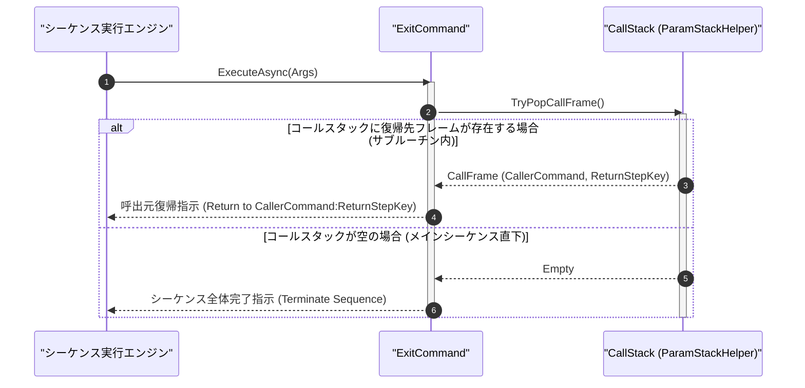

# コマンドリファレンス：Exit

## 概要

`Exit` は、サブルーチンからの復帰（Return 動作）またはメインシーケンス全体の正常終了（Exit 動作）を行う共通パラメータ・呼出・ループ制御系コマンドです。  
実行コンテキストのコールスタックに呼出元フレームが存在する場合はその復帰先行へ制御を戻し、コールスタックが空（トップレベル実行中）の場合はシーケンス全体を正常終了させます。

> 💡 **補足**  
> 本コマンドは 共通基盤コマンドです。[`Call`](./Call.Md) と対になってサブルーチンのライフサイクルを完結させます。

---

## 💡 書式・パラメータ仕様

### コマンド構文

```csv
,SEQUENCE, [ステップキー], Exit, "[メッセージ / 戻り値]", "[エラーコード]"
```

### パラメータ（引数）一覧

| 引数位置 | 引数名 | 説明 | 指定方法 / 有効な入力値 |
| :--- | :--- | :--- | :--- |
| 引数1 | Message / ReturnValue | 終了時または復帰時に出力・保持するメッセージまたは戻り値文字列（任意・省略可）。 | 任意の文字列または `$PARAM$` 置換（省略時は既定の完了状態） |
| 引数2 | ErrorCode | 終了ステータスコード（任意・省略可・既定値: `"0"`）。 | `"0"`（正常終了）または任意の整数ステータスコード |

---

## 🔄 特殊置換規約・分岐規約の適用

本コマンドの引数における特殊記法および解釈ルールです。
* **動的置換（`$`）**: 引数内で `$PARAMキー$` のように記述すると、実行時に変数プール（PARAM）の値へ動的置換されます。（適用可能な引数: 全引数対応）
* **ジャンプ先指定（`#`）**: 復帰先はコールスタックから自動解決されるため、`#` によるラベル指定は適用されません。（適用可能な引数: 非適用）
* **共通コマンド指定（`@`）**: 本コマンドは外部マクロを指定しないため適用されません。（適用可能な引数: 非適用）
* **カンマのエスケープ**: メッセージ文字列自体にカンマを含める場合は、必ず `","` と二重引用符で囲んで記述します。
* **エイリアス（別名）**: `Return`, `Ret`, `Halt`, `Stop`, `End`, `GpibExit`, `Analysis_Term_Exit`

---

## 💡 動作例（正しい構文での記述例）

### スクリプト記述例

※COMMAND ブロック配下の子要素行（PARAM, SEQUENCE）は必ず行頭カンマから開始し、スペースインデントや行末コメント（`;`）は記述しないでください。

```csv
COMMAND, "SUB_CHECK_LIMIT", "JUDGE_STAT"
,PARAM, "INPUT_VAL", Number, "入力測定値", "0.0"
,PARAM, "JUDGE_STAT", Work, "判定結果", "NG"
; 閾値 5.0 以上なら #PASS_EXIT# へ分岐、未満なら NG のまま終了復帰
,SEQUENCE, 010, Judge, LT, $INPUT_VAL$, 5.0, #PASS_EXIT#
,SEQUENCE, 020, Param_Set, "SUB_CHECK_LIMIT", "NG", "JUDGE_STAT"
,SEQUENCE, 030, Exit, "規格外(NG)のためサブルーチン復帰"
,SEQUENCE, #PASS_EXIT#, Param_Set, "SUB_CHECK_LIMIT", "OK", "JUDGE_STAT"
,SEQUENCE, 050, Exit, "正常(OK)復帰"
```

### 実行時の挙動・変数変化

* **実行前の状態**: メインコマンドから [`Call`](./Call.Md) で `"SUB_CHECK_LIMIT"` が呼び出され、コールスタックに呼出元フレームが 1 件積まれている状態。
* **実行後の状態**: `Exit` 実行によりコールスタックから呼出元フレームが Pop され、呼出元コマンドの `Call` 直後のステップへ実行ポインタが復帰します（トップレベルで実行された場合はシーケンス全体が完了停止します）。

---

## 🔄 動作フロー（シーケンス図）

本コマンド実行時における、シーケンス実行エンジン、コマンドクラス（`ExitCommand`）、およびコールスタック間のインタラクションを示すシーケンス図です。



---

## 🚫 エラーハンドリング・安全設計（仕様制限）

入力データの異常や実行時エラーに対し、解析・実行エンジンが実行するセーフティ規約です。

1. **非ゼロのエラーコード指定時（引数 2 に `"0"` 以外を指定）**:
   - 明示的な異常終了要求として認識し、指定されたメッセージとエラーコードを `_log.LogError` に記録した上でシーケンスを安全停止します。
2. **サブルーチン内でオープンされたループスタックの自動クリーンアップ**:
   - サブルーチン内の [`Loop`](./Loop.Md) ブロック途中で `Exit` が実行された場合、当該サブルーチンスコープに属する未完了の `LoopFrame` を自動的に破棄し、呼出元のループスタックが汚染されないよう保護します。

---

## 🧪 ユニットテスト仕様

本コマンドクラス（`ExitCommand.cs`）に実装されている `RunUnitTest()` メソッドが検証するユニットテストの仕様です。

### テスト実行前提条件

* **実行トリガー**: `RunUnitTest()` メソッドの呼び出し
* **有効化条件**: システム全体の最小ログレベル（`ErrorLogger.MinimumLevel`）が `LogLevel.Test` であること（それ以外の場合は無効化ガードにより早期リターン）
* **検証結果出力**: `_log.LogTest` によるログ出力。検証失敗時は `_log.LogError`、予期せぬ例外発生時は `_log.LogCritical` で記録。

### テストケース一覧

| No | テストカテゴリ | テスト条件（入力値） | 期待される結果（出力値） | 検証の目的 / 観点 |
| :---: | :--- | :--- | :--- | :--- |
| **1** | 正常系 | コールスタックにフレームがある状態で `Exit` 実行 | フレームが Pop され、呼出元の復帰ステップへ制御が戻る | サブルーチン Return 動作の検証 |
| **2** | 正常系 | コールスタックが空の状態で `Exit` 実行 | シーケンス全体の正常完了フラグがセットされ `Success` 返却 | トップレベル Exit 動作の検証 |
| **3** | 異常系 | 引数 2 に非ゼロエラーコード（`"Exit", "異常停止", "99"`）を指定 | エラーログが記録され異常終了ステータスが返却される | 明示的エラー終了コード指定時の動作検証 |

