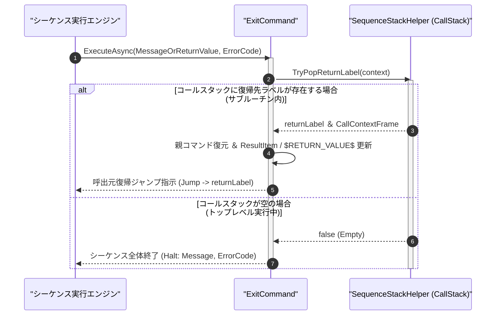

# コマンドリファレンス：Exit

## 概要

`Exit` は、コールスタックの状態に応じてサブルーチンからの復帰（Return 動作）またはメインシーケンス全体の終了（`Halt` 動作）を行う共通シーケンス・終了制御系コマンド（`Common.Commands.Sequence.dll`）です。  
実行コンテキストのコールスタック（`SequenceStackHelper`）に呼出元の復帰先ラベルが存在する場合は親コマンドを復元して復帰先行へジャンプ（`Jump`）し、コールスタックが空（トップレベル実行中）の場合は `AnalysisResult.Halt` を返却してシーケンス全体を終了させます（`ErrorCode == 0` 時はドライバ側で正常完了として扱われます）。

> 💡 **補足**  
> 本コマンドは共通基盤コマンドです。サブルーチンからの明示的な復帰には専用コマンド [`Return`](../Sequence/Return.Md)（エイリアス `Ret`, `Analysis_Term_Return`）も使用できます。

---

## 💡 書式・パラメータ仕様

### コマンド構文

```csv
,SEQUENCE, [ステップキー], Exit, "[メッセージ / 戻り値(MessageOrReturnValue)]", "[エラーコード(ErrorCode)]"
```

### パラメータ（引数）一覧

| 引数位置 | 引数名 | 説明 | 指定方法 / 有効な入力値 |
| :--- | :--- | :--- | :--- |
| 引数1 | `MessageOrReturnValue` | 終了メッセージ、またはサブルーチン復帰時に `$RETURN_VALUE$` へ格納する戻り値文字列（任意・省略時既定値: `""`）。 | 任意の文字列または `$PARAM$` 置換（省略時はトップレベル終了時に既定の終了メッセージを適用） |
| 引数2 | `ErrorCode` | 終了ステータスコード（任意・省略可・既定値: `0`）。 | `0`（正常終了扱い）または任意の整数ステータスコード |

---

## 🔄 特殊置換規約・分岐規約の適用

本コマンドの引数における特殊記法および解釈ルールです。
* **動的置換（`$`）**: 引数内で `$PARAMキー$` のように記述すると、実行時に変数プール（PARAM）の値へ動的置換されます。（適用可能な引数: 全引数対応）
* **ジャンプ先指定（`#`）**: 復帰先はコールスタックから自動解決されるため、`#` によるラベル指定は適用されません。（適用可能な引数: 非適用）
* **共通コマンド指定（`@`）**: 本コマンドは外部マクロを指定しないため適用されません。（適用可能な引数: 非適用）
* **カンマのエスケープ**: メッセージ文字列自体にカンマを含める場合は、必ず `","` と二重引用符で囲んで記述します。
* **エイリアス（別名）**: `Halt`, `Stop`, `End`, `Gpib_Exit`, `Analysis_Term_Exit`

---

## 💡 動作例（正しい構文での記述例）

### スクリプト記述例

※COMMAND ブロック配下の子要素行（PARAM, SEQUENCE）は必ず行頭カンマから開始し、スペースインデントや行末コメント（`;`）は記述しないでください。

```csv
COMMAND, "SUB_CHECK_LIMIT", "JUDGE_STAT"
,PARAM, "INPUT_VAL", Number, "入力測定値", "0.0"
,PARAM, "JUDGE_STAT", Work, "判定結果", "NG"
; 閾値 5.0 以上なら #PASS_EXIT# へ分岐、未満なら NG のまま終了復帰
,SEQUENCE, 010, Judge, LT, $INPUT_VAL$, 5.0, #PASS_EXIT#
,SEQUENCE, 020, Param_Set, "SUB_CHECK_LIMIT", "NG", "JUDGE_STAT"
,SEQUENCE, 030, Exit, "規格外(NG)のためサブルーチン復帰"
,SEQUENCE, #PASS_EXIT#, Param_Set, "SUB_CHECK_LIMIT", "OK", "JUDGE_STAT"
,SEQUENCE, 050, Exit, "正常(OK)復帰"
```

### 実行時の挙動・変数変化

* **実行前の状態**: メインコマンドから [`Call`](./Call.Md) で `"SUB_CHECK_LIMIT"` が呼び出され、コールスタックに呼出元フレームが 1 件積まれている状態。
* **実行後の状態**: `Exit` 実行によりコールスタックから呼出元フレームが Pop され、呼出元コマンドの `Call` 直後のステップへ実行ポインタが復帰します（トップレベルで実行された場合はシーケンス全体が完了停止します）。

---

## 🔄 動作フロー（シーケンス図）

本コマンド実行時における、シーケンス実行エンジン、コマンドクラス（`ExitCommand`）、およびコールスタック間のインタラクションを示すシーケンス図です。



---

## 🚫 エラーハンドリング・安全設計（仕様制限）

入力データの異常や実行時エラーに対し、解析・実行エンジンが実行するセーフティ規約です。

1. **トップレベル終了時のステータスコード伝播**:
   - コールスタックが空の状態で実行された場合は `AnalysisResult.Halt(haltMessage, errCode)` を返却します。`ErrorCode == 0` の場合はドライバ側で正常終了として完了し、非ゼロ整数を指定した場合は異常終了コードとして上位へ伝播します（サブルーチン内の `LoopFrame` を自動破棄する処理は行わないため、ループ途中から抜ける場合は [`Break`](./Break.Md) を併用してください）。
2. **未定義マクロトークン参照および型不整合時の防御**:
   - 第 1 引数内に未定義の `$PARAM$` トークンが含まれる場合は `_log.LogError` を記録して `Halt(-12)` を返し、第 2 引数 `ErrorCode` に非整数文字列が指定された場合は `OptionalInt` パイプライン検証で実行前に拒否します。

---

## 🧪 ユニットテスト仕様

本コマンドクラス（`ExitCommand.cs`）に実装されている `RunUnitTest()` メソッドが検証するユニットテストの仕様です。

### テスト実行前提条件

* **実行トリガー**: `RunUnitTest()` メソッドの呼び出し
* **有効化条件**: システム全体の最小ログレベル（`ErrorLogger.MinimumLevel`）が `LogLevel.Test` であること（それ以外の場合は無効化ガードにより早期リターン）
* **検証結果出力**: `_log.LogTest` によるログ出力。検証失敗時は `_log.LogError`、予期せぬ例外発生時は `_log.LogCritical` で記録。

### テストケース一覧

| No | テストカテゴリ | テスト条件（入力値） | 期待される結果（出力値） | 検証の目的 / 観点 |
| :---: | :--- | :--- | :--- | :--- |
| **1** | 正常系 | コールスタックに `"#30#"` および親 `MAIN` がある状態で `("$RESULT_VAL$", "0")` 実行 | `"#30#"` へ `Jump` し、`$RETURN_VALUE$` および親 `RET_SLOT` に `"MEAS_OK"` が格納されカレントコマンドが `MAIN` に復元される | サブルーチン Return 動作・戻り値引継の検証 |
| **2** | 正常系 | コールスタックが空の状態で終了メッセージと `"0"` を指定して実行 | `AnalysisResultStatus.Halt`（`ErrorCode == 0`、指定メッセージ保持）が返却される | トップレベル Exit（正常終了コード付き `Halt`）動作の検証 |

