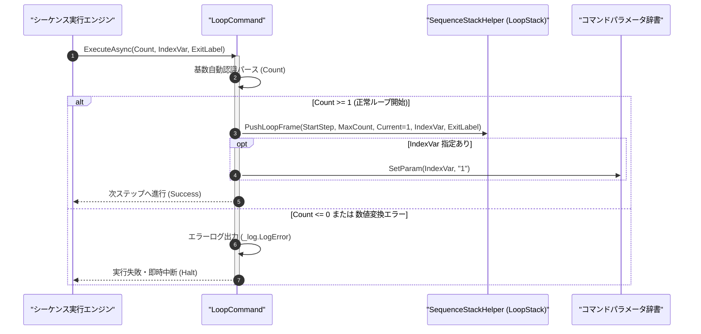

# コマンドリファレンス：Loop

## 概要

`Loop` は、指定された反復回数（`<Count>`）のループ処理を開始し、実行コンテキストのループスタック（`SequenceStackHelper`）へ新しいループフレーム（`LoopFrame`）を登録（Push）する共通シーケンス・ループ制御系コマンド（`Common.Commands.Sequence.dll`）です。  
対応する [`Next`](./Next.Md) コマンドと対になって動作し、カウンタ変数（省略時既定値: `"$LOOP_INDEX$"`）を初回 `"1"` で初期化した上で後続ステップへ進みます。ループの多重ネスト（入れ子構造）や [`Break`](./Break.Md) による途中脱出に完全対応しています。

> 💡 **補足**  
> 本コマンドは共通基盤コマンドです。反復回数 `<Count>` には 10 進数だけでなく、統一フォーマット指定子（16 進 `0x` / `&H`、2 進 `0b`）も直接指定可能です。

---

## 💡 書式・パラメータ仕様

### コマンド構文

```csv
,SEQUENCE, [ステップキー], Loop, "[反復回数(Count)]", "[カウンタ変数キー(IndexVariable)]", "[脱出先行ラベル(ExitLabel)]"
```

### パラメータ（引数）一覧

| 引数位置 | 引数名 | 説明 | 指定方法 / 有効な入力値 |
| :--- | :--- | :--- | :--- |
| 引数1 | `Count` | ループを繰り返す最大回数（必須）。 | `1` 以上の整数（10進 `"10"`、16進 `"0x0A"`、2進 `"0b1010"`）または `$PARAM$` 置換 |
| 引数2 | `IndexVariable` | 現在のループ回数（1 始まり）を格納する変数・パラメータキー名（任意・省略時既定値: **`"$LOOP_INDEX$"`** ）。 | `PARAM` キー名（例: `"IDX"`）またはコンテキスト変数名（省略時は `"$LOOP_INDEX$"` を `"1"` に初期化） |
| 引数3 | `ExitLabel` | ループ中断（引数省略時の [`Break`](./Break.Md)）でジャンプする既定の脱出先行ラベル（任意・省略可・既定値: `""`）。 | `#ラベル名#` 形式（例: `"#LOOP_END#"`）またはステップ番号 |

---

## 🔄 特殊置換規約・分岐規約の適用

本コマンドの引数における特殊記法および解釈ルールです。
* **動的置換（`$`）**: 引数 1 `Count` 内で `$PARAMキー$` と記述すると、実行時に変数プール（PARAM）の値へ動的置換されます。（適用可能な引数: 引数 1 `Count`）
* **ジャンプ先指定（`#`）**: 引数 3 に `Break` 時の既定脱出先ラベルを指定する場合は、`#LOOP_END#` のように `#` で囲んで指定します。（適用可能な引数: 引数 3 `ExitLabel`）
* **共通コマンド指定（`@`）**: 本コマンドは外部マクロを呼び出さないため適用されません。（適用可能な引数: 非適用）
* **カンマのエスケープ**: 引数文字列自体にカンマを含める場合は、必ず `","` と二重引用符で囲んで記述します。
* **エイリアス（別名）**: `For`, `Repeat`, `Gpib_Loop`, `Analysis_Term_Loop`

---

## 💡 動作例（正しい構文での記述例）

### スクリプト記述例

※COMMAND ブロック配下の子要素行（PARAM, SEQUENCE）は必ず行頭カンマから開始し、スペースインデントや行末コメント（`;`）は記述しないでください。

```csv
COMMAND, "MULTI_SAMPLE", "LAST_DATA"
,PARAM, "MAX_COUNT", Number, "サンプリング回数", "5"
,PARAM, "IDX", Work, "現在回数カウンタ", "0"
,PARAM, "LAST_DATA", Work, "最新測定値", ""
; 1. MAX_COUNT (5回) のループを開始し、カウンタ変数 "IDX" を 1 に初期化
,SEQUENCE, #SAMPLE_LOOP#, Loop, "$MAX_COUNT$", "IDX", "#SAMPLE_EXIT#"
,SEQUENCE, 020, Gpib_Send, "MEAS:VOLT:DC?"
,SEQUENCE, 030, Gpib_Receive, "LAST_DATA"
,SEQUENCE, 040, Wait, 200
; 2. カウンタ "IDX" を +1 更新し、5回未満なら #SAMPLE_LOOP# 直下へ戻る
,SEQUENCE, 050, Next, "IDX"
,SEQUENCE, #SAMPLE_EXIT#, Exit
```

### 実行時の挙動・変数変化

* **実行前の状態**: `"MAX_COUNT"` が `"5"`、`"IDX"` が `"0"` であり、ループスタックが空の状態。
* **実行後の状態**: `Loop` 実行により、最大回数 `5`・反復開始ステップ `"020"`（`Loop` 行の直後の次ステップ）・カウンタキー `"IDX"`・脱出ラベル `"#SAMPLE_EXIT#"` を持つ `LoopFrame` がスタックへ Push され、`"IDX"` が `"1"` に初期化されてステップ `020` へ進みます。

---

## 🔄 動作フロー（シーケンス図）

本コマンド実行時における、シーケンス実行エンジン、コマンドクラス（`LoopCommand`）、およびループスタック間のインタラクションを示すシーケンス図です。



---

## 🚫 エラーハンドリング・安全設計（仕様制限）

入力データの異常や実行時エラーに対し、解析・実行エンジンが実行するセーフティ規約です。

1. **反復回数に `0` 以下または非数値文字列が指定された場合**:
   - `ExitLabel` の有無に関わらず不正なループ回数として検出し、エラーログ（`_log.LogError`）を出力して常にエラーコード `-13` の `Halt` で安全停止します。
2. **カウンタ変数への柔軟な初期値同期**:
   - 引数 2 `IndexVariable`（省略時は `"$LOOP_INDEX$"`）がカレントコマンドの `PARAM` に存在する場合は `PARAM` とコンテキスト変数の双方を `"1"` に更新し、`PARAM` 未定義のキー名であっても停止せずコンテキスト変数へ `"1"` を格納して継続します。

---

## 🧪 ユニットテスト仕様

本コマンドクラス（`LoopCommand.cs`）に実装されている `RunUnitTest()` メソッドが検証するユニットテストの仕様です。

### テスト実行前提条件

* **実行トリガー**: `RunUnitTest()` メソッドの呼び出し
* **有効化条件**: システム全体の最小ログレベル（`ErrorLogger.MinimumLevel`）が `LogLevel.Test` であること（それ以外の場合は無効化ガードにより早期リターン）
* **検証結果出力**: `_log.LogTest` によるログ出力。検証失敗時は `_log.LogError`、予期せぬ例外発生時は `_log.LogCritical` で記録。

### テストケース一覧

| No | テストカテゴリ | テスト条件（入力値） | 期待される結果（出力値） | 検証の目的 / 観点 |
| :---: | :--- | :--- | :--- | :--- |
| **1** | 正常系 | 16 進回数＋カウンタ＋脱出ラベル指定 `("0x05", "I", "#EXIT_LOOP#")` | `LoopFrame(StartLabel="101", MaxCount=5, ExitLabel="#EXIT_LOOP#")` が Push され、`"I"` および `"$I$"` が `"1"` に初期化される | 基数自動認識・`LoopFrame` 生成・カウンタ初期化の検証 |
| **2** | 異常系 | `0` 回以下のループ回数指定 `("0")` | エラーログが出力され `AnalysisResultStatus.Halt`（`-13`）で安全停止する | 不正ループ回数に対するガード検証 |

