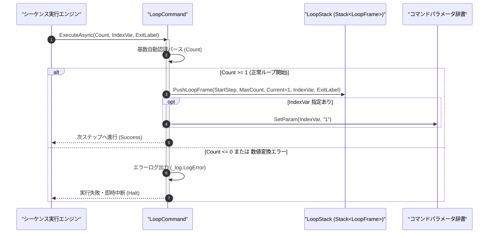

# コマンドリファレンス：Loop

## 概要

`Loop` は、指定された反復回数（`<Count>`）のループ処理を開始し、実行コンテキストのループスタック（`Stack<LoopFrame>`）へ新しいループフレームを登録（Push）する共通パラメータ・呼出・ループ制御系コマンドです。  
対応する [`Next`](./Next.Md) コマンドと対になって動作し、カウンタ変数を初回 `"1"` で初期化した上で後続ステップへ進みます。ループの多重ネスト（入れ子構造）や [`Break`](./Break.Md) による途中脱出に完全対応しています。

> 💡 **補足**  
> 本コマンドは 共通基盤コマンドです。反復回数 `<Count>` には 10 進数だけでなく、統一フォーマット指定子（16 進 `0x` / `&H`、2 進 `0b`）も直接指定可能です。

---

## 💡 書式・パラメータ仕様

### コマンド構文

```csv
,SEQUENCE, [ステップキー], Loop, "[反復回数]", "[カウンタ変数キー]", "[脱出先行ラベル]"
```

### パラメータ（引数）一覧

| 引数位置 | 引数名 | 説明 | 指定方法 / 有効な入力値 |
| :--- | :--- | :--- | :--- |
| 引数1 | Count | ループを繰り返す最大回数（必須）。 | 1 以上の整数（10進 `"10"`、16進 `"0x0A"`、2進 `"0b1010"`）または `$PARAM$` 置換 |
| 引数2 | IndexVariable | 現在のループ回数（1 始まり）を格納するパラメータキー名（任意・省略可）。 | 自コマンド内の `PARAM` キー名（例: `"LOOP_CNT"`）。省略時は内部カウンタのみ更新 |
| 引数3 | ExitLabel | ループ中断（[`Break`](./Break.Md)）や回数 0 以下指定時にジャンプする脱出先行ラベル（任意・省略可）。 | `#ラベル名#` 形式（例: `"#LOOP_END#"`） |

---

## 🔄 特殊置換規約・分岐規約の適用

本コマンドの引数における特殊記法および解釈ルールです。
* **動的置換（`$`）**: 引数内で `$PARAMキー$` のように記述すると、実行時に変数プール（PARAM）の値へ動的置換されます。（適用可能な引数: 引数 1 `Count`、引数 2 `IndexVariable`）
* **ジャンプ先指定（`#`）**: 引数 3 に脱出先行ラベルを指定する場合は、`#LOOP_END#` のように `#` で囲んで指定します。（適用可能な引数: 引数 3 `ExitLabel`）
* **共通コマンド指定（`@`）**: 本コマンドは外部マクロを呼び出さないため適用されません。（適用可能な引数: 非適用）
* **カンマのエスケープ**: 引数文字列自体にカンマを含める場合は、必ず `","` と二重引用符で囲んで記述します。
* **エイリアス（別名）**: `For`, `Repeat`

---

## 💡 動作例（正しい構文での記述例）

### スクリプト記述例

※COMMAND ブロック配下の子要素行（PARAM, SEQUENCE）は必ず行頭カンマから開始し、スペースインデントや行末コメント（`;`）は記述しないでください。

```csv
COMMAND, "MULTI_SAMPLE", "LAST_DATA"
,PARAM, "MAX_COUNT", Number, "サンプリング回数", "5"
,PARAM, "IDX", Work, "現在回数カウンタ", "0"
,PARAM, "LAST_DATA", Work, "最新測定値", ""
; 1. MAX_COUNT (5回) のループを開始し、カウンタ変数 "IDX" を 1 に初期化
,SEQUENCE, #SAMPLE_LOOP#, Loop, "$MAX_COUNT$", "IDX", "#SAMPLE_EXIT#"
,SEQUENCE, 020, Gpib_Send, "MEAS:VOLT:DC?"
,SEQUENCE, 030, Gpib_Receive, "LAST_DATA"
,SEQUENCE, 040, Wait, 200
; 2. カウンタ "IDX" を +1 更新し、5回未満なら #SAMPLE_LOOP# 直下へ戻る
,SEQUENCE, 050, Next, "IDX"
,SEQUENCE, #SAMPLE_EXIT#, Exit
```

### 実行時の挙動・変数変化

* **実行前の状態**: `"MAX_COUNT"` が `"5"`、`"IDX"` が `"0"` であり、ループスタックが空の状態。
* **実行後の状態**: `Loop` 実行により、最大回数 `5`・開始ステップ `#SAMPLE_LOOP#`・カウンタキー `"IDX"`・脱出ラベル `#SAMPLE_EXIT#` を持つ `LoopFrame` がスタックへ Push され、`"IDX"` が `"1"` に初期化されてステップ `020` へ進みます。

---

## 🔄 動作フロー（シーケンス図）

本コマンド実行時における、シーケンス実行エンジン、コマンドクラス（`LoopCommand`）、およびループスタック間のインタラクションを示すシーケンス図です。



---

## 🚫 エラーハンドリング・安全設計（仕様制限）

入力データの異常や実行時エラーに対し、解析・実行エンジンが実行するセーフティ規約です。

1. **反復回数に 0 以下または非数値文字列が指定された場合**:
   - 不正なループ回数として検出し、エラーログ（`_log.LogError`）を出力してシーケンスを安全停止（Halt）します。
2. **未定義のカウンタ変数キー指定**:
   - 引数 2 に指定されたカウンタ変数キーが `PARAM` に定義されていない場合、未定義変数アクセス禁止原則に従いエラーログを記録して即時中断します。

---

## 🧪 ユニットテスト仕様

本コマンドクラス（`LoopCommand.cs`）に実装されている `RunUnitTest()` メソッドが検証するユニットテストの仕様です。

### テスト実行前提条件

* **実行トリガー**: `RunUnitTest()` メソッドの呼び出し
* **有効化条件**: システム全体の最小ログレベル（`ErrorLogger.MinimumLevel`）が `LogLevel.Test` であること（それ以外の場合は無効化ガードにより早期リターン）
* **検証結果出力**: `_log.LogTest` によるログ出力。検証失敗時は `_log.LogError`、予期せぬ例外発生時は `_log.LogCritical` で記録。

### テストケース一覧

| No | テストカテゴリ | テスト条件（入力値） | 期待される結果（出力値） | 検証の目的 / 観点 |
| :---: | :--- | :--- | :--- | :--- |
| **1** | 正常系 | 10進回数指定（`"10", "IDX", "#EXIT#"`） | `LoopFrame(Max=10, Current=1)` が Push され `"IDX"` が `"1"` になる | 基本ループ開始とカウンタ初期化の検証 |
| **2** | 正常系 | 16進フォーマット指定（`"0x08", "IDX"`） | `MaxCount = 8` として正しく解析・Push される | 統一フォーマット指定子（基数自動認識）の検証 |
| **3** | 異常系 | 不正な回数指定（`"0"` または `"ABC"`） | エラーログが出力され `Failure` で安全停止する | 不正ループ回数に対するガード検証 |

