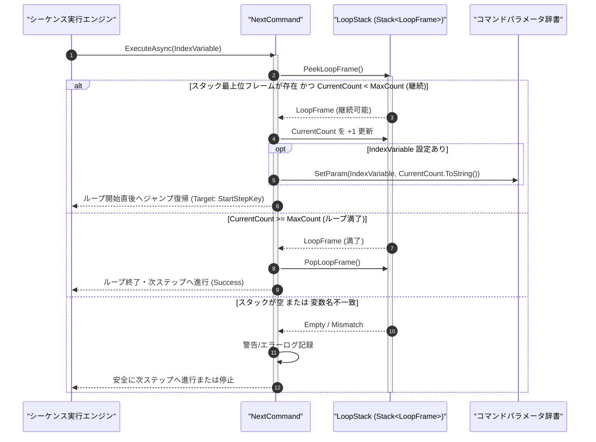

# コマンドリファレンス：Next

## 概要

`Next` は、[`Loop`](./Loop.Md) コマンドで開始されたループブロックの終端を示し、ループカウンタの加算更新と継続／満了判定を行う共通パラメータ・呼出・ループ制御系コマンドです。  
現在の反復回数が最大回数未満（`CurrentCount < MaxCount`）の場合はカウンタを `+1` 更新してループ開始行の直後へジャンプ復帰し、最大回数に到達（`CurrentCount >= MaxCount`）した場合はループスタックからフレームを Pop 解放して次行へ進みます。

> 💡 **補足**  
> 本コマンドは 共通基盤コマンドです。多重ネストされたループにおいても、常に最内周の `LoopFrame` を正確に制御します。

---

## 💡 書式・パラメータ仕様

### コマンド構文

```csv
,SEQUENCE, [ステップキー], Next, "[カウンタ変数キー]"
```

### パラメータ（引数）一覧

| 引数位置 | 引数名 | 説明 | 指定方法 / 有効な入力値 |
| :--- | :--- | :--- | :--- |
| 引数1 | IndexVariable | 対応する [`Loop`](./Loop.Md) で指定したカウンタ変数キー名（任意・省略可）。 | 自コマンド内の `PARAM` キー名（例: `"IDX"`）。省略時はループスタック最上位の直近ループを対象とする |

---

## 🔄 特殊置換規約・分岐規約の適用

本コマンドの引数における特殊記法および解釈ルールです。
* **動的置換（`$`）**: 引数にはパラメータキー名そのものを指定しますが、`$PARAM$` 置換も解釈されます。（適用可能な引数: 引数 1 `IndexVariable`）
* **ジャンプ先指定（`#`）**: 復帰先はループスタック（`LoopFrame.StartStepKey`）から自動解決されるため、`#` による指定は不要です。（適用可能な引数: 非適用）
* **共通コマンド指定（`@`）**: 本コマンドは外部マクロを呼び出さないため適用されません。（適用可能な引数: 非適用）
* **カンマのエスケープ**: 引数文字列自体にカンマを含める場合は、必ず `","` と二重引用符で囲んで記述します。
* **エイリアス（別名）**: `EndLoop`

---

## 💡 動作例（正しい構文での記述例）

### スクリプト記述例

※COMMAND ブロック配下の子要素行（PARAM, SEQUENCE）は必ず行頭カンマから開始し、スペースインデントや行末コメント（`;`）は記述しないでください。

```csv
COMMAND, "NESTED_LOOP_SAMPLE", "TOTAL_STEPS"
,PARAM, "OUTER_IDX", Work, "外側カウンタ", "0"
,PARAM, "INNER_IDX", Work, "内側カウンタ", "0"
,PARAM, "TOTAL_STEPS", Work, "累計実行回数", "0"
; 外側ループ（3回）開始
,SEQUENCE, #OUTER_START#, Loop, 3, "OUTER_IDX"
; 内側ループ（2回）開始
,SEQUENCE, #INNER_START#, Loop, 2, "INNER_IDX"
,SEQUENCE, 030, Param_Add, "NESTED_LOOP_SAMPLE", "TOTAL_STEPS", "1"
; 内側ループ終端
,SEQUENCE, 040, Next, "INNER_IDX"
; 外側ループ終端
,SEQUENCE, 050, Next, "OUTER_IDX"
,SEQUENCE, 060, Exit
```

### 実行時の挙動・変数変化

* **実行前の状態**: 外側ループ（3 回）の中に内側ループ（2 回）がネストされており、`"TOTAL_STEPS"` が `"0"` の状態。
* **実行後の状態**: 内側 `Next` が 2 回満了するごとに外側 `Next` が 1 回進行し、計 $3 \times 2 = 6$ 回の反復が完了した時点で双方の `LoopFrame` がスタックから解放され、`"TOTAL_STEPS"` が `"6"` となってステップ `060` へ抜けます。

---

## 🔄 動作フロー（シーケンス図）

本コマンド実行時における、シーケンス実行エンジン、コマンドクラス（`NextCommand`）、およびループスタック間のインタラクションを示すシーケンス図です。



---

## 🚫 エラーハンドリング・安全設計（仕様制限）

入力データの異常や実行時エラーに対し、解析・実行エンジンが実行するセーフティ規約です。

1. **対応する `Loop` が存在しない状態（ループスタック空）での `Next` 実行**:
   - スタックアンダーフロー例外を発生させず、警告ログを出力した上で安全に次ステップへ進行します（パース時の静的 Lint でも不整合を事前検出します）。
2. **ネスト順序の交差（外側の `IndexVariable` を内側の `Next` で指定した場合）**:
   - スタック最上位フレームの `IndexVariable` と一致しない指定を検出した場合、構文不整合エラーとしてログを記録し安全停止します。

---

## 🧪 ユニットテスト仕様

本コマンドクラス（`NextCommand.cs`）に実装されている `RunUnitTest()` メソッドが検証するユニットテストの仕様です。

### テスト実行前提条件

* **実行トリガー**: `RunUnitTest()` メソッドの呼び出し
* **有効化条件**: システム全体の最小ログレベル（`ErrorLogger.MinimumLevel`）が `LogLevel.Test` であること（それ以外の場合は無効化ガードにより早期リターン）
* **検証結果出力**: `_log.LogTest` によるログ出力。検証失敗時は `_log.LogError`、予期せぬ例外発生時は `_log.LogCritical` で記録。

### テストケース一覧

| No | テストカテゴリ | テスト条件（入力値） | 期待される結果（出力値） | 検証の目的 / 観点 |
| :---: | :--- | :--- | :--- | :--- |
| **1** | 正常系 | `CurrentCount = 1, MaxCount = 3` の状態で `Next` 実行 | `CurrentCount` が `2` に更新され、ループ開始位置へのジャンプ指示が返る | ループ継続時のカウンタ加算とジャンプ復帰の検証 |
| **2** | 正常系 | `CurrentCount = 3, MaxCount = 3`（最終回）の状態で `Next` 実行 | `LoopFrame` が Pop 解放され、次行への通常進行が返る | ループ満了時のスタック解放と脱出の検証 |
| **3** | 異常系 | ループスタックが空の状態で `Next` 実行 | 例外クラッシュせず安全に処理が完了する | スタック空時のセーフティガード検証 |

