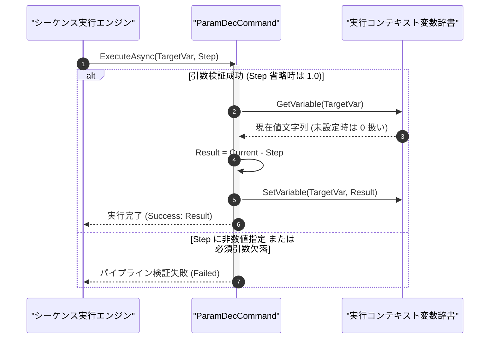

# コマンドリファレンス：ParamDec

## 概要

`ParamDec` は、実行コンテキスト内の指定された変数（`TargetVar`）の現在値を指定ステップ幅（`Step`、省略時は `1.0`）だけデクリメント（減算）する共通パラメータ・算術演算系コマンドです。  
リトライ残回数のカウントダウンや逆順走査ループのインデックス更新で使用します。

> 💡 **補足**  
> 第 2 引数 `Step` を省略した場合は既定値 `1.0` が減算されます（小数ステップ指定および `$KEY$` マクロ展開に対応）。更新された変数値はシーケンス実行ドライバにより同名の `PARAM` パラメータへも自動的に書き戻されます。

---

## 💡 書式・パラメータ仕様

### コマンド構文

```csv
,SEQUENCE, [ステップキー], ParamDec, "[対象変数名(TargetVar)]", "[減分値(Step)]"
```

### パラメータ（引数）一覧

| 引数位置 | 引数名 | 説明 | 指定方法 / 有効な入力値 |
| :--- | :--- | :--- | :--- |
| 引数1 | `TargetVar` | デクリメント対象の変数名（必須）。 | 変数識別子（例: `"TestDecVar"`, `"REMAIN_RETRY"`。前後の `$` 記号は自動除去され変数名として解釈、動的値置換は非適用） |
| 引数2 | `Step` | 減算するステップ値（任意・省略時既定値: `1.0`）。 | 数値リテラル（例: `1`, `0.5`, `2`）または `$PARAM$` 置換 |

---

## 🔄 特殊置換規約・分岐規約の適用

本コマンドの引数における特殊記法および解釈ルールです。
* **動的置換（`$`）**: 引数 2（`Step`）内で `$PARAMキー$` のように記述すると、実行時に変数プール（PARAM）の値へ動的置換されます。なお、引数 1（`TargetVar`）は対象変数名そのものを指定する引数であり、`CleanParamKey` により前後の `$` 記号が自動除去されて変数名として扱われます（間接値置換は行われません）。（適用可能な引数: 引数 2 `Step`）
* **ジャンプ先指定（`#`）**: 本コマンドはジャンプ制御を行わないため適用されません。（適用可能な引数: 非適用）
* **共通コマンド指定（`@`）**: 本コマンドは外部マクロを呼び出さないため適用されません。（適用可能な引数: 非適用）
* **カンマのエスケープ**: 引数文字列自体にカンマを含める場合は、必ず `","` と二重引用符で囲んで記述します。
* **エイリアス（別名）**: `Dec`, `Decrement`

---

## 💡 動作例（正しい構文での記述例）

### スクリプト記述例

※COMMAND ブロック配下の子要素行（PARAM, SEQUENCE）は必ず行頭カンマから開始し、スペースインデントや行末コメント（`;`）は記述しないでください。

```csv
COMMAND, "RETRY_COUNTDOWN", "REMAIN"
,PARAM, "REMAIN", Work, "残り試行回数", "10"
; REMAIN を 1 デクリメントし、0 以下でなければ（> 0 の間は）先頭 #RETRY_TOP# へ再試行分岐
,SEQUENCE, #RETRY_TOP#, ParamDec, "REMAIN"
,SEQUENCE, 020, Judge, "LE", "$REMAIN$", 0, #RETRY_TOP#
,SEQUENCE, 030, Exit
```

### 実行時の挙動・変数変化

* **実行前の状態**: 変数 `"REMAIN"` が `"10"` の状態。
* **実行後の状態**: `#RETRY_TOP#` の 1 回目の実行で既定減分 `1` が差し引かれて `"REMAIN"` が `"9"` に更新され、ステップ `020` の `Judge`（`LE`: `0` 以下判定）が不成立となるため `#RETRY_TOP#` へ分岐します。これを繰り返し、`"REMAIN"` が `"0"` に達すると条件成立となりステップ `030`（`Exit`）へ進行します。

---

## 🔄 動作フロー（シーケンス図）

本コマンド実行時における、シーケンス実行エンジン、`ParamDecCommand`、および実行コンテキスト変数辞書間のインタラクションを示すシーケンス図です。



---

## 🚫 エラーハンドリング・安全設計（仕様制限）

入力データの異常や実行時エラーに対し、解析・実行エンジンが実行するセーフティ規約です。

1. **減分ステップ値の数値型検証**:
   - 第 2 引数 `Step` に数値変換できない文字列が指定された場合、`OptionalDouble` 検証により実行前にエラー拒否します。
2. **未設定変数のゼロ起点安全減算**:
   - `TargetVar` が未設定または空文字列の場合は `0` から減算（例: `-1`）を行い、例外クラッシュを発生させません。

---

## 🧪 ユニットテスト仕様

本コマンドクラス（`ParamSubCommand.cs` 内 `ParamDecCommand`）に実装されている `RunUnitTest()` メソッドが検証するユニットテストの仕様です。

### テスト実行前提条件

* **実行トリガー**: `RunUnitTest()` メソッドの呼び出し
* **有効化条件**: システム全体の最小ログレベル（`ErrorLogger.MinimumLevel`）が `LogLevel.Test` であること（それ以外の場合は無効化ガードにより早期リターン）
* **検証結果出力**: `_log.LogTest` によるログ出力。検証失敗時は `_log.LogError`、予期せぬ例外発生時は `_log.LogCritical` で記録。

### テストケース一覧

| No | テストカテゴリ | テスト条件（入力値） | 期待される結果（出力値） | 検証の目的 / 観点 |
| :---: | :--- | :--- | :--- | :--- |
| **1** | 正常系 | `"TestDecVar" = "10"` に対して `("TestDecVar")` を実行 | `"TestDecVar"` が `"9"` に更新され `Success` を返却 | 既定減分（`-1`）デクリメント動作の検証 |
| **2** | 異常系 | `TargetVar` 省略または `Step` に非数値文字列を指定 | パイプライン検証で `IsValid == false` となり実行拒否 | 不正引数時の安全防御検証 |

