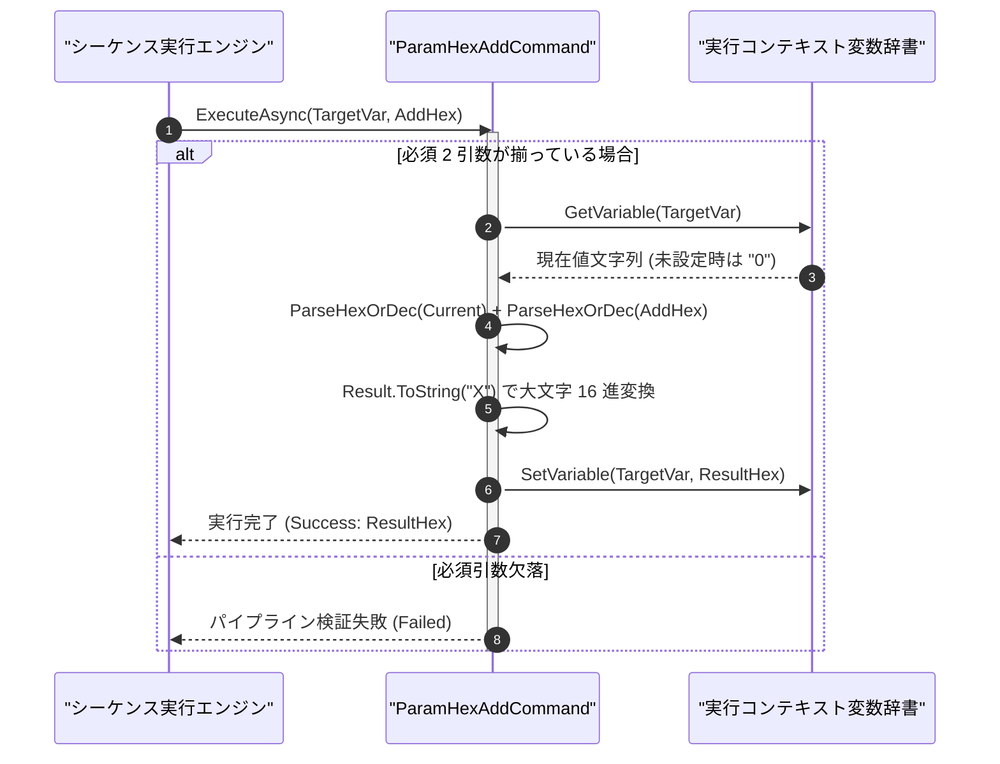

# コマンドリファレンス：ParamHexAdd

## 概要

`ParamHexAdd` は、実行コンテキスト内の指定変数（`TargetVar`）の 16 進数値に対して指定された 16 進加算値（`AddHex`）を加算し、計算結果を大文字 16 進数文字列として格納する共通パラメータ・算術演算系コマンドです。  
PLC リンクレジスタ（`W` / `B` / `ZR`）やメモリアドレスの 16 進オフセット順次更新で使用します。

> 💡 **補足**  
> 入力値には純粋な 16 進表記（例: `"0A"`, `"FF"`）のほか、`0x` プレフィックス（`"0x10"`）、`&H` プレフィックス（`"&H20"`）、および `$KEY$` マクロ展開にも対応しており、出力はプレフィックスなしの大文字 16 進文字列（例: `"10"`）として変数および同名の `PARAM` へ書き戻されます。

---

## 💡 書式・パラメータ仕様

### コマンド構文

```csv
,SEQUENCE, [ステップキー], ParamHexAdd, "[対象変数名(TargetVar)]", "[16進加算値(AddHex)]"
```

### パラメータ（引数）一覧

| 引数位置 | 引数名 | 説明 | 指定方法 / 有効な入力値 |
| :--- | :--- | :--- | :--- |
| 引数1 | `TargetVar` | 16 進加算対象の変数名（必須）。 | 変数識別子（例: `"TestHexVar"`, `"ADDR_HEX"`。前後の `$` 記号は自動除去され変数名として解釈、動的値置換は非適用） |
| 引数2 | `AddHex` | 加算する 16 進数文字列（必須）。 | 16 進リテラル（例: `"06"`, `"0x10"`, `"&H08"`）または `$PARAM$` 置換 |

---

## 🔄 特殊置換規約・分岐規約の適用

本コマンドの引数における特殊記法および解釈ルールです。
* **動的置換（`$`）**: 引数 2（`AddHex`）内で `$PARAMキー$` のように記述すると、実行時に変数プール（PARAM）の値へ動的置換されます。なお、引数 1（`TargetVar`）は対象変数名そのものを指定する引数であり、`CleanParamKey` により前後の `$` 記号が自動除去されて変数名として扱われます（間接値置換は行われません）。（適用可能な引数: 引数 2 `AddHex`）
* **ジャンプ先指定（`#`）**: 本コマンドはジャンプ制御を行わないため適用されません。（適用可能な引数: 非適用）
* **共通コマンド指定（`@`）**: 本コマンドは外部マクロを呼び出さないため適用されません。（適用可能な引数: 非適用）
* **カンマのエスケープ**: 引数文字列自体にカンマを含める場合は、必ず `","` と二重引用符で囲んで記述します。
* **エイリアス（別名）**: `HexAdd`

---

## 💡 動作例（正しい構文での記述例）

### スクリプト記述例

※COMMAND ブロック配下の子要素行（PARAM, SEQUENCE）は必ず行頭カンマから開始し、スペースインデントや行末コメント（`;`）は記述しないでください。

```csv
COMMAND, "NEXT_HEX_ADDRESS", "DEV_OFFSET"
,PARAM, "DEV_OFFSET", Text, "16進アドレスオフセット", "0A"
; DEV_OFFSET ("0A" = 10) に "06" (= 6) を加算して "10" (= 16) へ更新
,SEQUENCE, 010, ParamHexAdd, "DEV_OFFSET", "06"
,SEQUENCE, 020, Exit
```

### 実行時の挙動・変数変化

* **実行前の状態**: 変数 `"DEV_OFFSET"` が `"0A"`（10 進で `10`）の状態。
* **実行後の状態**: ステップ `010` の実行後、`0x0A + 0x06 = 0x10` が算出され、`"DEV_OFFSET"` に大文字 16 進文字列 `"10"` が格納されます。

---

## 🔄 動作フロー（シーケンス図）

本コマンド実行時における、シーケンス実行エンジン、`ParamHexAddCommand`、および実行コンテキスト変数辞書間のインタラクションを示すシーケンス図です。



---

## 🚫 エラーハンドリング・安全設計（仕様制限）

入力データの異常や実行時エラーに対し、解析・実行エンジンが実行するセーフティ規約です。

1. **不正フォーマット文字列に対するゼロ安全変換**:
   - `ParseHexOrDec` 内部で 16 進数・10 進数のいずれとしても解釈できない文字列が渡された場合でも、`FormatException` でクラッシュさせず安全に `0` として扱います。
2. **64ビット整数（`long`）演算によるオーバーフロー抑止**:
   - 32 ビット境界（`0x7FFFFFFF`）を超えるアドレス・カウンタ加算でもオーバーフローしないよう 64 ビット符号付き整数で内部計算を行います。

---

## 🧪 ユニットテスト仕様

本コマンドクラス（`ParamSubCommand.cs` 内 `ParamHexAddCommand`）に実装されている `RunUnitTest()` メソッドが検証するユニットテストの仕様です。

### テスト実行前提条件

* **実行トリガー**: `RunUnitTest()` メソッドの呼び出し
* **有効化条件**: システム全体の最小ログレベル（`ErrorLogger.MinimumLevel`）が `LogLevel.Test` であること（それ以外の場合は無効化ガードにより早期リターン）
* **検証結果出力**: `_log.LogTest` によるログ出力。検証失敗時は `_log.LogError`、予期せぬ例外発生時は `_log.LogCritical` で記録。

### テストケース一覧

| No | テストカテゴリ | テスト条件（入力値） | 期待される結果（出力値） | 検証の目的 / 観点 |
| :---: | :--- | :--- | :--- | :--- |
| **1** | 正常系 | `"TestHexVar" = "0A"` に対して `("TestHexVar", "06")` を実行 | `"TestHexVar"` が `"10"`（`0x10`）へ更新され `Success` を返却 | 16 進加算および大文字 HEX 変換の検証 |
| **2** | 境界値・異常系 | 不正 16 進文字 `("TestHexVar", "0xZZ")` のゼロフォールバック、および `AddHex` 省略 | `"0xZZ"` は `0` として扱われ既存値 `"10"` を維持して `Success` となり、引数省略は `IsValid == false` で拒否される | 不正文字列ゼロ安全変換および必須引数検証 |

