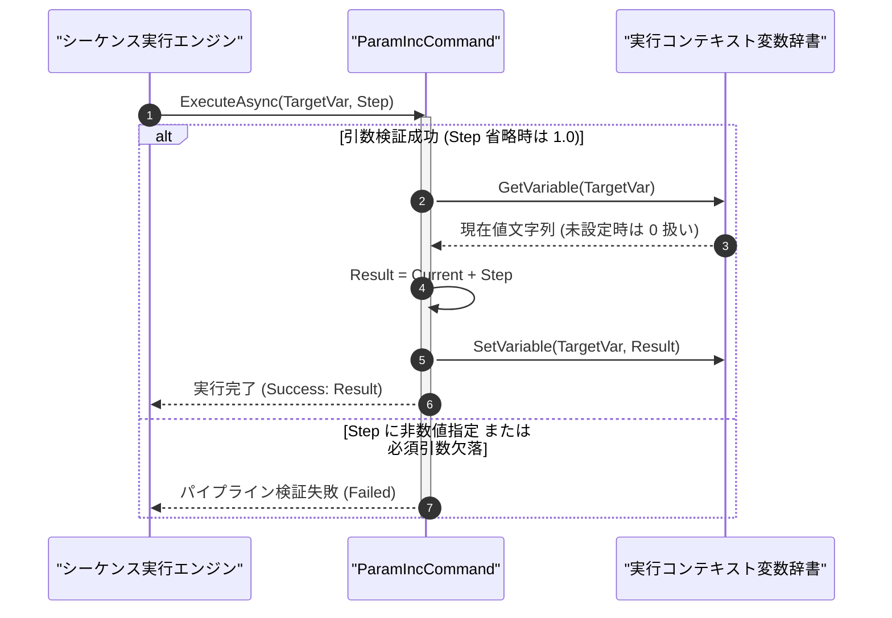

# コマンドリファレンス：ParamInc

## 概要

`ParamInc` は、実行コンテキスト内の指定された変数（`TargetVar`）の現在値を指定ステップ幅（`Step`、省略時は `1.0`）だけインクリメント（加算）する共通パラメータ・算術演算系コマンドです。  
ループ試行回数のカウントアップやインデックス変数の順次増加制御で使用します。

> 💡 **補足**  
> 第 2 引数 `Step` を省略した場合は既定値 `1.0` が加算されます（小数ステップ指定および `$KEY$` マクロ展開に対応）。更新された変数値はシーケンス実行ドライバにより同名の `PARAM` パラメータへも自動的に書き戻されます。

---

## 💡 書式・パラメータ仕様

### コマンド構文

```csv
,SEQUENCE, [ステップキー], ParamInc, "[対象変数名(TargetVar)]", "[増分値(Step)]"
```

### パラメータ（引数）一覧

| 引数位置 | 引数名 | 説明 | 指定方法 / 有効な入力値 |
| :--- | :--- | :--- | :--- |
| 引数1 | `TargetVar` | インクリメント対象の変数名（必須）。 | 変数識別子（例: `"TestIncVar"`, `"RETRY_CNT"`。前後の `$` 記号は自動除去され変数名として解釈、動的値置換は非適用） |
| 引数2 | `Step` | 加算する増分ステップ値（任意・省略時既定値: `1.0`）。 | 数値リテラル（例: `1`, `0.5`, `10`）または `$PARAM$` 置換 |

---

## 🔄 特殊置換規約・分岐規約の適用

本コマンドの引数における特殊記法および解釈ルールです。
* **動的置換（`$`）**: 引数 2（`Step`）内で `$PARAMキー$` のように記述すると、実行時に変数プール（PARAM）の値へ動的置換されます。なお、引数 1（`TargetVar`）は対象変数名そのものを指定する引数であり、`CleanParamKey` により前後の `$` 記号が自動除去されて変数名として扱われます（間接値置換は行われません）。（適用可能な引数: 引数 2 `Step`）
* **ジャンプ先指定（`#`）**: 本コマンドはジャンプ制御を行わないため適用されません。（適用可能な引数: 非適用）
* **共通コマンド指定（`@`）**: 本コマンドは外部マクロを呼び出さないため適用されません。（適用可能な引数: 非適用）
* **カンマのエスケープ**: 引数文字列自体にカンマを含める場合は、必ず `","` と二重引用符で囲んで記述します。
* **エイリアス（別名）**: `Inc`, `Increment`

---

## 💡 動作例（正しい構文での記述例）

### スクリプト記述例

※COMMAND ブロック配下の子要素行（PARAM, SEQUENCE）は必ず行頭カンマから開始し、スペースインデントや行末コメント（`;`）は記述しないでください。

```csv
COMMAND, "COUNT_UP_SAMPLE", "PASS_COUNT"
,PARAM, "PASS_COUNT", Work, "合格件数", "10"
; PASS_COUNT を 1 ずつインクリメント
,SEQUENCE, 010, ParamInc, "PASS_COUNT"
,SEQUENCE, 020, Exit
```

### 実行時の挙動・変数変化

* **実行前の状態**: 変数 `"PASS_COUNT"` が `"10"` の状態。
* **実行後の状態**: ステップ `010` の実行後、既定増分 `1` が加算されて `"PASS_COUNT"` が `"11"` に更新されます。

---

## 🔄 動作フロー（シーケンス図）

本コマンド実行時における、シーケンス実行エンジン、`ParamIncCommand`、および実行コンテキスト変数辞書間のインタラクションを示すシーケンス図です。



---

## 🚫 エラーハンドリング・安全設計（仕様制限）

入力データの異常や実行時エラーに対し、解析・実行エンジンが実行するセーフティ規約です。

1. **増分ステップ値の数値型検証**:
   - 第 2 引数 `Step` に非数値文字列が渡された場合、`OptionalDouble` バリデータにより実行前に検出して誤演算を防止します。
2. **未設定変数の安全なゼロ起点加算**:
   - `TargetVar` が空または未定義の場合は現在値 `0` として安全に加算処理を実行し、例外停止を回避します。

---

## 🧪 ユニットテスト仕様

本コマンドクラス（`ParamSubCommand.cs` 内 `ParamIncCommand`）に実装されている `RunUnitTest()` メソッドが検証するユニットテストの仕様です。

### テスト実行前提条件

* **実行トリガー**: `RunUnitTest()` メソッドの呼び出し
* **有効化条件**: システム全体の最小ログレベル（`ErrorLogger.MinimumLevel`）が `LogLevel.Test` であること（それ以外の場合は無効化ガードにより早期リターン）
* **検証結果出力**: `_log.LogTest` によるログ出力。検証失敗時は `_log.LogError`、予期せぬ例外発生時は `_log.LogCritical` で記録。

### テストケース一覧

| No | テストカテゴリ | テスト条件（入力値） | 期待される結果（出力値） | 検証の目的 / 観点 |
| :---: | :--- | :--- | :--- | :--- |
| **1** | 正常系 | `"TestIncVar" = "10"` に対して `("TestIncVar")` を実行 | `"TestIncVar"` が `"11"` に更新され `Success` を返却 | 既定増分（`+1`）インクリメント動作の検証 |
| **2** | 異常系 | `TargetVar` 省略または `Step` に非数値文字列を指定 | パイプライン検証で `IsValid == false` となり実行拒否 | 不正引数時の安全防御検証 |

