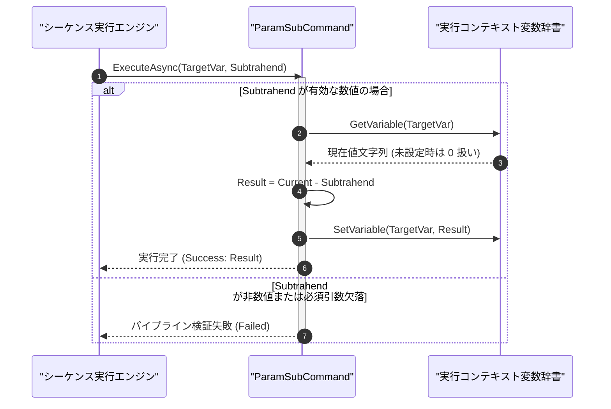

# コマンドリファレンス：ParamSub

## 概要

`ParamSub` は、実行コンテキスト内の指定された変数（`TargetVar`）の現在値から指定数値（`Subtrahend`）を算術減算し、その結果で変数を更新する共通パラメータ・算術演算系コマンドです。  
カウンタの減算制御やオフセット補正計算など、単一変数に対する直接減算処理で使用します。

> 💡 **補足**  
> 対象変数が未設定または空文字列の場合は現在値を `0` として扱い、`0 - Subtrahend` の結果（InvariantCulture 文字列）を格納します。コマンド間パラメータペアの一括加減算には [`Param_Add`](./Param_Add.Md) も利用できます。

---

## 💡 書式・パラメータ仕様

### コマンド構文

```csv
,SEQUENCE, [ステップキー], ParamSub, "[対象変数名(TargetVar)]", [減算値(Subtrahend)]
```

### パラメータ（引数）一覧

| 引数位置 | 引数名 | 説明 | 指定方法 / 有効な入力値 |
| :--- | :--- | :--- | :--- |
| 引数1 | `TargetVar` | 減算対象となる変数名（必須）。 | 変数識別子（例: `"TestSubVar"`, `"REMAIN_VOLT"`）または `$PARAM$` 置換 |
| 引数2 | `Subtrahend` | 現在値から差し引く倍精度浮動小数点数値（必須）。 | 整数・小数リテラル（例: `7.5`, `1`, `-2.0`）または `$PARAM$` 置換 |

---

## 🔄 特殊置換規約・分岐規約の適用

本コマンドの引数における特殊記法および解釈ルールです。
* **動的置換（`$`）**: 引数内で `$PARAMキー$` のように記述すると、実行時に変数プール（PARAM）の値へ動的置換されます。（適用可能な引数: 全引数対応）
* **ジャンプ先指定（`#`）**: 本コマンドはジャンプ制御を行わないため適用されません。（適用可能な引数: 非適用）
* **共通コマンド指定（`@`）**: 本コマンドは外部マクロを呼び出さないため適用されません。（適用可能な引数: 非適用）
* **カンマのエスケープ**: 引数文字列自体にカンマを含める場合は、必ず `","` と二重引用符で囲んで記述します。
* **エイリアス（別名）**: `Sub`

---

## 💡 動作例（正しい構文での記述例）

### スクリプト記述例

※COMMAND ブロック配下の子要素行（PARAM, SEQUENCE）は必ず行頭カンマから開始し、スペースインデントや行末コメント（`;`）は記述しないでください。

```csv
COMMAND, "CALC_OFFSET_DIFF", "MEAS_VAL"
,PARAM, "MEAS_VAL", Number, "測定値", "20"
,PARAM, "OFFSET_VAL", Number, "ゼロ点オフセット", "7.5"
; MEAS_VAL から OFFSET_VAL (7.5) を減算して更新
,SEQUENCE, 010, ParamSub, "MEAS_VAL", "$OFFSET_VAL$"
,SEQUENCE, 020, Exit
```

### 実行時の挙動・変数変化

* **実行前の状態**: 変数 `"MEAS_VAL"` が `"20"`、`"OFFSET_VAL"` が `"7.5"` の状態。
* **実行後の状態**: ステップ `010` の実行後、`20 - 7.5` が計算され、`"MEAS_VAL"` の値が `"12.5"` に更新されます。

---

## 🔄 動作フロー（シーケンス図）

本コマンド実行時における、シーケンス実行エンジン、`ParamSubCommand`、および実行コンテキスト変数辞書間のインタラクションを示すシーケンス図です。



---

## 🚫 エラーハンドリング・安全設計（仕様制限）

入力データの異常や実行時エラーに対し、解析・実行エンジンが実行するセーフティ規約です。

1. **減算値の型検証ガード**:
   - 第 2 引数 `Subtrahend` に数値へ変換できない文字列が指定された場合、`CommandParameterSpec.RequireDouble` により実行前に検証エラーとして安全に拒否します。
2. **未初期化変数に対するゼロフォールバック**:
   - 対象変数 `TargetVar` が未定義または空文字列であっても例外クラッシュを起こさず、初期値 `0` として安全に減算を継続します。

---

## 🧪 ユニットテスト仕様

本コマンドクラス（`ParamSubCommand.cs` 内 `ParamSubCommand`）に実装されている `RunUnitTest()` メソッドが検証するユニットテストの仕様です。

### テスト実行前提条件

* **実行トリガー**: `RunUnitTest()` メソッドの呼び出し
* **有効化条件**: システム全体の最小ログレベル（`ErrorLogger.MinimumLevel`）が `LogLevel.Test` であること（それ以外の場合は無効化ガードにより早期リターン）
* **検証結果出力**: `_log.LogTest` によるログ出力。検証失敗時は `_log.LogError`、予期せぬ例外発生時は `_log.LogCritical` で記録。

### テストケース一覧

| No | テストカテゴリ | テスト条件（入力値） | 期待される結果（出力値） | 検証の目的 / 観点 |
| :---: | :--- | :--- | :--- | :--- |
| **1** | 正常系 | `"TestSubVar" = "20"` に対して `("TestSubVar", "7.5")` を実行 | `"TestSubVar"` が `"12.5"` に更新され `Success` を返却 | 浮動小数点減算の基本動作検証 |
| **2** | 異常系 | 第 2 引数に非数値文字列（`"ABC"`）を指定 | `CommandParameterPipeline` 検証が `IsValid == false` となる | 型不整合入力時のクラッシュ防御検証 |

