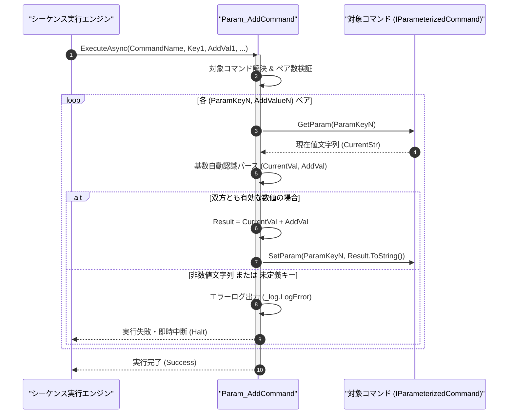

# コマンドリファレンス：Param_Add

## 概要

`Param_Add` は、指定されたコマンドのパラメータ値に対して数値を算術加算し、その計算結果でパラメータ値を更新する共通パラメータ・呼出・ループ制御系コマンドです。  
加算値に負数（例: `"-1"` や `"-5.5"`）を指定することで減算（旧 `ParamSub`）およびデクリメント（旧 `ParamDec`）を、`"1"` を指定することでインクリメント（旧 `ParamInc`）を完全に内包・統合しています。また、第 2 引数以降に `<ParamKey>, <AddValue>` のペアを連続指定することで、複数のパラメータを一括で加算更新することも可能です。

> 💡 **補足**  
> 本コマンドは 共通基盤コマンドです。統一フォーマット指定子（10 進数、16 進数 `0x`/`&H`、2 進数 `0b`）による基数自動認識と、整数／倍精度浮動小数点数の自動判別に対応しています。

---

## 💡 書式・パラメータ仕様

### コマンド構文

```csv
,SEQUENCE, [ステップキー], Param_Add, "[対象コマンド名]", "[対象キー1]", "[加算値1]", "[対象キー2]", "[加算値2]"
```

### パラメータ（引数）一覧

| 引数位置 | 引数名 | 説明 | 指定方法 / 有効な入力値 |
| :--- | :--- | :--- | :--- |
| 引数1 | CommandName | 加算対象のパラメータを保持するマクロコマンド名（必須）。 | `COMMAND` で定義されたコマンド名（例: `"DCV_MEAS"`）または `$PARAM$` 置換 |
| 引数2 | ParamKey1 | 第 1 ペアの加算対象パラメータキー名（必須）。 | 対象コマンド内の `PARAM` キー名（例: `"LOOP_CNT"`, `"1"`） |
| 引数3 | AddValue1 | 第 1 ペアの加算する数値（必須。負数指定時は減算）。 | 数値リテラル（`"1"`, `"-2.5"`, `"0x10"`）または `$PARAM$` 置換 |
| 引数4以降 | ParamKeyN, AddValueN | 第 2 ペア以降の `[対象キーN], [加算値N]` の組み合わせ（任意、可変長ペア）。 | 2 個 1 組のペア形式で任意個数まで連続指定可能 |

---

## 🔄 特殊置換規約・分岐規約の適用

本コマンドの引数における特殊記法および解釈ルールです。
* **動的置換（`$`）**: 引数内で `$PARAMキー$` のように記述すると、実行時に変数プール（PARAM）の値へ動的置換されます。（適用可能な引数: 全引数対応）
* **ジャンプ先指定（`#`）**: 本コマンドはジャンプ制御を行わないため適用されません。（適用可能な引数: 非適用）
* **共通コマンド指定（`@`）**: 引数 1 に対象コマンド名を指定する際、先頭に `@` を付与した場合は共通基盤（`GENERAL`）を対象とします。（適用可能な引数: 引数 1 `CommandName`）
* **カンマのエスケープ**: 引数文字列自体にカンマを含める場合は、必ず `","` と二重引用符で囲んで記述します。
* **エイリアス（別名）**: `ParamAdd`, `Add`, `GpibParamAdd`, `Analysis_Term_PARAM_Add`, `ParamSub`, `Sub`, `ParamInc`, `Inc`, `ParamDec`, `Dec`

---

## 💡 動作例（正しい構文での記述例）

### スクリプト記述例

※COMMAND ブロック配下の子要素行（PARAM, SEQUENCE）は必ず行頭カンマから開始し、スペースインデントや行末コメント（`;`）は記述しないでください。

```csv
COMMAND, "SWEEP_VOLTAGE", "CURRENT_VOLT"
,PARAM, "CURRENT_VOLT", Number, "現在電圧(V)", "1.0"
,PARAM, "STEP_VOLT", Number, "ステップ電圧(V)", "0.5"
,PARAM, "REMAIN_CNT", Work, "残り回数", "10"
; CURRENT_VOLT に +0.5V を加算し、同時に REMAIN_CNT から -1 を減算
,SEQUENCE, 010, Param_Add, "SWEEP_VOLTAGE", "CURRENT_VOLT", "$STEP_VOLT$", "REMAIN_CNT", "-1"
```

### 実行時の挙動・変数変化

* **実行前の状態**: `"CURRENT_VOLT"` が `"1.0"`、`"STEP_VOLT"` が `"0.5"`、`"REMAIN_CNT"` が `"10"` の状態。
* **実行後の状態**: ステップ `010` の実行後、`"CURRENT_VOLT"` が `"1.5"` に加算更新され、同時に `"REMAIN_CNT"` が `"9"` に減算更新されます。

---

## 🔄 動作フロー（シーケンス図）

本コマンド実行時における、シーケンス実行エンジン、コマンドクラス（`Param_AddCommand`）、および対象コマンドパラメータ辞書間のインタラクションを示すシーケンス図です。



---

## 🚫 エラーハンドリング・安全設計（仕様制限）

入力データの異常や実行時エラーに対し、解析・実行エンジンが実行するセーフティ規約です。

1. **非数値文字列に対する加算試行**:
   - 対象パラメータの現在値または `<AddValue>` が数値（10進・16進・2進）として解析できない場合、型変換エラーとして `_log.LogError` に記録し、直ちにシーケンスを安全停止（Halt）します。
2. **未定義のコマンド名・パラメータキー指定**:
   - 存在しないコマンドや未定義キーが指定された場合、暗黙の `0` 初期化等は行わず、未定義エラーとして即時中断します。

---

## 🧪 ユニットテスト仕様

本コマンドクラス（`Param_AddCommand.cs`）に実装されている `RunUnitTest()` メソッドが検証するユニットテストの仕様です。

### テスト実行前提条件

* **実行トリガー**: `RunUnitTest()` メソッドの呼び出し
* **有効化条件**: システム全体の最小ログレベル（`ErrorLogger.MinimumLevel`）が `LogLevel.Test` であること（それ以外の場合は無効化ガードにより早期リターン）
* **検証結果出力**: `_log.LogTest` によるログ出力。検証失敗時は `_log.LogError`、予期せぬ例外発生時は `_log.LogCritical` で記録。

### テストケース一覧

| No | テストカテゴリ | テスト条件（入力値） | 期待される結果（出力値） | 検証の目的 / 観点 |
| :---: | :--- | :--- | :--- | :--- |
| **1** | 正常系 | 整数・小数の正負加算（`"10" + "5"`, `"2.5" + "-1.0"`） | それぞれ `"15"`, `"1.5"` に更新される | 加算および負数減算の基本動作検証 |
| **2** | 正常系 | 16進フォーマット加算（現在値 `"10"` に `"0x10"` を加算） | `"26"` に更新される | 統一フォーマット指定子（基数自動認識）の検証 |
| **3** | 異常系 | 非数値文字列（`"ABC"`）への加算試行 | エラーログが出力され `Failure` で安全停止する | 数値変換エラー時のクラッシュ防御検証 |

