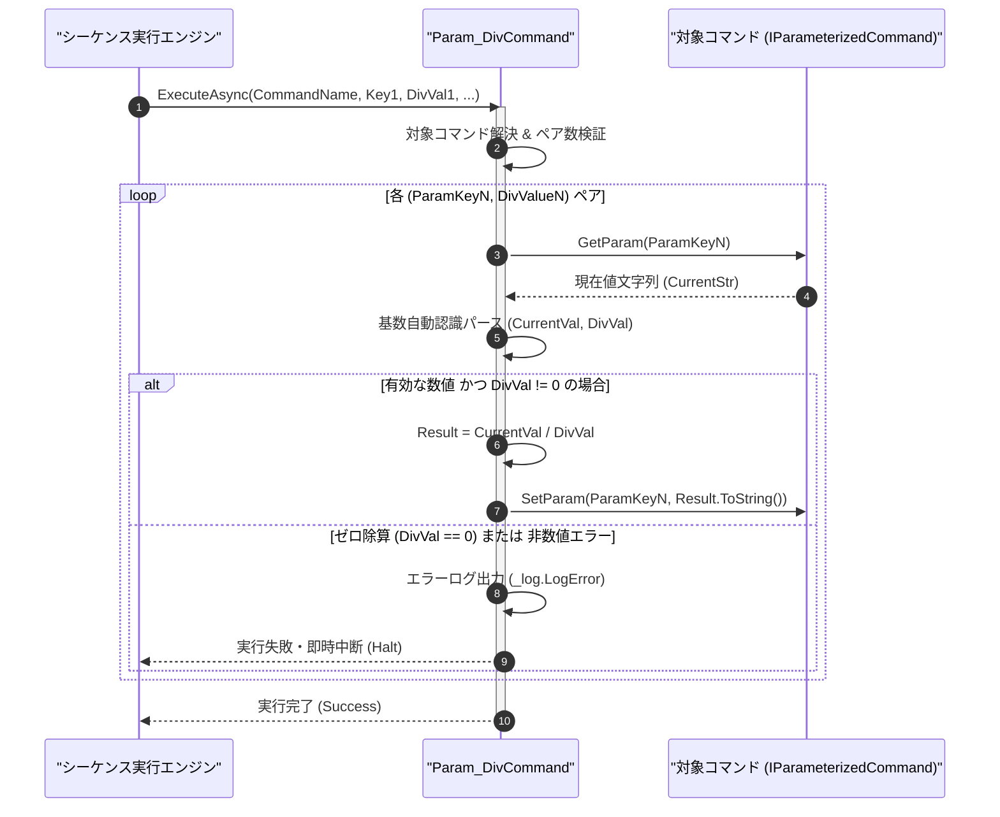

# コマンドリファレンス：Param_Div

## 概要

`Param_Div` は、指定されたコマンドのパラメータ値を数値で算術除算し、その計算結果でパラメータ値を更新する共通パラメータ・呼出・ループ制御系コマンドです。  
平均値の算出や単位スケーリング除算に使用され、ゼロ除算（`DivValue == 0`）に対する厳格な安全防御ガードを内包しています。

> 💡 **補足**  
> 本コマンドは 共通基盤コマンドです。

---

## 💡 書式・パラメータ仕様

### コマンド構文

```csv
,SEQUENCE, [ステップキー], Param_Div, "[対象コマンド名]", "[対象キー1]", "[除算値1]", "[対象キー2]", "[除算値2]"
```

### パラメータ（引数）一覧

| 引数位置 | 引数名 | 説明 | 指定方法 / 有効な入力値 |
| :--- | :--- | :--- | :--- |
| 引数1 | CommandName | 除算対象のパラメータを保持するマクロコマンド名（必須）。 | `COMMAND` で定義されたコマンド名（例: `"AVG_CALC"`）または `$PARAM$` 置換 |
| 引数2 | ParamKey1 | 第 1 ペアの除算対象パラメータキー名（必須）。 | 対象コマンド内の `PARAM` キー名（例: `"SUM_VAL"`, `"1"`） |
| 引数3 | DivValue1 | 第 1 ペアの除数（0 以外の数値・必須）。 | 数値リテラル（`"10"`, `"2.0"`, `"0x04"`）または `$PARAM$` 置換 |
| 引数4以降 | ParamKeyN, DivValueN | 第 2 ペア以降の `[対象キーN], [除算値N]` の組み合わせ（任意、可変長ペア）。 | 2 個 1 組のペア形式で任意個数まで連続指定可能 |

---

## 🔄 特殊置換規約・分岐規約の適用

本コマンドの引数における特殊記法および解釈ルールです。
* **動的置換（`$`）**: 引数内で `$PARAMキー$` のように記述すると、実行時に変数プール（PARAM）の値へ動的置換されます。（適用可能な引数: 全引数対応）
* **ジャンプ先指定（`#`）**: 本コマンドはジャンプ制御を行わないため適用されません。（適用可能な引数: 非適用）
* **共通コマンド指定（`@`）**: 引数 1 に対象コマンド名を指定する際、先頭に `@` を付与した場合は共通基盤（`GENERAL`）を対象とします。（適用可能な引数: 引数 1 `CommandName`）
* **カンマのエスケープ**: 引数文字列自体にカンマを含める場合は、必ず `","` と二重引用符で囲んで記述します。
* **エイリアス（別名）**: `ParamDiv`, `Div`, `Dev`, `PARAM_Div`

---

## 💡 動作例（正しい構文での記述例）

### スクリプト記述例

※COMMAND ブロック配下の子要素行（PARAM, SEQUENCE）は必ず行頭カンマから開始し、スペースインデントや行末コメント（`;`）は記述しないでください。

```csv
COMMAND, "AVERAGE_MEAS", "AVG_RESULT"
,PARAM, "SUM_VAL", Number, "合計値", "50.25"
,PARAM, "SAMPLE_CNT", Number, "サンプル数", "5"
,PARAM, "AVG_RESULT", Work, "平均値結果", "0"
; 合計値を AVG_RESULT にコピーし、サンプル数 SAMPLE_CNT (5) で除算して平均値を算出
,SEQUENCE, 010, Param_Set, "AVERAGE_MEAS", "$SUM_VAL$", "AVG_RESULT"
,SEQUENCE, 020, Param_Div, "AVERAGE_MEAS", "AVG_RESULT", "$SAMPLE_CNT$"
```

### 実行時の挙動・変数変化

* **実行前の状態**: `"SUM_VAL"` が `"50.25"`、`"SAMPLE_CNT"` が `"5"` の状態。
* **実行後の状態**: ステップ `020` の `Param_Div` 実行により、$50.25 \div 5 = 10.05$ が計算され、`"AVG_RESULT"` に `"10.05"` が格納されます。

---

## 🔄 動作フロー（シーケンス図）

本コマンド実行時における、シーケンス実行エンジン、コマンドクラス（`Param_DivCommand`）、および対象コマンドパラメータ辞書間のインタラクションを示すシーケンス図です。



---

## 🚫 エラーハンドリング・安全設計（仕様制限）

入力データの異常や実行時エラーに対し、解析・実行エンジンが実行するセーフティ規約です。

1. **ゼロ除算（`DivValue == 0`）の防止ガード**:
   - 除数 `<DivValue>` が `0`（または `0.0`、`0x00`）である場合、`DivideByZeroException` や `"Infinity"` 文字列の混入を防止するため事前判定でトラップし、エラーログ（`_log.LogError`）を記録して安全停止（Halt）します。
2. **非数値文字列・未定義キーの検証**:
   - 被除数・除数が数値に変換できない場合、または未定義のパラメータキーが指定された場合はエラーログを出力して即時中断します。

---

## 🧪 ユニットテスト仕様

本コマンドクラス（`Param_DivCommand.cs`）に実装されている `RunUnitTest()` メソッドが検証するユニットテストの仕様です。

### テスト実行前提条件

* **実行トリガー**: `RunUnitTest()` メソッドの呼び出し
* **有効化条件**: システム全体の最小ログレベル（`ErrorLogger.MinimumLevel`）が `LogLevel.Test` であること（それ以外の場合は無効化ガードにより早期リターン）
* **検証結果出力**: `_log.LogTest` によるログ出力。検証失敗時は `_log.LogError`、予期せぬ例外発生時は `_log.LogCritical` で記録。

### テストケース一覧

| No | テストカテゴリ | テスト条件（入力値） | 期待される結果（出力値） | 検証の目的 / 観点 |
| :---: | :--- | :--- | :--- | :--- |
| **1** | 正常系 | 通常除算（`"100" / "4"`, `"10.5" / "2"`） | それぞれ `"25"`, `"5.25"` に更新される | 整数・浮動小数点除算の基本動作検証 |
| **2** | 異常系 | ゼロ除算（`"100" / "0"`） | ゼロ除算エラーが記録され `Failure` で安全停止する | ゼロ除算防護ガードの検証 |
| **3** | 異常系 | 非数値文字列による除算（`"100" / "XYZ"`） | 型変換エラーが記録され `Failure` が返却される | 入力バリデーション検証 |

