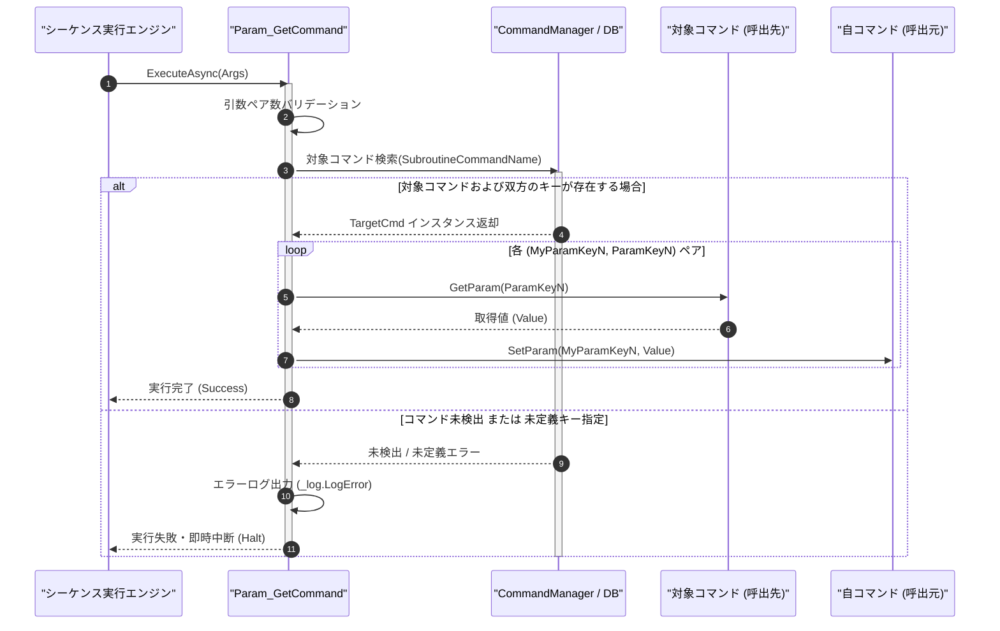

# コマンドリファレンス：Param_Get

## 概要

`Param_Get` は、サブルーチン呼出後（[`Call`](./Call.Md) 実行後）の後処理として、呼出先コマンドの指定パラメータ値を取得し、自コマンド（カレント）のパラメータキーへ回収・格納する共通パラメータ・呼出・ループ制御系コマンドです。  
第 2 引数以降に `"[自パラメータキー]", "[相手のパラメータキー]"` の 2 引数ペアを連続して指定でき、1 回のコマンド実行で複数の戻り値を一括回収することが可能です。サブルーチン呼出前に引数を渡す [`Param_Set`](./Param_Set.Md) と完全に対をなす対称構造を持ちます。

> 💡 **補足**  
> 本コマンドは 共通基盤コマンドです。Term 型の数値キー名（`"1"`, `"2"` 等）および GPIB 型の英字キー名（`"RESULT"`, `"STATUS"` 等）の双方を透過的に解決します。

---

## 💡 書式・パラメータ仕様

### コマンド構文

```csv
,SEQUENCE, [ステップキー], Param_Get, "[対象コマンド名]", "[自キー1]", "[相手キー1]", "[自キー2]", "[相手キー2]"
```

### パラメータ（引数）一覧

| 引数位置 | 引数名 | 説明 | 指定方法 / 有効な入力値 |
| :--- | :--- | :--- | :--- |
| 引数1 | SubroutineCommandName | 戻り値を取得する対象（呼出先）のマクロコマンド名（必須）。 | `COMMAND` で定義されたコマンド名（例: `"DCV_MEASURE"`）または `$PARAM$` 置換 |
| 引数2 | MyParamKey1 | 第 1 ペアの格納先となる自コマンド（カレント）のパラメータキー名（必須）。 | 自コマンド内の `PARAM` キー名（例: `"MEAS_RESULT"`, `"1"`） |
| 引数3 | ParamKey1 | 第 1 ペアの取得元となる相手コマンドのパラメータキー名（必須）。 | 対象コマンド内の `PARAM` キー名（例: `"RESULT_DATA"`, `"2"`） |
| 引数4以降 | MyParamKeyN, ParamKeyN | 第 2 ペア以降の `[自キーN], [相手キーN]` の組み合わせ（任意、可変長ペア）。 | 2 個 1 組のペア形式で任意個数まで連続指定可能 |

---

## 🔄 特殊置換規約・分岐規約の適用

本コマンドの引数における特殊記法および解釈ルールです。
* **動的置換（`$`）**: 引数内で `$PARAMキー$` のように記述すると、実行時に変数プール（PARAM）の値へ動的置換されます。（適用可能な引数: 全引数対応）
* **ジャンプ先指定（`#`）**: 本コマンドはジャンプ制御を行わないため適用されません。（適用可能な引数: 非適用）
* **共通コマンド指定（`@`）**: 引数 1 に対象コマンド名を指定する際、先頭に `@` を付与した場合は共通基盤（`GENERAL`）を対象とし、付与しない場合は現在の機器に対するマクロを対象とします。（適用可能な引数: 引数 1 `SubroutineCommandName`）
* **カンマのエスケープ**: 引数文字列自体にカンマを含める場合は、必ず `","` と二重引用符で囲んで記述します。
* **エイリアス（別名）**: `ParamGet`, `GetVar`, `GpibParamGet`, `Analysis_Term_PARAM_Get`（※内部では `FormatCommand` により `"PARAMGET"` として単一正規化解決）

---

## 💡 動作例（正しい構文での記述例）

### スクリプト記述例

※COMMAND ブロック配下の子要素行（PARAM, SEQUENCE）は必ず行頭カンマから開始し、スペースインデントや行末コメント（`;`）は記述しないでください。

```csv
COMMAND, "MAIN_SEQUENCE", "MEAS_VAL"
,PARAM, "MEAS_VAL", Work, "測定値格納用", ""
,PARAM, "MEAS_STAT", Work, "測定ステータス格納用", ""
; 1. サブルーチン "DCV_MEASURE" を呼び出し実行
,SEQUENCE, 010, Call, "DCV_MEASURE"
; 2. Call後処理："DCV_MEASURE" の "RESULT_DATA" と "STATUS_CODE" を自パラメータへ一括回収
,SEQUENCE, 020, Param_Get, "DCV_MEASURE", "MEAS_VAL", "RESULT_DATA", "MEAS_STAT", "STATUS_CODE"
```

### 実行時の挙動・変数変化

* **実行前の状態**: サブルーチン `"DCV_MEASURE"` の実行が完了し、`"DCV_MEASURE"` 内の `"RESULT_DATA"` に `"+5.0012E+00"`、`"STATUS_CODE"` に `"OK"` が格納されている状態。
* **実行後の状態**: ステップ `020` の `Param_Get` 実行により、自コマンド `"MAIN_SEQUENCE"` の `"MEAS_VAL"` に `"+5.0012E+00"`、`"MEAS_STAT"` に `"OK"` が一括回収されます。

---

## 🔄 動作フロー（シーケンス図）

本コマンド実行時における、シーケンス実行エンジン、コマンドクラス（`Param_GetCommand`）、およびコマンドデータベース間のインタラクションを示すシーケンス図です。



---

## 🚫 エラーハンドリング・安全設計（仕様制限）

入力データの異常や実行時エラーに対し、解析・実行エンジンが実行するセーフティ規約です。

1. **取得元または格納先のパラメータキー未定義**:
   - 呼出先コマンドの取得元キー、または自コマンドの格納先キーが `PARAM` で明示定義されていない場合、エラーログ（`_log.LogError`）を記録して直ちにシーケンス実行を安全停止（Halt）します。
2. **引数ペア数の不整合**:
   - 引数 2 以降が `[自キー], [相手キー]` の 2 個 1 組になっていない場合、構文エラーとして検出し安全に実行を中断します。

---

## 🧪 ユニットテスト仕様

本コマンドクラス（`Param_GetCommand.cs`）に実装されている `RunUnitTest()` メソッドが検証するユニットテストの仕様です。

### テスト実行前提条件

* **実行トリガー**: `RunUnitTest()` メソッドの呼び出し
* **有効化条件**: システム全体の最小ログレベル（`ErrorLogger.MinimumLevel`）が `LogLevel.Test` であること（それ以外の場合は無効化ガードにより早期リターン）
* **検証結果出力**: `_log.LogTest` によるログ出力。検証失敗時は `_log.LogError`、予期せぬ例外発生時は `_log.LogCritical` で記録。

### テストケース一覧

| No | テストカテゴリ | テスト条件（入力値） | 期待される結果（出力値） | 検証の目的 / 観点 |
| :---: | :--- | :--- | :--- | :--- |
| **1** | 正常系 | 単一ペア回収（`"SUB_CMD", "MY_RES", "SUB_RES"`） | `"SUB_CMD"` の `"SUB_RES"` 値が自コマンド `"MY_RES"` に格納され `Success` 返却 | 単一戻り値回収の基本動作検証 |
| **2** | 正常系 | 複数ペア一括回収（`"SUB_CMD", "MY_V1", "RES1", "MY_V2", "RES2"`） | 2 つのパラメータが同時に自コマンドへ複写される | 可変長ペアによる一括戻り値回収の検証 |
| **3** | 異常系 | 存在しない取得元キー（`"SUB_CMD", "MY_RES", "NO_SUCH_KEY"`） | エラーログが出力され `Failure`（即時中断）が返却される | 未定義キー参照時の安全停止検証 |

