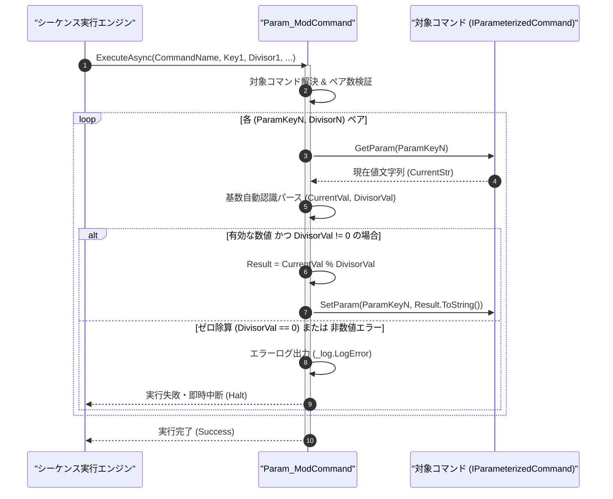

# コマンドリファレンス：Param_Mod

## 概要

`Param_Mod` は、指定されたコマンドのパラメータ値を除数（`<Divisor>`）で割った余り（剰余）を算出し、その結果でパラメータ値を更新する共通パラメータ・呼出・ループ制御系コマンドです。  
ループ内の周期処理判定（例: $N$ 回ごとにログ出力する等）やリングカウンタ計算に使用され、ゼロ除算防止ガードおよび統一フォーマット指定子（10 進・16 進・2 進）に対応しています。

> 💡 **補足**  
> 本コマンドは 共通基盤コマンドです。

---

## 💡 書式・パラメータ仕様

### コマンド構文

```csv
,SEQUENCE, [ステップキー], Param_Mod, "[対象コマンド名]", "[対象キー1]", "[除数1]", "[対象キー2]", "[除数2]"
```

### パラメータ（引数）一覧

| 引数位置 | 引数名 | 説明 | 指定方法 / 有効な入力値 |
| :--- | :--- | :--- | :--- |
| 引数1 | CommandName | 剰余計算対象のパラメータを保持するマクロコマンド名（必須）。 | `COMMAND` で定義されたコマンド名（例: `"MOD_CALC"`）または `$PARAM$` 置換 |
| 引数2 | ParamKey1 | 第 1 ペアの計算対象パラメータキー名（必須）。 | 対象コマンド内の `PARAM` キー名（例: `"MOD_VAL"`, `"1"`） |
| 引数3 | Divisor1 | 第 1 ペアの除数（0 以外の数値・必須）。 | 数値リテラル（`"10"`, `"0x10"`）または `$PARAM$` 置換 |
| 引数4以降 | ParamKeyN, DivisorN | 第 2 ペア以降の `[対象キーN], [除数N]` の組み合わせ（任意、可変長ペア）。 | 2 個 1 組のペア形式で任意個数まで連続指定可能 |

---

## 🔄 特殊置換規約・分岐規約の適用

本コマンドの引数における特殊記法および解釈ルールです。
* **動的置換（`$`）**: 引数内で `$PARAMキー$` のように記述すると、実行時に変数プール（PARAM）の値へ動的置換されます。（適用可能な引数: 全引数対応）
* **ジャンプ先指定（`#`）**: 本コマンドはジャンプ制御を行わないため適用されません。（適用可能な引数: 非適用）
* **共通コマンド指定（`@`）**: 引数 1 に対象コマンド名を指定する際、先頭に `@` を付与した場合は共通基盤（`GENERAL`）を対象とします。（適用可能な引数: 引数 1 `CommandName`）
* **カンマのエスケープ**: 引数文字列自体にカンマを含める場合は、必ず `","` と二重引用符で囲んで記述します。
* **エイリアス（別名）**: `ParamMod`, `Mod`, `PARAM_Mod`

---

## 💡 動作例（正しい構文での記述例）

### スクリプト記述例

※COMMAND ブロック配下の子要素行（PARAM, SEQUENCE）は必ず行頭カンマから開始し、スペースインデントや行末コメント（`;`）は記述しないでください。

```csv
COMMAND, "PERIODIC_CHECK", "REM_VAL"
,PARAM, "COUNTER", Number, "実行カウンタ", "17"
,PARAM, "REM_VAL", Work, "剰余結果", "0"
; COUNTER (17) を REM_VAL にコピーし、5 で割った余り (2) を算出
,SEQUENCE, 010, Param_Set, "PERIODIC_CHECK", "$COUNTER$", "REM_VAL"
,SEQUENCE, 020, Param_Mod, "PERIODIC_CHECK", "REM_VAL", "5"
```

### 実行時の挙動・変数変化

* **実行前の状態**: `"COUNTER"` が `"17"`、`"REM_VAL"` が `"0"` の状態。
* **実行後の状態**: ステップ `020` の `Param_Mod` 実行により、$17 \bmod 5 = 2$ が算出され、`"REM_VAL"` に `"2"` が格納されます。

---

## 🔄 動作フロー（シーケンス図）

本コマンド実行時における、シーケンス実行エンジン、コマンドクラス（`Param_ModCommand`）、および対象コマンドパラメータ辞書間のインタラクションを示すシーケンス図です。



---

## 🚫 エラーハンドリング・安全設計（仕様制限）

入力データの異常や実行時エラーに対し、解析・実行エンジンが実行するセーフティ規約です。

1. **ゼロ除数（`Divisor == 0`）指定時の安全防護**:
   - 除数 `<Divisor>` に `0` が指定された場合、`NaN` の発生や未処理例外を防止するためエラーログ（`_log.LogError`）を記録して直ちにシーケンスを安全停止（Halt）します。
2. **非数値文字列・未定義キーの検証**:
   - 数値として解釈できない文字列や未定義のパラメータキーが指定された場合、エラーログを記録して即時中断します。

---

## 🧪 ユニットテスト仕様

本コマンドクラス（`Param_ModCommand.cs`）に実装されている `RunUnitTest()` メソッドが検証するユニットテストの仕様です。

### テスト実行前提条件

* **実行トリガー**: `RunUnitTest()` メソッドの呼び出し
* **有効化条件**: システム全体の最小ログレベル（`ErrorLogger.MinimumLevel`）が `LogLevel.Test` であること（それ以外の場合は無効化ガードにより早期リターン）
* **検証結果出力**: `_log.LogTest` によるログ出力。検証失敗時は `_log.LogError`、予期せぬ例外発生時は `_log.LogCritical` で記録。

### テストケース一覧

| No | テストカテゴリ | テスト条件（入力値） | 期待される結果（出力値） | 検証の目的 / 観点 |
| :---: | :--- | :--- | :--- | :--- |
| **1** | 正常系 | 整数剰余計算（`"17" % "5"`） | `"2"` に更新される | 剰余演算の基本動作検証 |
| **2** | 正常系 | 16進フォーマット指定（`"0x1F" % "0x10"`） | `"15"` に更新される | 統一フォーマット指定子（基数自動認識）の検証 |
| **3** | 異常系 | 除数に `"0"` を指定（`"17" % "0"`） | ゼロ除算エラーが出力され `Failure` で安全停止する | ゼロ除数ガードの検証 |

