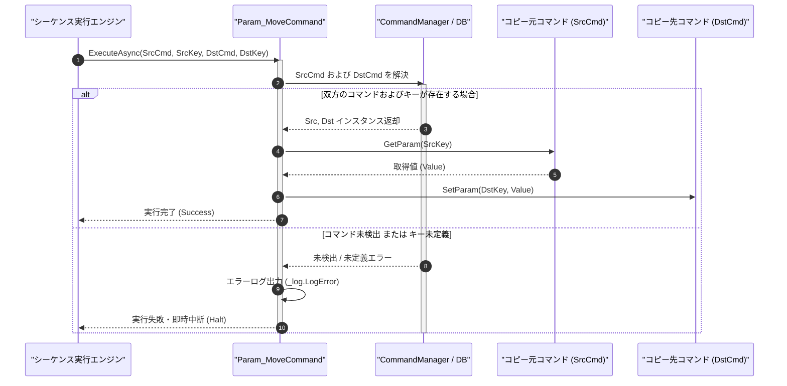

# コマンドリファレンス：Param_Move

## 概要

`Param_Move` は、コピー元コマンド（`<SrcCmd>`）の指定パラメータキー（`<SrcKey>`）の現在値を、コピー先コマンド（`<DstCmd>`）の指定パラメータキー（`<DstKey>`）へ直接転送・複写する共通パラメータ・呼出・ループ制御系コマンドです。  
自コマンドを経由せずに別コマンド間で直接データを橋渡ししたい場合や、同一コマンド内の別パラメータへ値をバックアップ複写したい場合に使用します。

> 💡 **補足**  
> 本コマンドは 共通基盤コマンドです。Term 型の数値キー名および GPIB 型の英字キー名の双方に対応しています。

---

## 💡 書式・パラメータ仕様

### コマンド構文

```csv
,SEQUENCE, [ステップキー], Param_Move, "[コピー元コマンド名]", "[コピー元キー]", "[コピー先コマンド名]", "[コピー先キー]"
```

### パラメータ（引数）一覧

| 引数位置 | 引数名 | 説明 | 指定方法 / 有効な入力値 |
| :--- | :--- | :--- | :--- |
| 引数1 | SrcCmd | コピー元となるマクロコマンド名（必須）。 | `COMMAND` で定義されたコマンド名（例: `"READ_DMM"`）または `$PARAM$` 置換 |
| 引数2 | SrcKey | コピー元コマンド内の取得対象パラメータキー名（必須）。 | コピー元コマンドの `PARAM` キー名（例: `"MEAS_OUT"`, `"1"`） |
| 引数3 | DstCmd | コピー先となるマクロコマンド名（必須）。 | `COMMAND` で定義されたコマンド名（例: `"WRITE_REPORT"`）または `$PARAM$` 置換 |
| 引数4 | DstKey | コピー先コマンド内の格納対象パラメータキー名（必須）。 | コピー先コマンドの `PARAM` キー名（例: `"INPUT_DATA"`, `"2"`） |

---

## 🔄 特殊置換規約・分岐規約の適用

本コマンドの引数における特殊記法および解釈ルールです。
* **動的置換（`$`）**: 引数内で `$PARAMキー$` のように記述すると、実行時に変数プール（PARAM）の値へ動的置換されます。（適用可能な引数: 全引数対応）
* **ジャンプ先指定（`#`）**: 本コマンドはジャンプ制御を行わないため適用されません。（適用可能な引数: 非適用）
* **共通コマンド指定（`@`）**: 引数 1（`SrcCmd`）または引数 3（`DstCmd`）の先頭に `@` を付与した場合、共通基盤（`GENERAL`）のコマンドを対象として解決します。（適用可能な引数: 引数 1 `SrcCmd`、引数 3 `DstCmd`）
* **カンマのエスケープ**: 引数文字列自体にカンマを含める場合は、必ず `","` と二重引用符で囲んで記述します。
* **エイリアス（別名）**: `ParamMove`, `MoveVar`, `CopyVar`, `GpibParamMove`, `Analysis_Term_PARAM_Move`

---

## 💡 動作例（正しい構文での記述例）

### スクリプト記述例

※COMMAND ブロック配下の子要素行（PARAM, SEQUENCE）は必ず行頭カンマから開始し、スペースインデントや行末コメント（`;`）は記述しないでください。

```csv
COMMAND, "BRIDGE_CONTROLLER", "STATUS"
,PARAM, "STATUS", Work, "実行状態", "OK"
; 1. 測定コマンド "DMM_MEAS" を実行
,SEQUENCE, 010, Call, "DMM_MEAS"
; 2. "DMM_MEAS" の結果 "RAW_VAL" を 判定コマンド "LIMIT_CHECK" の "TARGET_VAL" へ直接転送
,SEQUENCE, 020, Param_Move, "DMM_MEAS", "RAW_VAL", "LIMIT_CHECK", "TARGET_VAL"
; 3. 判定コマンド "LIMIT_CHECK" を実行
,SEQUENCE, 030, Call, "LIMIT_CHECK"
```

### 実行時の挙動・変数変化

* **実行前の状態**: `"DMM_MEAS"` の `"RAW_VAL"` に `"4.998"` が格納されており、`"LIMIT_CHECK"` の `"TARGET_VAL"` が `"0.0"` の状態。
* **実行後の状態**: ステップ `020` の `Param_Move` 実行により、`"DMM_MEAS"` の `"RAW_VAL"` の値（`"4.998"`）は保持されたまま、`"LIMIT_CHECK"` の `"TARGET_VAL"` に `"4.998"` が複写されます。

---

## 🔄 動作フロー（シーケンス図）

本コマンド実行時における、シーケンス実行エンジン、コマンドクラス（`Param_MoveCommand`）、およびコピー元・コピー先コマンド間のインタラクションを示すシーケンス図です。



---

## 🚫 エラーハンドリング・安全設計（仕様制限）

入力データの異常や実行時エラーに対し、解析・実行エンジンが実行するセーフティ規約です。

1. **コピー元またはコピー先のコマンド／パラメータキー未定義**:
   - 指定された `SrcCmd`/`SrcKey` または `DstCmd`/`DstKey` のいずれかが存在しない場合、暗黙の生成は行わずエラーログ（`_log.LogError`）を記録して直ちに安全停止（Halt）します。
2. **必須引数（4 引数）の不足**:
   - 引数が 4 個未満の場合は構文エラーとして検出し、不正な転送を防止して停止します。

---

## 🧪 ユニットテスト仕様

本コマンドクラス（`Param_MoveCommand.cs`）に実装されている `RunUnitTest()` メソッドが検証するユニットテストの仕様です。

### テスト実行前提条件

* **実行トリガー**: `RunUnitTest()` メソッドの呼び出し
* **有効化条件**: システム全体の最小ログレベル（`ErrorLogger.MinimumLevel`）が `LogLevel.Test` であること（それ以外の場合は無効化ガードにより早期リターン）
* **検証結果出力**: `_log.LogTest` によるログ出力。検証失敗時は `_log.LogError`、予期せぬ例外発生時は `_log.LogCritical` で記録。

### テストケース一覧

| No | テストカテゴリ | テスト条件（入力値） | 期待される結果（出力値） | 検証の目的 / 観点 |
| :---: | :--- | :--- | :--- | :--- |
| **1** | 正常系 | 異コマンド間転送（`"CMD_A", "K1", "CMD_B", "K2"`） | `"CMD_A"` の `"K1"` 値が `"CMD_B"` の `"K2"` に複写され `Success` 返却 | コマンド間パラメータ直接転送の検証 |
| **2** | 正常系 | 同一コマンド内別キー複写（`"CMD_A", "K1", "CMD_A", "K2"`） | 同一コマンド内の `"K1"` から `"K2"` へ値が複写される | 同一コマンド内バックアップ複写の検証 |
| **3** | 異常系 | 存在しないコピー先キー指定（`"CMD_A", "K1", "CMD_B", "NO_KEY"`） | エラーログが出力され `Failure` で安全停止する | 未定義キー保護ガードの検証 |

