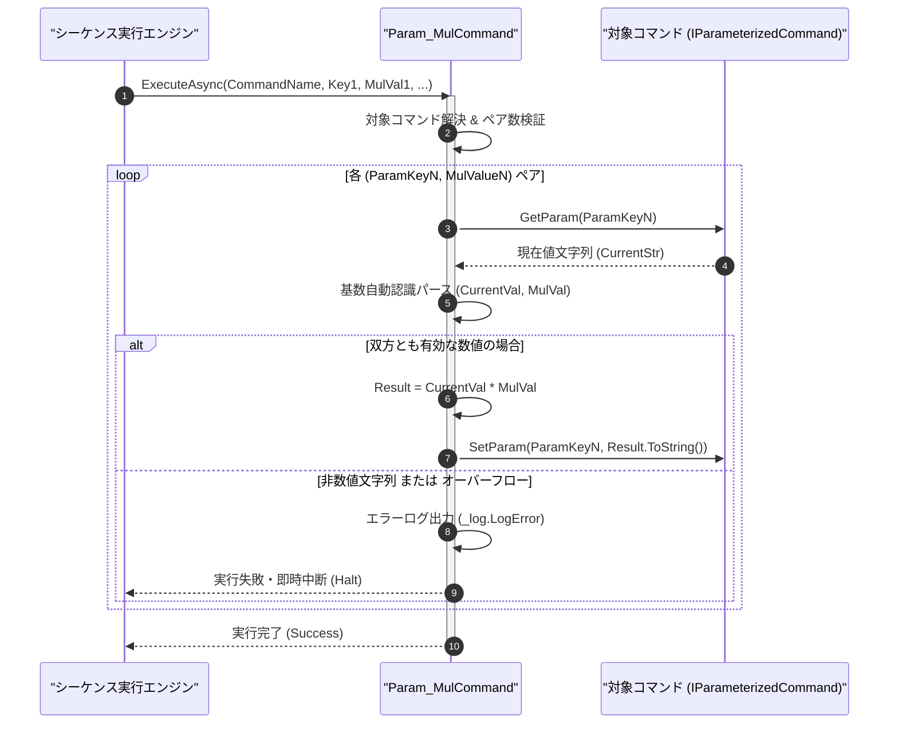

# コマンドリファレンス：Param_Mul

## 概要

`Param_Mul` は、指定されたコマンドのパラメータ値に対して数値を算術乗算し、その計算結果でパラメータ値を更新する共通パラメータ・呼出・ループ制御系コマンドです。  
単位換算（例: V から mV への `1000` 倍換算）やスケーリング係数乗算などに使用され、複数ペアの一括指定および統一フォーマット指定子（10 進・16 進・2 進）に対応しています。

> 💡 **補足**  
> 本コマンドは 共通基盤コマンドです。

---

## 💡 書式・パラメータ仕様

### コマンド構文

```csv
,SEQUENCE, [ステップキー], Param_Mul, "[対象コマンド名]", "[対象キー1]", "[乗算値1]", "[対象キー2]", "[乗算値2]"
```

### パラメータ（引数）一覧

| 引数位置 | 引数名 | 説明 | 指定方法 / 有効な入力値 |
| :--- | :--- | :--- | :--- |
| 引数1 | CommandName | 乗算対象のパラメータを保持するマクロコマンド名（必須）。 | `COMMAND` で定義されたコマンド名（例: `"SCALE_CALC"`）または `$PARAM$` 置換 |
| 引数2 | ParamKey1 | 第 1 ペアの乗算対象パラメータキー名（必須）。 | 対象コマンド内の `PARAM` キー名（例: `"MEAS_VAL"`, `"1"`） |
| 引数3 | MulValue1 | 第 1 ペアの乗算する数値（必須）。 | 数値リテラル（`"1000"`, `"0.001"`, `"0x02"`）または `$PARAM$` 置換 |
| 引数4以降 | ParamKeyN, MulValueN | 第 2 ペア以降の `[対象キーN], [乗算値N]` の組み合わせ（任意、可変長ペア）。 | 2 個 1 組のペア形式で任意個数まで連続指定可能 |

---

## 🔄 特殊置換規約・分岐規約の適用

本コマンドの引数における特殊記法および解釈ルールです。
* **動的置換（`$`）**: 引数内で `$PARAMキー$` のように記述すると、実行時に変数プール（PARAM）の値へ動的置換されます。（適用可能な引数: 全引数対応）
* **ジャンプ先指定（`#`）**: 本コマンドはジャンプ制御を行わないため適用されません。（適用可能な引数: 非適用）
* **共通コマンド指定（`@`）**: 引数 1 に対象コマンド名を指定する際、先頭に `@` を付与した場合は共通基盤（`GENERAL`）を対象とします。（適用可能な引数: 引数 1 `CommandName`）
* **カンマのエスケープ**: 引数文字列自体にカンマを含める場合は、必ず `","` と二重引用符で囲んで記述します。
* **エイリアス（別名）**: `ParamMul`, `Mul`, `PARAM_Mul`

---

## 💡 動作例（正しい構文での記述例）

### スクリプト記述例

※COMMAND ブロック配下の子要素行（PARAM, SEQUENCE）は必ず行頭カンマから開始し、スペースインデントや行末コメント（`;`）は記述しないでください。

```csv
COMMAND, "POWER_CALC", "POWER_MW"
,PARAM, "VOLT_V", Number, "電圧(V)", "5.0"
,PARAM, "CURR_A", Number, "電流(A)", "0.2"
,PARAM, "POWER_MW", Work, "電力(mW)", "0"
; 1. VOLT_V を POWER_MW にセット
,SEQUENCE, 010, Param_Set, "POWER_CALC", "$VOLT_V$", "POWER_MW"
; 2. 電流 CURR_A (0.2) と mW換算係数 (1000) を順番に乗算
,SEQUENCE, 020, Param_Mul, "POWER_CALC", "POWER_MW", "$CURR_A$", "POWER_MW", "1000"
```

### 実行時の挙動・変数変化

* **実行前の状態**: `"VOLT_V"` が `"5.0"`、`"CURR_A"` が `"0.2"`、`"POWER_MW"` が `"0"` の状態。
* **実行後の状態**: ステップ `010` で `"POWER_MW"` が `"5.0"` となり、ステップ `020` の `Param_Mul` により $5.0 \times 0.2 \times 1000 = 1000$ が計算され、`"POWER_MW"` に `"1000"` が格納されます。

---

## 🔄 動作フロー（シーケンス図）

本コマンド実行時における、シーケンス実行エンジン、コマンドクラス（`Param_MulCommand`）、および対象コマンドパラメータ辞書間のインタラクションを示すシーケンス図です。



---

## 🚫 エラーハンドリング・安全設計（仕様制限）

入力データの異常や実行時エラーに対し、解析・実行エンジンが実行するセーフティ規約です。

1. **非数値文字列に対する乗算試行**:
   - 対象パラメータの現在値または `<MulValue>` が数値として解析できない場合、エラーログ（`_log.LogError`）を記録して直ちにシーケンスを安全停止（Halt）します。
2. **数値オーバーフロー（`Infinity` / `NaN`）の検出**:
   - 乗算結果が倍精度浮動小数点数の表現範囲を超えた場合（`double.IsInfinity` / `double.IsNaN`）、異常値伝播を防ぐためエラー停止します。

---

## 🧪 ユニットテスト仕様

本コマンドクラス（`Param_MulCommand.cs`）に実装されている `RunUnitTest()` メソッドが検証するユニットテストの仕様です。

### テスト実行前提条件

* **実行トリガー**: `RunUnitTest()` メソッドの呼び出し
* **有効化条件**: システム全体の最小ログレベル（`ErrorLogger.MinimumLevel`）が `LogLevel.Test` であること（それ以外の場合は無効化ガードにより早期リターン）
* **検証結果出力**: `_log.LogTest` によるログ出力。検証失敗時は `_log.LogError`、予期せぬ例外発生時は `_log.LogCritical` で記録。

### テストケース一覧

| No | テストカテゴリ | テスト条件（入力値） | 期待される結果（出力値） | 検証の目的 / 観点 |
| :---: | :--- | :--- | :--- | :--- |
| **1** | 正常系 | 整数および小数の乗算（`"12" * "3"`, `"2.5" * "0.4"`） | それぞれ `"36"`, `"1"` に更新される | 乗算演算の基本動作検証 |
| **2** | 正常系 | 16進フォーマット指定（`"5" * "0x10"`） | `"80"` に更新される | 統一フォーマット指定子（基数自動認識）の検証 |
| **3** | 異常系 | 非数値文字列（`"ERR"`）に対する乗算 | エラーログが出力され `Failure` で安全停止する | 数値変換異常時のクラッシュ防御検証 |

