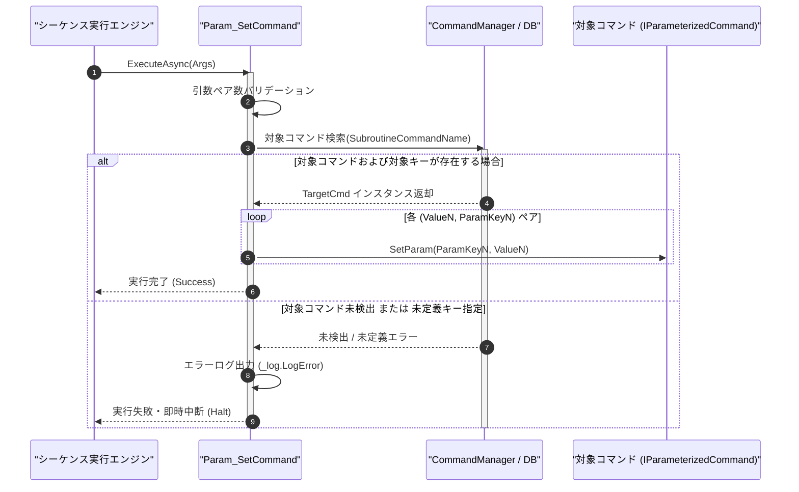

# コマンドリファレンス：Param_Set

## 概要

`Param_Set` は、サブルーチン呼出前（[`Call`](./Call.Md) 実行前）の前処理として、呼出先コマンドの指定パラメータキーへ入力引数値を代入する共通パラメータ・呼出・ループ制御系コマンドです。  
第 2 引数以降に `"[設定値または自パラメータキー]", "[相手のパラメータキー]"` の 2 引数ペアを連続して指定でき、1 回のコマンド実行で複数のパラメータへ一括代入することが可能です。サブルーチン呼出後に戻り値を回収する [`Param_Get`](./Param_Get.Md) と完全に対をなす対称構造を持ちます。

> 💡 **補足**  
> 本コマンドは 共通基盤コマンドです。引数解析パイプライン（`CommandParameterPipeline`）により、Term 型の数値キー名（`"1"`, `"2"` 等）および GPIB 型の英字キー名（`"RANGE"`, `"COUNT"` 等）の双方を単一の `string Key` として透過解決します。

---

## 💡 書式・パラメータ仕様

### コマンド構文

```csv
,SEQUENCE, [ステップキー], Param_Set, "[対象コマンド名]", "[設定値1 / 自キー1]", "[相手キー1]", "[設定値2 / 自キー2]", "[相手キー2]"
```

### パラメータ（引数）一覧

| 引数位置 | 引数名 | 説明 | 指定方法 / 有効な入力値 |
| :--- | :--- | :--- | :--- |
| 引数1 | SubroutineCommandName | パラメータを代入する対象（呼出先）のマクロコマンド名（必須）。 | `COMMAND` で定義されたコマンド名（例: `"DCV_MEASURE"`）または `$PARAM$` 置換 |
| 引数2 | Value1 / MyParamKey1 | 第 1 ペアの渡す値（リテラル文字列・数値）または自コマンドのパラメータキー（必須）。 | 固定値（例: `"10V"`）または `$PARAM$` 置換（例: `"$MY_RANGE$"`） |
| 引数3 | ParamKey1 | 第 1 ペアの代入先となる相手コマンドのパラメータキー名（必須）。 | 対象コマンド内の `PARAM` キー名（例: `"RANGE"`, `"1"`） |
| 引数4以降 | ValueN, ParamKeyN | 第 2 ペア以降の `[設定値N], [相手キーN]` の組み合わせ（任意、可変長ペア）。 | 2 個 1 組のペア形式で任意個数まで連続指定可能 |

---

## 🔄 特殊置換規約・分岐規約の適用

本コマンドの引数における特殊記法および解釈ルールです。
* **動的置換（`$`）**: 引数内で `$PARAMキー$` のように記述すると、実行時に自コマンドの変数プール（PARAM）の値へ動的置換されます。（適用可能な引数: 全引数対応）
* **ジャンプ先指定（`#`）**: 本コマンドはジャンプ制御を行わないため適用されません。（適用可能な引数: 非適用）
* **共通コマンド指定（`@`）**: 引数 1 に対象コマンド名を指定する際、先頭に `@` を付与した場合は共通基盤（`GENERAL`）を対象とし、付与しない場合は現在の機器に対するマクロを対象とします。（適用可能な引数: 引数 1 `SubroutineCommandName`）
* **カンマのエスケープ**: 設定値にカンマ（`,`）を含める場合は、必ず `","` のように二重引用符で囲んで記述します。
* **エイリアス（別名）**: `ParamSet`, `SetVar`, `Let`, `GpibParamSet`, `Analysis_Term_PARAM_Set`（※内部では `FormatCommand` により `"PARAMSET"` として単一正規化解決）

---

## 💡 動作例（正しい構文での記述例）

### スクリプト記述例

※COMMAND ブロック配下の子要素行（PARAM, SEQUENCE）は必ず行頭カンマから開始し、スペースインデントや行末コメント（`;`）は記述しないでください。

```csv
COMMAND, "MAIN_SEQUENCE", "MEAS_RESULT"
,PARAM, "MEAS_RANGE", Text, "測定レンジ設定", "10V"
,PARAM, "MEAS_RESULT", Work, "測定結果格納用", ""
; 1. Call前処理：サブルーチン "DCV_MEASURE" の "RANGE" と "COUNT" に引数を一括セット
,SEQUENCE, 010, Param_Set, "DCV_MEASURE", "$MEAS_RANGE$", "RANGE", "5", "COUNT"
; 2. サブルーチン呼出実行
,SEQUENCE, 020, Call, "DCV_MEASURE"
; 3. Call後処理：サブルーチン "DCV_MEASURE" の "RESULT_DATA" を自パラメータへ回収
,SEQUENCE, 030, Param_Get, "DCV_MEASURE", "MEAS_RESULT", "RESULT_DATA"
```

### 実行時の挙動・変数変化

* **実行前の状態**: 自コマンド `"MAIN_SEQUENCE"` の `"MEAS_RANGE"` が `"10V"` であり、呼出先 `"DCV_MEASURE"` の `"RANGE"` が `"AUTO"`、`"COUNT"` が `"1"` である状態。
* **実行後の状態**: ステップ `010` の `Param_Set` 実行により、`"DCV_MEASURE"` 側のパラメータ `"RANGE"` が `"10V"`、`"COUNT"` が `"5"` に一括更新され、直後の `Call` 実行に引き継がれます。

---

## 🔄 動作フロー（シーケンス図）

本コマンド実行時における、シーケンス実行エンジン、コマンドクラス（`Param_SetCommand`）、およびコマンドデータベース（`IParameterizedCommand`）間のインタラクションを示すシーケンス図です。



---

## 🚫 エラーハンドリング・安全設計（仕様制限）

入力データの異常や実行時エラーに対し、解析・実行エンジンが実行するセーフティ規約です。

1. **未定義のコマンド名または未定義パラメータキーの指定**:
   - 暗黙の変数生成は一切行わず、未定義エラーとして `_log.LogError` に詳細を記録し、直ちにシーケンス実行を安全停止（Halt）します。
2. **引数ペア数の不整合（奇数個の指定など）**:
   - 引数 2 以降が `[設定値], [相手キー]` の 2 個 1 組になっていない場合、構文エラーとして検出し、不正なメモリ書き換えを防止して中断します。

---

## 🧪 ユニットテスト仕様

本コマンドクラス（`Param_SetCommand.cs`）に実装されている `RunUnitTest()` メソッドが検証するユニットテストの仕様です。

### テスト実行前提条件

* **実行トリガー**: `RunUnitTest()` メソッドの呼び出し
* **有効化条件**: システム全体の最小ログレベル（`ErrorLogger.MinimumLevel`）が `LogLevel.Test` であること（それ以外の場合は無効化ガードにより早期リターン）
* **検証結果出力**: `_log.LogTest` によるログ出力。検証失敗時は `_log.LogError`、予期せぬ例外発生時は `_log.LogCritical` で記録。

### テストケース一覧

| No | テストカテゴリ | テスト条件（入力値） | 期待される結果（出力値） | 検証の目的 / 観点 |
| :---: | :--- | :--- | :--- | :--- |
| **1** | 正常系 | 単一ペア指定（`"SUB_CMD", "100", "RANGE"`） | `"SUB_CMD"` の `"RANGE"` が `"100"` に更新され `Success` 返却 | 単一パラメータ代入の基本動作検証 |
| **2** | 正常系 | 複数ペア一括指定（`"SUB_CMD", "10V", "RANGE", "5", "1"`） | 英字キー `"RANGE"` と数値キー `"1"` の双方が一括更新される | 可変長ペア一括代入および数値/英字キー透過解決の検証 |
| **3** | 異常系 | 存在しないパラメータキー（`"SUB_CMD", "100", "UNDEFINED_KEY"`） | エラーログが出力され `Failure`（即時中断）が返却される | 未定義キーアクセス禁止とクラッシュ防止の検証 |

