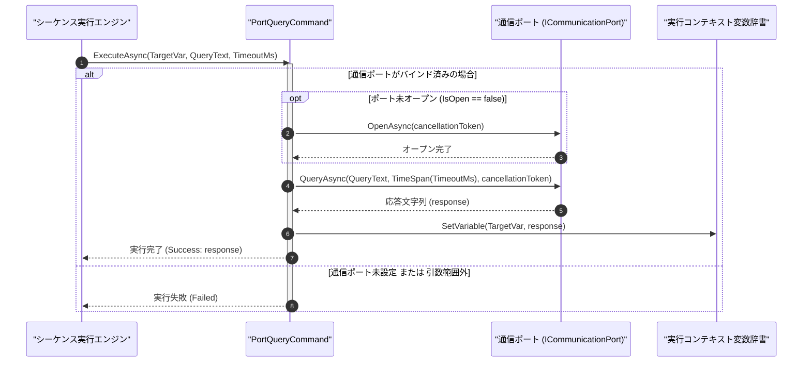

# コマンドリファレンス：PortQuery

## 概要

`PortQuery` は、共通通信ポート（`ICommunicationPort`）に対してクエリ文字列の送信と応答文字列の受信を 1 命令で連続実行し、取得した応答を指定変数（`TargetVar`）へ格納する透過ポート通信制御系コマンドです。  
SCPI クエリ（`*IDN?`, `MEAS?` 等）や機器ステータス照会など、送信と受信が対になるトランザクション処理で使用します。

> 💡 **補足**  
> 第 3 引数 `TimeoutMs` を省略した場合は既定値 `5000` ミリ秒（有効範囲: `10` 〜 `120000` ミリ秒）で応答を待機します。

---

## 💡 書式・パラメータ仕様

### コマンド構文

```csv
,SEQUENCE, [ステップキー], PortQuery, "[格納先変数名(TargetVar)]", "[クエリ文字列(QueryText)]", "[タイムアウトms(TimeoutMs)]"
```

### パラメータ（引数）一覧

| 引数位置 | 引数名 | 説明 | 指定方法 / 有効な入力値 |
| :--- | :--- | :--- | :--- |
| 引数1 | `TargetVar` | 受信した応答データを格納する変数名（必須）。 | 変数識別子（例: `"QueryVar"`, `"DEV_ID"`。前後の `$` 記号は自動除去され変数名として解釈、動的値置換は非適用） |
| 引数2 | `QueryText` | 送信するクエリコマンド文字列（必須）。 | クエリ文字列（例: `"*IDN?"`, `"READ?"`）または `$PARAM$` 置換 |
| 引数3 | `TimeoutMs` | 応答受信タイムアウト時間［ミリ秒］（任意・省略時既定値: `5000`）。 | `10` 〜 `120000` の整数または `$PARAM$` 置換 |

---

## 🔄 特殊置換規約・分岐規約の適用

本コマンドの引数における特殊記法および解釈ルールです。
* **動的置換（`$`）**: 引数 2（`QueryText`）および引数 3（`TimeoutMs`）内で `$PARAMキー$` のように記述すると、実行時に変数プール（PARAM）の値へ動的置換されます。なお、引数 1（`TargetVar`）は格納先変数名そのものを指定する引数であり、`CleanParamKey` により前後の `$` 記号が自動除去されて変数名として扱われます（間接値置換は行われません）。（適用可能な引数: 引数 2 `QueryText`、引数 3 `TimeoutMs`）
* **ジャンプ先指定（`#`）**: 本コマンドはジャンプ制御を行わないため適用されません。（適用可能な引数: 非適用）
* **共通コマンド指定（`@`）**: 本コマンドは外部マクロを呼び出さないため適用されません。（適用可能な引数: 非適用）
* **カンマのエスケープ**: 引数文字列自体にカンマを含める場合は、必ず `","` と二重引用符で囲んで記述します。
* **エイリアス（別名）**: `Port.Query`, `Query`

---

## 💡 動作例（正しい構文での記述例）

### スクリプト記述例

※COMMAND ブロック配下の子要素行（PARAM, SEQUENCE）は必ず行頭カンマから開始し、スペースインデントや行末コメント（`;`）は記述しないでください。

```csv
COMMAND, "CHECK_DEVICE_ID", "DEV_INFO"
,PARAM, "DEV_INFO", Work, "機器ID情報", ""
; *IDN? クエリを送信し、1000ms タイムアウトで応答を DEV_INFO に取得
,SEQUENCE, 010, PortQuery, "DEV_INFO", "*IDN?", 1000
,SEQUENCE, 020, Exit
```

### 実行時の挙動・変数変化

* **実行前の状態**: `"DEV_INFO"` が空文字列 `""` で、通信ポートがバインドされている状態。
* **実行後の状態**: ステップ `010` により `"*IDN?"` が送信され、返却された機器識別文字列（例: `"MONACA,DMM-01,1.00"`）が `"DEV_INFO"` に格納されます。

---

## 🔄 動作フロー（シーケンス図）

本コマンド実行時における、シーケンス実行エンジン、`PortQueryCommand`、および `ICommunicationPort` 間のインタラクションを示すシーケンス図です。



---

## 🚫 エラーハンドリング・安全設計（仕様制限）

入力データの異常や実行時エラーに対し、解析・実行エンジンが実行するセーフティ規約です。

1. **クエリ引数およびタイムアウト範囲の厳格検証**:
   - `TargetVar` または `QueryText` の欠落、ならびに `TimeoutMs` の範囲外指定（`10` 〜 `120000` ms 以外）は実行前に `CommandParameterPipeline` が検出し安全に停止します。
2. **ポート未設定時の安全なエラー返却**:
   - 通信ポートインスタンスが存在しない場合は例外クラッシュさせず `AnalysisResult.Failed` を返却します。

---

## 🧪 ユニットテスト仕様

本コマンドクラス（`PortSendCommand.cs` 内 `PortQueryCommand`）に実装されている `RunUnitTest()` メソッドが検証するユニットテストの仕様です。

### テスト実行前提条件

* **実行トリガー**: `RunUnitTest()` メソッドの呼び出し
* **有効化条件**: システム全体の最小ログレベル（`ErrorLogger.MinimumLevel`）が `LogLevel.Test` であること（それ以外の場合は無効化ガードにより早期リターン）
* **検証結果出力**: `_log.LogTest` によるログ出力。検証失敗時は `_log.LogError`、予期せぬ例外発生時は `_log.LogCritical` で記録。

### テストケース一覧

| No | テストカテゴリ | テスト条件（入力値） | 期待される結果（出力値） | 検証の目的 / 観点 |
| :---: | :--- | :--- | :--- | :--- |
| **1** | 正常系 | モック応答 `"QUERY_REPLY"`、引数 `("QueryVar", "*IDN?", "100")` | `LastSentData == "*IDN?"` かつ `"QueryVar" == "QUERY_REPLY"` | クエリ送受信と変数格納の一貫性検証 |
| **2** | 異常系 | 必須引数欠落または通信ポート未設定状態での実行 | パイプライン検証エラーまたは `AnalysisResult.Failed` を返却 | 異常入力・未接続時のセーフティ検証 |

