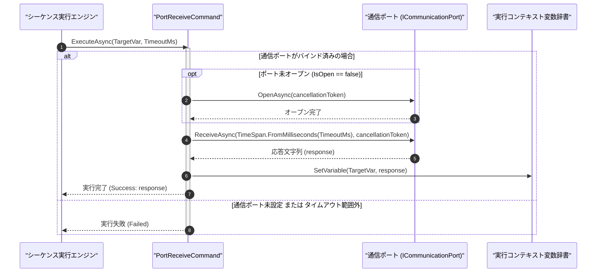

# コマンドリファレンス：PortReceive

## 概要

`PortReceive` は、共通通信ポート（`ICommunicationPort`）からタイムアウト監視付きで応答文字列を非同期受信し、指定された変数（`TargetVar`）へ格納する透過ポート通信制御系コマンドです。  
`PortSend` や `SendCR` の後に続けて呼び出し、外部機器からの測定値やステータス応答を取得する際に使用します。

> 💡 **補足**  
> 第 2 引数 `TimeoutMs` を省略した場合は既定値 `5000` ミリ秒（有効範囲: `10` 〜 `120000` ミリ秒）が適用されます。

---

## 💡 書式・パラメータ仕様

### コマンド構文

```csv
,SEQUENCE, [ステップキー], PortReceive, "[格納先変数名(TargetVar)]", "[タイムアウトms(TimeoutMs)]"
```

### パラメータ（引数）一覧

| 引数位置 | 引数名 | 説明 | 指定方法 / 有効な入力値 |
| :--- | :--- | :--- | :--- |
| 引数1 | `TargetVar` | 受信した文字列データを格納する変数名（必須）。 | 変数識別子（例: `"ReceivedVar"`, `"MEAS_VAL"`。前後の `$` 記号は自動除去され変数名として解釈、動的値置換は非適用） |
| 引数2 | `TimeoutMs` | 受信待機タイムアウト時間［ミリ秒］（任意・省略時既定値: `5000`）。 | `10` 〜 `120000` の整数または `$PARAM$` 置換 |

---

## 🔄 特殊置換規約・分岐規約の適用

本コマンドの引数における特殊記法および解釈ルールです。
* **動的置換（`$`）**: 引数 2（`TimeoutMs`）内で `$PARAMキー$` のように記述すると、実行時に変数プール（PARAM）の値へ動的置換されます。なお、引数 1（`TargetVar`）は格納先変数名そのものを指定する引数であり、`CleanParamKey` により前後の `$` 記号が自動除去されて変数名として扱われます（間接値置換は行われません）。（適用可能な引数: 引数 2 `TimeoutMs`）
* **ジャンプ先指定（`#`）**: 本コマンドはジャンプ制御を行わないため適用されません。（適用可能な引数: 非適用）
* **共通コマンド指定（`@`）**: 本コマンドは外部マクロを呼び出さないため適用されません。（適用可能な引数: 非適用）
* **カンマのエスケープ**: 引数文字列自体にカンマを含める場合は、必ず `","` と二重引用符で囲んで記述します。
* **エイリアス（別名）**: `Port.Receive`, `Receive`

---

## 💡 動作例（正しい構文での記述例）

### スクリプト記述例

※COMMAND ブロック配下の子要素行（PARAM, SEQUENCE）は必ず行頭カンマから開始し、スペースインデントや行末コメント（`;`）は記述しないでください。

```csv
COMMAND, "READ_PORT_DATA", "RECV_DATA"
,PARAM, "RECV_DATA", Work, "受信結果", ""
,PARAM, "WAIT_LIMIT", Number, "タイムアウト(ms)", "2000"
; 送信後に最大 2000ms 待機して応答を RECV_DATA へ格納
,SEQUENCE, 010, SendCR, "MEAS:VOLT:DC?"
,SEQUENCE, 020, PortReceive, "RECV_DATA", "$WAIT_LIMIT$"
,SEQUENCE, 030, Exit
```

### 実行時の挙動・変数変化

* **実行前の状態**: `"RECV_DATA"` が空文字列 `""`、`"WAIT_LIMIT"` が `"2000"` の状態。
* **実行後の状態**: ステップ `020` で最大 `2000` ミリ秒間の非同期受信待機が行われ、機器から返却された応答文字列（例: `"+1.234500E+00"`）が `"RECV_DATA"` に格納されます。

---

## 🔄 動作フロー（シーケンス図）

本コマンド実行時における、シーケンス実行エンジン、`PortReceiveCommand`、および `ICommunicationPort` 間のインタラクションを示すシーケンス図です。



---

## 🚫 エラーハンドリング・安全設計（仕様制限）

入力データの異常や実行時エラーに対し、解析・実行エンジンが実行するセーフティ規約です。

1. **タイムアウト値の範囲制限（`10` 〜 `120000` ms）**:
   - 極端に短い値（`10` ms 未満）や過大な待機時間（`120000` ms 超過）が指定された場合、`ParameterSpec` の範囲制約により実行前に安全にエラー検出します。
2. **通信ポート未バインドおよびキャンセル応答**:
   - ポート未設定時は `AnalysisResult.Failed` を返却し、受信待機中にキャンセルトークンが要求された場合は非同期待機を即座に中断して UI フリーズを防止します。

---

## 🧪 ユニットテスト仕様

本コマンドクラス（`PortSendCommand.cs` 内 `PortReceiveCommand`）に実装されている `RunUnitTest()` メソッドが検証するユニットテストの仕様です。

### テスト実行前提条件

* **実行トリガー**: `RunUnitTest()` メソッドの呼び出し
* **有効化条件**: システム全体の最小ログレベル（`ErrorLogger.MinimumLevel`）が `LogLevel.Test` であること（それ以外の場合は無効化ガードにより早期リターン）
* **検証結果出力**: `_log.LogTest` によるログ出力。検証失敗時は `_log.LogError`、予期せぬ例外発生時は `_log.LogCritical` で記録。

### テストケース一覧

| No | テストカテゴリ | テスト条件（入力値） | 期待される結果（出力値） | 検証の目的 / 観点 |
| :---: | :--- | :--- | :--- | :--- |
| **1** | 正常系 | モック応答 `"SAMPLE_RESPONSE"`、引数 `("ReceivedVar", "100")` | `Status == Success` かつ変数 `"ReceivedVar"` が `"SAMPLE_RESPONSE"` | 非同期ポート受信および変数格納の検証 |
| **2** | 異常系 | `TimeoutMs` に範囲外値（`"1"`）を指定、または通信ポート未設定状態で実行 | パイプライン検証失敗（`IsValid == false`）または `AnalysisResult.Failed` を返却 | タイムアウト境界検証および未接続防御の確認 |

