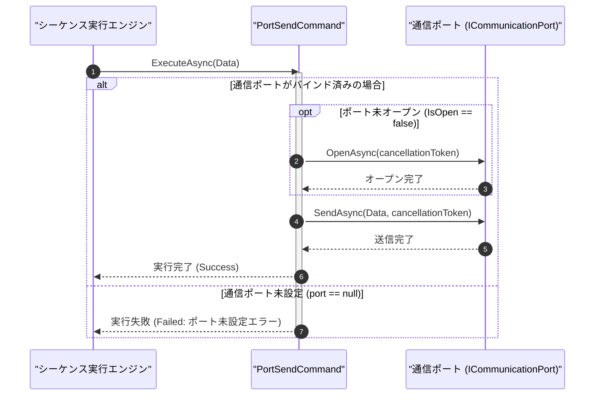

# コマンドリファレンス：PortSend

## 概要

`PortSend` は、共通通信ポート抽象化インターフェース（`ICommunicationPort`）を介して任意の文字列電文を接続先機器へ非同期送信する透過ポート通信制御系コマンドです。  
プロトコル種別（シリアル・ソケット・GPIB アダプタ等）に依存しない共通テストシーケンスや汎用通信制御で使用します。

> 💡 **補足**  
> 送信実行時に対象の `ICommunicationPort` が未オープンの場合は、内部で自動的に `OpenAsync` を呼び出して回線を接続してからデータを送出します。

---

## 💡 書式・パラメータ仕様

### コマンド構文

```csv
,SEQUENCE, [ステップキー], PortSend, "[送信データ(Data)]"
```

### パラメータ（引数）一覧

| 引数位置 | 引数名 | 説明 | 指定方法 / 有効な入力値 |
| :--- | :--- | :--- | :--- |
| 引数1 | `Data` | 通信ポートへ送信する文字列電文（必須）。 | 任意の文字列リテラル（例: `"TEST_DATA"`, `"*RST"`）または `$PARAM$` 置換 |

---

## 🔄 特殊置換規約・分岐規約の適用

本コマンドの引数における特殊記法および解釈ルールです。
* **動的置換（`$`）**: 引数内で `$PARAMキー$` のように記述すると、実行時に変数プール（PARAM）の値へ動的置換されます。（適用可能な引数: 引数 1 `Data`）
* **ジャンプ先指定（`#`）**: 本コマンドはジャンプ制御を行わないため適用されません。（適用可能な引数: 非適用）
* **共通コマンド指定（`@`）**: 本コマンドは外部マクロを呼び出さないため適用されません。（適用可能な引数: 非適用）
* **カンマのエスケープ**: 引数文字列自体にカンマを含める場合は、必ず `","` と二重引用符で囲んで記述します。
* **エイリアス（別名）**: `Port.Send`, `Send`

---

## 💡 動作例（正しい構文での記述例）

### スクリプト記述例

※COMMAND ブロック配下の子要素行（PARAM, SEQUENCE）は必ず行頭カンマから開始し、スペースインデントや行末コメント（`;`）は記述しないでください。

```csv
COMMAND, "SEND_INIT_CMD", ""
,PARAM, "INIT_STR", Text, "初期化電文", "SYST:PRES"
; 共通通信ポートへ初期化コマンド文字列を送信
,SEQUENCE, 010, PortSend, "$INIT_STR$"
,SEQUENCE, 020, Exit
```

### 実行時の挙動・変数変化

* **実行前の状態**: `"INIT_STR"` に `"SYST:PRES"` が設定され、実行コンテキストに有効な通信ポートがバインドされている状態。
* **実行後の状態**: ステップ `010` の実行により、ポートが未接続であれば自動オープンされた上で `"SYST:PRES"` が非同期送信され、正常完了ステータス（`Success`）でステップ `020` へ進みます。

---

## 🔄 動作フロー（シーケンス図）

本コマンド実行時における、シーケンス実行エンジン、`PortSendCommand`、および `ICommunicationPort` 間のインタラクションを示すシーケンス図です。



---

## 🚫 エラーハンドリング・安全設計（仕様制限）

入力データの異常や実行時エラーに対し、解析・実行エンジンが実行するセーフティ規約です。

1. **通信ポート未バインド時の安全失敗返却**:
   - コンストラクタ注入および `IAnalysisContext.CommunicationPort` のいずれにも通信ポートが設定されていない場合、`NullReferenceException` を発生させず `AnalysisResult.Failed` を返却して安全に停止します。
2. **必須引数欠落時のパイプライン検証防御**:
   - 第 1 引数 `Data` が省略された場合、`CommandParameterPipeline` の事前検証によって実行前にエラー検出され、不正な空送信を防止します。

---

## 🧪 ユニットテスト仕様

本コマンドクラス（`PortSendCommand.cs`）に実装されている `RunUnitTest()` メソッドが検証するユニットテストの仕様です。

### テスト実行前提条件

* **実行トリガー**: `RunUnitTest()` メソッドの呼び出し
* **有効化条件**: システム全体の最小ログレベル（`ErrorLogger.MinimumLevel`）が `LogLevel.Test` であること（それ以外の場合は無効化ガードにより早期リターン）
* **検証結果出力**: `_log.LogTest` によるログ出力。検証失敗時は `_log.LogError`、予期せぬ例外発生時は `_log.LogCritical` で記録。

### テストケース一覧

| No | テストカテゴリ | テスト条件（入力値） | 期待される結果（出力値） | 検証の目的 / 観点 |
| :---: | :--- | :--- | :--- | :--- |
| **1** | 正常系 | `MockCommunicationPort` バインド環境で `"TEST_DATA"` を指定 | `Status == Success` かつ `LastSentData == "TEST_DATA"` | 透過ポート文字列送信の基本動作検証 |
| **2** | 異常系 | 必須引数 `Data` 欠落または通信ポート未設定状態での実行 | パイプライン検証失敗または `AnalysisResult.Failed` を返却 | 引数欠落・未接続時のクラッシュ防御検証 |

