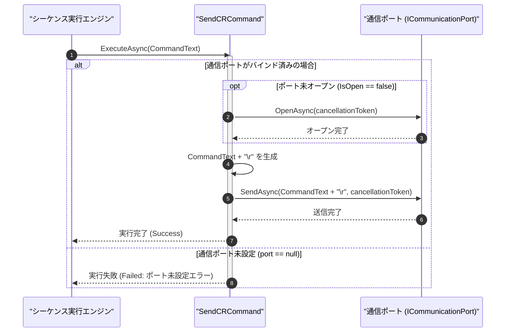

# コマンドリファレンス：SendCR

## 概要

`SendCR` は、指定されたコマンド文字列の末尾にキャリッジリターン（`\r`：CR ターミネータ）を自動付加して共通通信ポート（`ICommunicationPort`）へ非同期送信する透過ポート通信制御系コマンドです。  
CR 終端を要求する計測器やシリアル制御機器へのコマンド送出を簡潔に記述する際に使用します。

> 💡 **補足**  
> 対象ポートが未オープンの場合は自動的に `OpenAsync` を実行してから送信します。終端文字を付加せずそのまま送信したい場合は `PortSend` を使用してください。

---

## 💡 書式・パラメータ仕様

### コマンド構文

```csv
,SEQUENCE, [ステップキー], SendCR, "[送信コマンド文字列(CommandText)]"
```

### パラメータ（引数）一覧

| 引数位置 | 引数名 | 説明 | 指定方法 / 有効な入力値 |
| :--- | :--- | :--- | :--- |
| 引数1 | `CommandText` | 末尾に `\r`（CR）を付加して送信するコマンド文字列（必須）。 | 任意の文字列リテラル（例: `"*IDN?"`, `"RD DM100"`）または `$PARAM$` 置換 |

---

## 🔄 特殊置換規約・分岐規約の適用

本コマンドの引数における特殊記法および解釈ルールです。
* **動的置換（`$`）**: 引数内で `$PARAMキー$` のように記述すると、実行時に変数プール（PARAM）の値へ動的置換されます。（適用可能な引数: 引数 1 `CommandText`）
* **ジャンプ先指定（`#`）**: 本コマンドはジャンプ制御を行わないため適用されません。（適用可能な引数: 非適用）
* **共通コマンド指定（`@`）**: 本コマンドは外部マクロを呼び出さないため適用されません。（適用可能な引数: 非適用）
* **カンマのエスケープ**: 引数文字列自体にカンマを含める場合は、必ず `","` と二重引用符で囲んで記述します。
* **エイリアス（別名）**: なし（標準名 `SendCR` のみ）

---

## 💡 動作例（正しい構文での記述例）

### スクリプト記述例

※COMMAND ブロック配下の子要素行（PARAM, SEQUENCE）は必ず行頭カンマから開始し、スペースインデントや行末コメント（`;`）は記述しないでください。

```csv
COMMAND, "QUERY_IDN_CR", "IDN_RES"
,PARAM, "IDN_RES", Work, "機器識別応答", ""
; CR 終端付きで *IDN? を送信し、続けて応答を受信
,SEQUENCE, 010, SendCR, "*IDN?"
,SEQUENCE, 020, PortReceive, "IDN_RES", 3000
,SEQUENCE, 030, Exit
```

### 実行時の挙動・変数変化

* **実行前の状態**: 通信ポートが利用可能な状態で、`"IDN_RES"` は空文字列 `""` の状態。
* **実行後の状態**: ステップ `010` で `"*IDN?\r"` が通信ポートへ送出され、続くステップ `020` で機器からの応答文字列が `"IDN_RES"` に格納されます。

---

## 🔄 動作フロー（シーケンス図）

本コマンド実行時における、シーケンス実行エンジン、`SendCRCommand`、および `ICommunicationPort` 間のインタラクションを示すシーケンス図です。



---

## 🚫 エラーハンドリング・安全設計（仕様制限）

入力データの異常や実行時エラーに対し、解析・実行エンジンが実行するセーフティ規約です。

1. **通信ポート未設定時の安全停止**:
   - 実行コンテキストに通信ポートが割り当てられていない場合、例外クラッシュを起こさず `AnalysisResult.Failed` を返して安全にシーケンスを停止します。
2. **必須引数検証ガード**:
   - `CommandText` 引数が不足している場合はパラメータ検証パイプラインで即座に拒否され、CR 単体の誤送信を防止します。

---

## 🧪 ユニットテスト仕様

本コマンドクラス（`PortSendCommand.cs` 内 `SendCRCommand`）に実装されている `RunUnitTest()` メソッドが検証するユニットテストの仕様です。

### テスト実行前提条件

* **実行トリガー**: `RunUnitTest()` メソッドの呼び出し
* **有効化条件**: システム全体の最小ログレベル（`ErrorLogger.MinimumLevel`）が `LogLevel.Test` であること（それ以外の場合は無効化ガードにより早期リターン）
* **検証結果出力**: `_log.LogTest` によるログ出力。検証失敗時は `_log.LogError`、予期せぬ例外発生時は `_log.LogCritical` で記録。

### テストケース一覧

| No | テストカテゴリ | テスト条件（入力値） | 期待される結果（出力値） | 検証の目的 / 観点 |
| :---: | :--- | :--- | :--- | :--- |
| **1** | 正常系 | `MockCommunicationPort` 環境で `"*IDN?"` を指定 | `Status == Success` かつ `LastSentData == "*IDN?\r"` | CR ターミネータ自動付加と非同期送信の検証 |
| **2** | 異常系 | 引数省略または通信ポート未バインド状態での実行 | パイプライン検証エラーまたは `AnalysisResult.Failed` を返却 | 異常入力・未接続時のセーフティ検証 |

