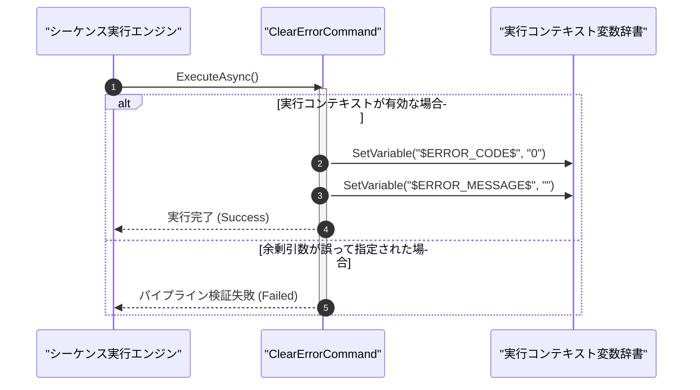

# コマンドリファレンス：ClearError

## 概要

`ClearError` は、実行コンテキスト内に保持されているエラーコード（`$ERROR_CODE$`）を `"0"` に、エラーメッセージ（`$ERROR_MESSAGE$`）を空文字列 `""` にリセットする共通シーケンス制御系コマンドです。  
`OnError` トラップ先でのリカバリ処理完了後や、リトライ再実行前のエラーステータス初期化で使用します。

> 💡 **補足**  
> 本コマンドは引数を必要とせず、呼び出すだけで直前のエラー状態変数を安全にクリアします。

---

## 💡 書式・パラメータ仕様

### コマンド構文

```csv
,SEQUENCE, [ステップキー], ClearError
```

### パラメータ（引数）一覧

（引数なし：システム変数 `$ERROR_CODE$` および `$ERROR_MESSAGE$` を既定の正常状態へ初期化します。）

---

## 🔄 特殊置換規約・分岐規約の適用

本コマンドの引数における特殊記法および解釈ルールです。
* **動的置換（`$`）**: 引数を持たないため適用されません。（適用可能な引数: 非適用）
* **ジャンプ先指定（`#`）**: 本コマンドはジャンプ制御を行わないため適用されません。（適用可能な引数: 非適用）
* **共通コマンド指定（`@`）**: 本コマンドは外部マクロを呼び出さないため適用されません。（適用可能な引数: 非適用）
* **カンマのエスケープ**: 引数を持たないため適用されません（一般規則として引数内カンマは `","` で囲みます）。
* **エイリアス（別名）**: `ResetError`, `Analysis_Term_ClearError`

---

## 💡 動作例（正しい構文での記述例）

### スクリプト記述例

※COMMAND ブロック配下の子要素行（PARAM, SEQUENCE）は必ず行頭カンマから開始し、スペースインデントや行末コメント（`;`）は記述しないでください。

```csv
COMMAND, "RECOVER_ERROR_STATE", ""
,SEQUENCE, 010, OnError, #RECOVER#
,SEQUENCE, 020, SetError, -100, "一時通信タイムアウト"
; エラートラップ後にエラーステータスをクリアして正常終了
,SEQUENCE, #RECOVER#, ClearError
,SEQUENCE, 040, Exit
```

### 実行時の挙動・変数変化

* **実行前の状態**: `$ERROR_CODE$` が `"-100"`、`$ERROR_MESSAGE$` が `"一時通信タイムアウト"` の状態。
* **実行後の状態**: `#RECOVER#` ステップで `ClearError` が実行されると、`$ERROR_CODE$` が `"0"`、`$ERROR_MESSAGE$` が `""` に初期化されます。

---

## 🔄 動作フロー（シーケンス図）

本コマンド実行時における、シーケンス実行エンジン、`ClearErrorCommand`、および実行コンテキスト変数辞書間のインタラクションを示すシーケンス図です。



---

## 🚫 エラーハンドリング・安全設計（仕様制限）

入力データの異常や実行時エラーに対し、解析・実行エンジンが実行するセーフティ規約です。

1. **冪等（Idempotent）なクリア動作**:
   - エラーが発生していない正常状態で `ClearError` を何度実行しても副作用や例外を発生させず、常に `$ERROR_CODE$ = "0"` を保証します。
2. **不要な余剰引数の誤記述検出**:
   - 空の `CommandParameterSpec` により、誤って不要な引数が付与された場合は実行前にパラメータ検証で検出されます。

---

## 🧪 ユニットテスト仕様

本コマンドクラス（`EqualCommand.cs` 内 `ClearErrorCommand`）に実装されている `RunUnitTest()` メソッドが検証するユニットテストの仕様です。

### テスト実行前提条件

* **実行トリガー**: `RunUnitTest()` メソッドの呼び出し
* **有効化条件**: システム全体の最小ログレベル（`ErrorLogger.MinimumLevel`）が `LogLevel.Test` であること（それ以外の場合は無効化ガードにより早期リターン）
* **検証結果出力**: `_log.LogTest` によるログ出力。検証失敗時は `_log.LogError`、予期せぬ例外発生時は `_log.LogCritical` で記録。

### テストケース一覧

| No | テストカテゴリ | テスト条件（入力値） | 期待される結果（出力値） | 検証の目的 / 観点 |
| :---: | :--- | :--- | :--- | :--- |
| **1** | 正常系 | `$ERROR_CODE$="-100"`, `$ERROR_MESSAGE$="Some error"` 状態で引数なし実行 | `$ERROR_CODE$ == "0"` かつ `$ERROR_MESSAGE$ == ""` に初期化 | エラーステータスリセット動作の検証 |
| **2** | 異常系 | 不要な余剰引数を渡して検証パイプラインを実行 | `IsValid == false` となり誤記述を検出 | 引数仕様境界の検証 |

