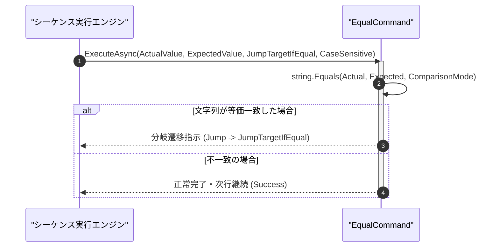

# コマンドリファレンス：Equal

## 概要

`Equal` は、実測値または比較元文字列（`ActualValue`）と期待値文字列（`ExpectedValue`）の等価比較を行い、一致した場合に指定ステップまたはラベル（`JumpTargetIfEqual`）へ条件分岐ジャンプする共通シーケンス制御系コマンドです。  
機器応答文字列（`"PASS"`, `"OK"` 等）の一致判定による分岐処理を簡潔に記述する際に使用します。

> 💡 **補足**  
> 第 4 引数 `CaseSensitive` を省略した場合は既定値 `false`（大文字・小文字を区別しない比較）で判定されます。不等号や数値大小比較を含む汎用条件分岐には [`Judge`](./Judge.Md) も利用できます。

---

## 💡 書式・パラメータ仕様

### コマンド構文

```csv
,SEQUENCE, [ステップキー], Equal, "[比較対象値(ActualValue)]", "[期待値(ExpectedValue)]", [一致時ジャンプ先(JumpTargetIfEqual)], "[大文字小文字区別(CaseSensitive)]"
```

### パラメータ（引数）一覧

| 引数位置 | 引数名 | 説明 | 指定方法 / 有効な入力値 |
| :--- | :--- | :--- | :--- |
| 引数1 | `ActualValue` | 判定対象の実測値または文字列（必須）。 | 文字列リテラルまたは `$PARAM$` 置換（例: `"$STATUS$"`） |
| 引数2 | `ExpectedValue` | 一致判定の基準となる期待値文字列（必須）。 | 文字列リテラル（例: `"PASS"`, `"READY"`）または `$PARAM$` 置換 |
| 引数3 | `JumpTargetIfEqual` | 等価一致時に遷移するステップ番号または行ラベル（必須）。 | ステップ番号（例: `120`）または `#ラベル名#`（例: `#OK_END#`） |
| 引数4 | `CaseSensitive` | 大文字・小文字を厳密に区別するかどうかの真偽値（任意・既定値: `false`）。 | `true`（区別する）または `false`（区別しない） |

---

## 🔄 特殊置換規約・分岐規約の適用

本コマンドの引数における特殊記法および解釈ルールです。
* **動的置換（`$`）**: 引数内で `$PARAMキー$` のように記述すると、実行時に変数プール（PARAM）の値へ動的置換されます。（適用可能な引数: 全引数対応）
* **ジャンプ先指定（`#`）**: 一致時の遷移先ラベルを `#ラベル名#` の形式で指定できます。（適用可能な引数: 引数 3 `JumpTargetIfEqual`）
* **共通コマンド指定（`@`）**: 本コマンドは外部マクロを呼び出さないため適用されません。（適用可能な引数: 非適用）
* **カンマのエスケープ**: 引数文字列自体にカンマを含める場合は、必ず `","` と二重引用符で囲んで記述します。
* **エイリアス（別名）**: `JudgeEqual`, `JudgeHD`, `Gpib_Equal`, `Analysis_Term_Equal`, `Analysis_Term_JudgeHD`

---

## 💡 動作例（正しい構文での記述例）

### スクリプト記述例

※COMMAND ブロック配下の子要素行（PARAM, SEQUENCE）は必ず行頭カンマから開始し、スペースインデントや行末コメント（`;`）は記述しないでください。

```csv
COMMAND, "JUDGE_STATUS_EQ", "RES_TEXT"
,PARAM, "RES_TEXT", Text, "機器応答ステータス", "pass"
; 大文字小文字を区別せず "PASS" と一致すれば #COMPLETE# へジャンプ
,SEQUENCE, 010, Equal, "$RES_TEXT$", "PASS", #COMPLETE#, false
,SEQUENCE, 020, Param_Set, "JUDGE_STATUS_EQ", "NG", "RES_TEXT"
,SEQUENCE, #COMPLETE#, Exit
```

### 実行時の挙動・変数変化

* **実行前の状態**: `"RES_TEXT"` が小文字の `"pass"` である状態。
* **実行後の状態**: ステップ `010` で `CaseSensitive = false` により `"pass"` と `"PASS"` が一致と判定され、ステップ `020` をスキップして `#COMPLETE#` へジャンプします。

---

## 🔄 動作フロー（シーケンス図）

本コマンド実行時における、シーケンス実行エンジンと `EqualCommand` 間のインタラクションを示すシーケンス図です。



---

## 🚫 エラーハンドリング・安全設計（仕様制限）

入力データの異常や実行時エラーに対し、解析・実行エンジンが実行するセーフティ規約です。

1. **必須 3 引数の事前検証ガード**:
   - `ActualValue`、`ExpectedValue`、`JumpTargetIfEqual` のいずれかが欠落している場合は `CommandParameterPipeline` が実行前に検出し、不定先への誤ジャンプを防止します。
2. **整数ステップ番号と文字列ラベルの双方安全解決**:
   - `JumpTargetIfEqual` が整数（例: `"120"`）であれば `AnalysisResult.Jump(int)`、ラベル文字列（例: `"#OK#"`）であれば `AnalysisResult.Jump(string)` へ自動振り分けします。

---

## 🧪 ユニットテスト仕様

本コマンドクラス（`EqualCommand.cs` 内 `EqualCommand`）に実装されている `RunUnitTest()` メソッドが検証するユニットテストの仕様です。

### テスト実行前提条件

* **実行トリガー**: `RunUnitTest()` メソッドの呼び出し
* **有効化条件**: システム全体の最小ログレベル（`ErrorLogger.MinimumLevel`）が `LogLevel.Test` であること（それ以外の場合は無効化ガードにより早期リターン）
* **検証結果出力**: `_log.LogTest` によるログ出力。検証失敗時は `_log.LogError`、予期せぬ例外発生時は `_log.LogCritical` で記録。

### テストケース一覧

| No | テストカテゴリ | テスト条件（入力値） | 期待される結果（出力値） | 検証の目的 / 観点 |
| :---: | :--- | :--- | :--- | :--- |
| **1** | 正常系 | 引数 `("PASS", "pass", "120")` で比較実行 | `Status == Jump` かつ `NextStepOverride == 120` を返却 | 大文字小文字非区別一致ジャンプの検証 |
| **2** | 正常系 | 引数 `("FAIL", "PASS", "120")` で不一致比較実行 | ジャンプせず `Status == Success`（次行進行）を返却 | 不一致時のフォールスルー動作検証 |
| **3** | 異常系 | 第 4 引数 `CaseSensitive` に不正真偽値文字列を指定 | パイプライン検証で `IsValid == false` となり安全拒否 | 型バリデーション防御の検証 |

