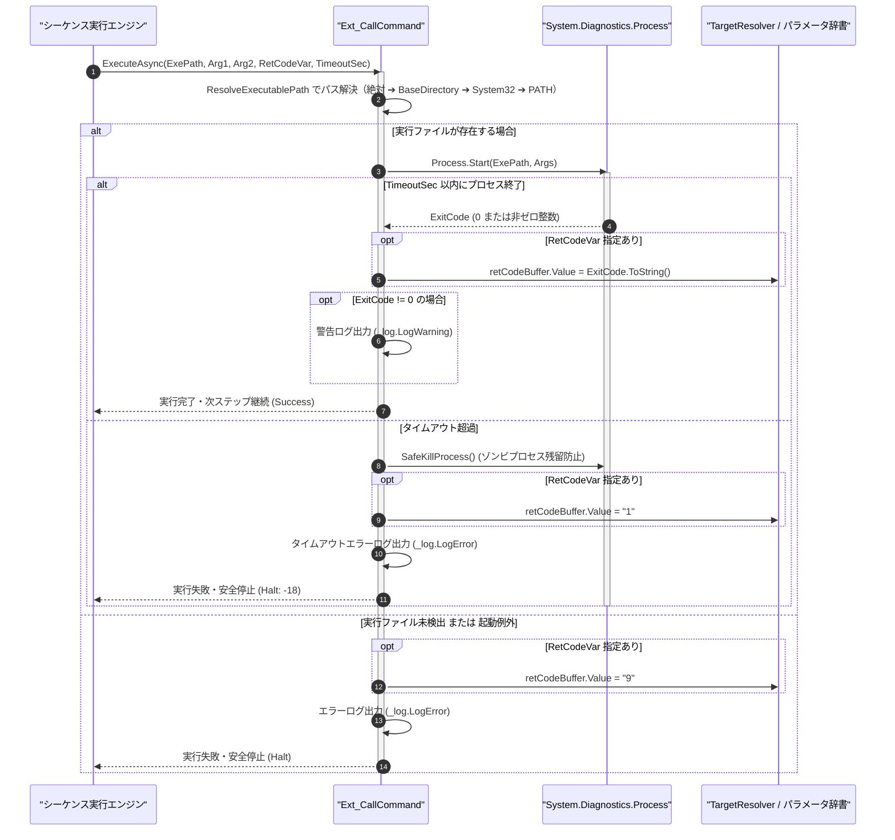

# コマンドリファレンス：Ext_Call

## 概要

`Ext_Call` は、外部実行可能プログラム（`.exe`、バッチファイル、PowerShell スクリプト等）を別プロセスとして起動し、指定されたタイムアウト時間（秒単位、既定 15 秒）までプロセスの終了を非同期待機する共通シーケンス・フロー制御系コマンドです。  
終了コード格納先（`<RetCodeVar>`：省略可）を指定した場合は、外部プロセスの終了コード文字列（`0` または任意の非ゼロ `ExitCode`: プロセス完了 / `"1"`: タイムアウト強制終了 / `"9"`: ファイル未存在または起動異常）を格納します。

> 💡 **補足**  
> 本コマンドは共通基盤コマンドです。実行ファイルパス（`ExecutablePath`）は独自のパス解決ロジック（`ResolveExecutablePath`）により、 **① 絶対パス ➔ ② `BaseDirectory`（コンテキスト指定またはアプリケーション基底ディレクトリ）起点の相対パス ➔ ③ ファイル名単独指定時は `Environment.SystemDirectory`（`System32`） ➔ ④ 環境変数 `PATH`（`.exe` 拡張子自動補完対応）** の順で探索されます。また、外部プロセスがタイムアウト時間内に終了した場合、終了コードが非ゼロであっても警告ログ（`_log.LogWarning`）を記録した上で `AnalysisResult.Success`（次ステップ継続）を返します。

---

## 💡 書式・パラメータ仕様

### コマンド構文

```csv
,SEQUENCE, [ステップキー], Ext_Call, "[実行ファイルパス(ExecutablePath)]", "[第1引数(Arg1)]", "[第2引数(Arg2)]", "[終了コード格納先(RetCodeVar)]", "[タイムアウト秒(TimeoutSec)]"
```

### パラメータ（引数）一覧

| 引数位置 | 引数名 | 説明 | 指定方法 / 有効な入力値 |
| :--- | :--- | :--- | :--- |
| 引数1 | ExecutablePath | 起動する外部実行ファイルまたはスクリプトのパス（必須）。 | 絶対パス、相対パス（例: `"./tools/conv.exe"`）、システムコマンド名（例: `"cmd.exe"`）、または `$PARAM$` 置換 |
| 引数2 | Arg1 | 外部プログラムへ渡す第 1 コマンドライン引数（任意・不要時は `""`）。 | 任意の引数文字列または `$PARAM$` 置換 |
| 引数3 | Arg2 | 外部プログラムへ渡す第 2 コマンドライン引数（任意・不要時は `""`）。 | 任意の引数文字列または `$PARAM$` 置換 |
| 引数4 | RetCodeVar | 終了ステータスコード（`"0"`, 非ゼロ終了コード, `"1"`, `"9"`）を格納するパラメータキー名（任意・省略可・既定値: `""`）。 | 自コマンド内の `PARAM` キー名または変数名（例: `"EXT_RET"`）。省略時は格納なし |
| 引数5 | TimeoutSec | プロセス完了を待つ最大タイムアウト秒数（任意・省略可・既定値: `"15"`）。 | 1 以上の整数（10 進 / `0x` 16 進 / `0b` 2 進対応、秒単位、例: `"30"`）または `$PARAM$` 置換 |

---

## 🔄 特殊置換規約・分岐規約の適用

本コマンドの引数における特殊記法および解釈ルールです。
* **動的置換（`$`）**: 引数内で `$PARAMキー$` のように記述すると、実行時に変数プール（PARAM）の値へ動的置換されます。（適用可能な引数: 全引数対応）
* **ジャンプ先指定（`#`）**: 本コマンドはジャンプ制御を行わないため適用されません。（適用可能な引数: 非適用）
* **共通コマンド指定（`@`）**: 本コマンドは OS 外部プロセスを起動するため `@` は適用されません。（適用可能な引数: 非適用）
* **カンマのエスケープ**: コマンドライン引数にカンマを含める場合は、必ず `","` と二重引用符で囲んで記述します。
* **エイリアス（別名）**: `ExecProcess`, `ShellExecute`, `Gpib_ExtCall`, `Term_ExtCall`, `Analysis_Term_ExtCall`

---

## 💡 動作例（正しい構文での記述例）

### スクリプト記述例

※COMMAND ブロック配下の子要素行（PARAM, SEQUENCE）は必ず行頭カンマから開始し、スペースインデントや行末コメント（`;`）は記述しないでください。

```csv
COMMAND, "RUN_CONVERTER", "EXT_RET"
,PARAM, "INPUT_CSV", Text, "入力ファイル", "./data/raw.csv"
,PARAM, "OUTPUT_CSV", Text, "出力ファイル", "./data/formatted.csv"
,PARAM, "EXT_RET", Work, "外部終了コード", "-1"
; 外部変換ツールをタイムアウト 30 秒で起動し、終了コードを EXT_RET に取得
,SEQUENCE, 010, Ext_Call, "./bin/DataConverter.exe", "$INPUT_CSV$", "$OUTPUT_CSV$", "EXT_RET", 30
,SEQUENCE, 020, Exit
```

### 実行時の挙動・変数変化

* **実行前の状態**: `"EXT_RET"` が `"-1"` であり、`./bin/DataConverter.exe` が存在する状態。
* **実行後の状態**: `DataConverter.exe` に 2 つの引数が渡されて実行され、正常終了（ExitCode = 0）すると `"EXT_RET"` に `"0"` が格納されてステップ `020` へ進みます。

---

## 🔄 動作フロー（シーケンス図）

本コマンド実行時における、シーケンス実行エンジン、コマンドクラス（`Ext_CallCommand`）、および OS プロセス管理層間のインタラクションを示すシーケンス図です。



---

## 🚫 エラーハンドリング・安全設計（仕様制限）

入力データの異常や実行時エラーに対し、解析・実行エンジンが実行するセーフティ規約です。

1. **タイムアウト発生時のプロセス強制終了とコード `"1"` 記録**:
   - 指定秒数（`TimeoutSec`）以内に外部プログラムが終了しない場合、ハングアップを防ぐためプロセスを安全に `Kill()` し、`<RetCodeVar>` 指定時は `"1"` を格納した上でエラーログを記録して安全停止（`Halt`）します。
2. **実行ファイル未存在・起動異常時のコード `"9"` 記録**:
   - 指定された実行ファイルが存在しない場合や起動権限エラーが発生した場合は、例外クラッシュを防ぎ `<RetCodeVar>` 指定時は `"9"` を格納して安全停止（`Halt`）します。
3. **非ゼロ終了コード完了時の継続制御**:
   - 外部プログラムがタイムアウト以内に自発終了した場合、その終了コード（`ExitCode`）が `0` 以外であっても自動停止（`Halt`）は行わず、警告ログ（`_log.LogWarning`）を出力し `<RetCodeVar>` に終了コード文字列を格納して `AnalysisResult.Success` を返します（終了コードに応じた分岐は直後の [`Judge`](./Judge.Md) 等で制御可能です）。

---

## 🧪 ユニットテスト仕様

本コマンドクラス（`Ext_CallCommand.cs`）に実装されている `RunUnitTest()` メソッドが検証するユニットテストの仕様です。

### テスト実行前提条件

* **実行トリガー**: `RunUnitTest()` メソッドの呼び出し
* **有効化条件**: システム全体の最小ログレベル（`ErrorLogger.MinimumLevel`）が `LogLevel.Test` であること（それ以外の場合は無効化ガードにより早期リターン）
* **検証結果出力**: `_log.LogTest` によるログ出力。検証失敗時は `_log.LogError`、予期せぬ例外発生時は `_log.LogCritical` で記録。

### テストケース一覧

| No | テストカテゴリ | テスト条件（入力値） | 期待される結果（出力値） | 検証の目的 / 観点 |
| :---: | :--- | :--- | :--- | :--- |
| **1** | 正常系 | 標準コマンド起動（`cmd.exe`, `"/c"`, `"exit 0"`, `"EXT_RET"`, `"5"`） | `"EXT_RET"` に `"0"` が格納され `Status == Success` が返る | 外部プロセス起動・完了待機の検証 |
| **2** | 異常系 | タイムアウト超過プロセス起動（`powershell.exe`, `"-NoProfile -NonInteractive -Command"`, `"Start-Sleep -Seconds 5"`, `"EXT_RET"`, `"1"`） | 1 秒経過でプロセスが強制中断され `"EXT_RET"` に `"1"` が格納されて `Status == Halt` が返る | タイムアウト保護・`SafeKillProcess` の検証 |
| **3** | 異常系 | 存在しない実行ファイルパス（`"./no_such_app.exe"`, `""`, `""`, `"EXT_RET"`, `"5"`） | `"EXT_RET"` に `"9"` が格納され `Status == Halt` で安全停止する | ファイル未存在時のセーフティ検証 |

