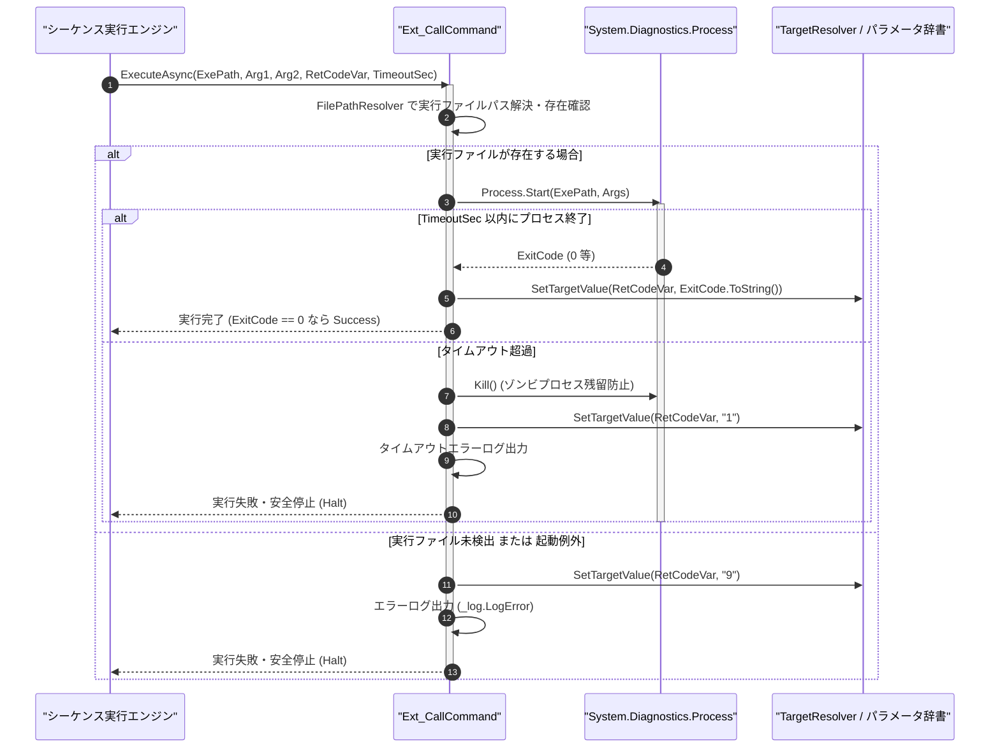

# コマンドリファレンス：Ext_Call

## 概要

`Ext_Call` は、外部実行可能プログラム（`.exe`、バッチファイル、PowerShell スクリプト等）を別プロセスとして起動し、指定されたタイムアウト時間（秒単位、既定 15 秒）までプロセスの終了を非同期同期待機する共通シーケンス・フロー制御系コマンドです。  
外部プロセスの終了コード（`0`: 正常完了 / `1`: タイムアウト / `9`: 起動異常）を指定されたパラメータ（`<RetCodeVar>`）へ格納します。

> 💡 **補足**  
> 本コマンドは 共通基盤コマンドです。実行ファイルパスに相対パスが指定された場合は、`FilePathResolver` により設定ファイル配置ディレクトリを起点として安全に解決されます。

---

## 💡 書式・パラメータ仕様

### コマンド構文

```csv
,SEQUENCE, [ステップキー], Ext_Call, "[実行ファイルパス(ExecutablePath)]", "[第1引数(Arg1)]", "[第2引数(Arg2)]", "[終了コード格納先(RetCodeVar)]", "[タイムアウト秒(TimeoutSec)]"
```

### パラメータ（引数）一覧

| 引数位置 | 引数名 | 説明 | 指定方法 / 有効な入力値 |
| :--- | :--- | :--- | :--- |
| 引数1 | ExecutablePath | 起動する外部実行ファイルまたはスクリプトのパス（必須）。 | 相対パス（例: `"./tools/conv.exe"`）または `$PARAM$` 置換 |
| 引数2 | Arg1 | 外部プログラムへ渡す第 1 コマンドライン引数（任意・不要時は `""`）。 | 任意の引数文字列または `$PARAM$` 置換 |
| 引数3 | Arg2 | 外部プログラムへ渡す第 2 コマンドライン引数（任意・不要時は `""`）。 | 任意の引数文字列または `$PARAM$` 置換 |
| 引数4 | RetCodeVar | 終了ステータスコード（`"0"`, `"1"`, `"9"` 等）を格納するパラメータキー名（必須）。 | 自コマンド内の `PARAM` キー名（例: `"EXT_RET"`, `"1"`） |
| 引数5 | TimeoutSec | プロセス完了を待つ最大タイムアウト秒数（任意・省略可・既定値: `"15"`）。 | 1 以上の整数（秒単位、例: `"30"`）または `$PARAM$` 置換 |

---

## 🔄 特殊置換規約・分岐規約の適用

本コマンドの引数における特殊記法および解釈ルールです。
* **動的置換（`$`）**: 引数内で `$PARAMキー$` のように記述すると、実行時に変数プール（PARAM）の値へ動的置換されます。（適用可能な引数: 全引数対応）
* **ジャンプ先指定（`#`）**: 本コマンドはジャンプ制御を行わないため適用されません。（適用可能な引数: 非適用）
* **共通コマンド指定（`@`）**: 本コマンドは OS 外部プロセスを起動するため `@` は適用されません。（適用可能な引数: 非適用）
* **カンマのエスケープ**: コマンドライン引数にカンマを含める場合は、必ず `","` と二重引用符で囲んで記述します。
* **エイリアス（別名）**: `ExtCall`, `ExecProcess`, `ShellExecute`, `Analysis_Term_ExtCall`

---

## 💡 動作例（正しい構文での記述例）

### スクリプト記述例

※COMMAND ブロック配下の子要素行（PARAM, SEQUENCE）は必ず行頭カンマから開始し、スペースインデントや行末コメント（`;`）は記述しないでください。

```csv
COMMAND, "RUN_CONVERTER", "EXT_RET"
,PARAM, "INPUT_CSV", Text, "入力ファイル", "./data/raw.csv"
,PARAM, "OUTPUT_CSV", Text, "出力ファイル", "./data/formatted.csv"
,PARAM, "EXT_RET", Work, "外部終了コード", "-1"
; 外部変換ツールをタイムアウト 30 秒で起動し、終了コードを EXT_RET に取得
,SEQUENCE, 010, Ext_Call, "./bin/DataConverter.exe", "$INPUT_CSV$", "$OUTPUT_CSV$", "EXT_RET", 30
,SEQUENCE, 020, Exit
```

### 実行時の挙動・変数変化

* **実行前の状態**: `"EXT_RET"` が `"-1"` であり、`./bin/DataConverter.exe` が存在する状態。
* **実行後の状態**: `DataConverter.exe` に 2 つの引数が渡されて実行され、正常終了（ExitCode = 0）すると `"EXT_RET"` に `"0"` が格納されてステップ `020` へ進みます。

---

## 🔄 動作フロー（シーケンス図）

本コマンド実行時における、シーケンス実行エンジン、コマンドクラス（`Ext_CallCommand`）、および OS プロセス管理層間のインタラクションを示すシーケンス図です。



---

## 🚫 エラーハンドリング・安全設計（仕様制限）

入力データの異常や実行時エラーに対し、解析・実行エンジンが実行するセーフティ規約です。

1. **タイムアウト発生時のプロセス強制終了とコード `"1"` 記録**:
   - 指定秒数（`TimeoutSec`）以内に外部プログラムが終了しない場合、ハングアップを防ぐためプロセスを安全に `Kill()` し、`<RetCodeVar>` に `"1"` を格納した上でエラーログを記録して停止します。
2. **実行ファイル未存在・起動異常時のコード `"9"` 記録**:
   - 指定された実行ファイルが存在しない場合や起動権限エラーが発生した場合は、例外クラッシュを防ぎ `<RetCodeVar>` に `"9"` を格納して安全停止します。

---

## 🧪 ユニットテスト仕様

本コマンドクラス（`Ext_CallCommand.cs`）に実装されている `RunUnitTest()` メソッドが検証するユニットテストの仕様です。

### テスト実行前提条件

* **実行トリガー**: `RunUnitTest()` メソッドの呼び出し
* **有効化条件**: システム全体の最小ログレベル（`ErrorLogger.MinimumLevel`）が `LogLevel.Test` であること（それ以外の場合は無効化ガードにより早期リターン）
* **検証結果出力**: `_log.LogTest` によるログ出力。検証失敗時は `_log.LogError`、予期せぬ例外発生時は `_log.LogCritical` で記録。

### テストケース一覧

| No | テストカテゴリ | テスト条件（入力値） | 期待される結果（出力値） | 検証の目的 / 観点 |
| :---: | :--- | :--- | :--- | :--- |
| **1** | 正常系 | 正常終了する標準コマンド起動 | `<RetCodeVar>` に `"0"` が格納され `Success` が返る | 外部プロセス起動・完了待機の検証 |
| **2** | 異常系 | タイムアウト秒数を超えて待機するプロセス起動 | プロセスが中断され `<RetCodeVar>` に `"1"` が格納される | タイムアウト保護ガードの検証 |
| **3** | 異常系 | 存在しない実行ファイルパス（`"./no_such_app.exe"`） | `<RetCodeVar>` に `"9"` が格納され `Failure` で安全停止する | ファイル未存在時のセーフティ検証 |

