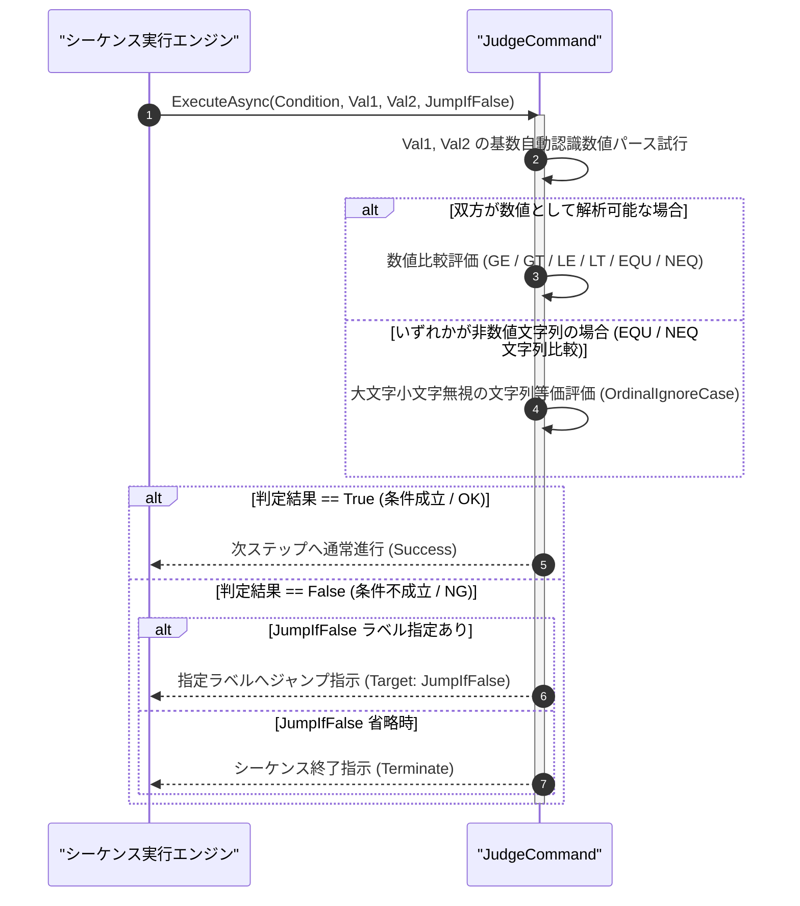

# コマンドリファレンス：Judge

## 概要

`Judge` は、2 つの値（`<Val1>` と `<Val2>`：数値および文字列の双方に対応）を指定された比較条件演算子（`<Condition>`：`GE`, `GT`, `LE`, `LT`, `EQU`, `NEQ`）で比較判定し、**条件が成立（真 / OK）した場合は次の行へ進み、条件が不成立（偽 / NG）の場合にのみ指定された行ラベル（`<JumpIfFalse>`）へジャンプ**する共通シーケンス・フロー制御系コマンドです。  
統一フォーマット指定子（10 進、16 進 `0x`/`&H`、2 進 `0b`）による基数自動認識（旧 `JudgeHD` 統合）および文字列の等価・非等価比較（旧 `Equal` 統合）を単一コマンドで包含しています。

> 💡 **補足**  
> 本コマンドは 共通基盤コマンドです。条件不成立時（偽 / NG）に `<JumpIfFalse>` が省略されている場合は、規格外判定としてシーケンス実行を終了します。

---

## 💡 書式・パラメータ仕様

### コマンド構文

```csv
,SEQUENCE, [ステップキー], Judge, "[比較条件(Condition)]", "[比較値1(Val1)]", "[比較値2(Val2)]", "[不成立時ジャンプ先(JumpIfFalse)]"
```

### パラメータ（引数）一覧

| 引数位置 | 引数名 | 説明 | 指定方法 / 有効な入力値 |
| :--- | :--- | :--- | :--- |
| 引数1 | Condition | 比較条件演算子（必須）。<br/>・`GE`: `Val1 >= Val2`（以上）<br/>・`GT`: `Val1 > Val2`（より大きい）<br/>・`LE`: `Val1 <= Val2`（以下）<br/>・`LT`: `Val1 < Val2`（未満）<br/>・`EQU`: `Val1 == Val2`（等しい：数値または文字列大文字小文字無視）<br/>・`NEQ`: `Val1 != Val2`（等しくない） | `"GE"`, `"GT"`, `"LE"`, `"LT"`, `"EQU"`, `"NEQ"`（または `">="`, `">"`, `"<="`, `"<"`, `"=="`, `"!="`） |
| 引数2 | Val1 | 左辺の比較対象値（数値または文字列・必須）。 | 数値リテラル（`"5.0"`, `"0x1A"`）、文字列、または `$PARAM$` 置換 |
| 引数3 | Val2 | 右辺の比較基準値（数値または文字列・必須）。 | 数値リテラル、文字列、または `$PARAM$` 置換 |
| 引数4 | JumpIfFalse | 条件不成立（偽 / NG）時にジャンプする行ラベル（任意・省略可）。 | `#ラベル名#` 形式（例: `"#NG_HANDLE#"`）。省略時は不成立時にシーケンス終了 |

---

## 🔄 特殊置換規約・分岐規約の適用

本コマンドの引数における特殊記法および解釈ルールです。
* **動的置換（`$`）**: 引数内で `$PARAMキー$` のように記述すると、実行時に変数プール（PARAM）の値へ動的置換されます。（適用可能な引数: 全引数対応）
* **ジャンプ先指定（`#`）**: 引数 4 に条件不成立時の遷移先ラベルを指定する場合は、`#ERROR_EXIT#` のように `#` で囲んで指定します。（適用可能な引数: 引数 4 `JumpIfFalse`）
* **共通コマンド指定（`@`）**: 本コマンドは外部マクロを呼び出さないため適用されません。（適用可能な引数: 非適用）
* **カンマのエスケープ**: 比較文字列自体にカンマを含める場合は、必ず `","` と二重引用符で囲んで記述します。
* **エイリアス（別名）**: `GpibJudge`, `Analysis_Term_Judge`, `JudgeHD`, `Analysis_Term_JudgeHD`, `Equal`, `GpibEqual`, `Analysis_Term_Equal`, `Equ`

---

## 💡 動作例（正しい構文での記述例）

### スクリプト記述例

※COMMAND ブロック配下の子要素行（PARAM, SEQUENCE）は必ず行頭カンマから開始し、スペースインデントや行末コメント（`;`）は記述しないでください。

```csv
COMMAND, "VOLTAGE_TEST", "JUDGE_RES"
,PARAM, "MEAS_V", Number, "測定電圧", "5.02"
,PARAM, "LOWER_LIM", Number, "下限値", "4.80"
,PARAM, "UPPER_LIM", Number, "上限値", "5.20"
,PARAM, "JUDGE_RES", Work, "合否結果", "PASS"
; 1. 下限判定：MEAS_V >= LOWER_LIM (4.80) でなければ #FAIL_EXIT# へジャンプ
,SEQUENCE, 010, Judge, GE, $MEAS_V$, $LOWER_LIM$, #FAIL_EXIT#
; 2. 上限判定：MEAS_V <= UPPER_LIM (5.20) でなければ #FAIL_EXIT# へジャンプ
,SEQUENCE, 020, Judge, LE, $MEAS_V$, $UPPER_LIM$, #FAIL_EXIT#
,SEQUENCE, 030, Exit
,SEQUENCE, #FAIL_EXIT#, Param_Set, "VOLTAGE_TEST", "FAIL", "JUDGE_RES"
,SEQUENCE, 050, Exit
```

### 実行時の挙動・変数変化

* **実行前の状態**: `"MEAS_V"` が `"5.02"`、`"LOWER_LIM"` が `"4.80"`、`"UPPER_LIM"` が `"5.20"` の状態。
* **実行後の状態**: ステップ `010`（$5.02 \ge 4.80$：成立）およびステップ `020`（$5.02 \le 5.20$：成立）ともに真となるため次行へ進行し、`"JUDGE_RES"` が `"PASS"` のままステップ `030` で正常終了します。もし `"MEAS_V"` が `"5.50"` であった場合は、ステップ `020` が不成立となり `#FAIL_EXIT#` へジャンプして `"FAIL"` が格納されます。

---

## 🔄 動作フロー（シーケンス図）

本コマンド実行時における、シーケンス実行エンジンおよびコマンドクラス（`JudgeCommand`）間のインタラクションを示すシーケンス図です。



---

## 🚫 エラーハンドリング・安全設計（仕様制限）

入力データの異常や実行時エラーに対し、解析・実行エンジンが実行するセーフティ規約です。

1. **非数値文字列に対する大小比較（`GE`, `GT`, `LE`, `LT`）指定時**:
   - `EQU` / `NEQ` 以外の大小比較演算子で数値変換できない文字列が指定された場合、不正比較エラーとして `_log.LogError` に記録し、直ちに安全停止（Halt）します。
2. **未定義の比較演算子または未定義ジャンプ先ラベルの指定**:
   - 規定外の `<Condition>` 文字列や存在しない `#ラベル名#` が指定された場合、エラーログを出力して安全停止します。

---

## 🧪 ユニットテスト仕様

本コマンドクラス（`JudgeCommand.cs`）に実装されている `RunUnitTest()` メソッドが検証するユニットテストの仕様です。

### テスト実行前提条件

* **実行トリガー**: `RunUnitTest()` メソッドの呼び出し
* **有効化条件**: システム全体の最小ログレベル（`ErrorLogger.MinimumLevel`）が `LogLevel.Test` であること（それ以外の場合は無効化ガードにより早期リターン）
* **検証結果出力**: `_log.LogTest` によるログ出力。検証失敗時は `_log.LogError`、予期せぬ例外発生時は `_log.LogCritical` で記録。

### テストケース一覧

| No | テストカテゴリ | テスト条件（入力値） | 期待される結果（出力値） | 検証の目的 / 観点 |
| :---: | :--- | :--- | :--- | :--- |
| **1** | 正常系 | 数値比較成立（`"GE", "5.0", "4.8", "#NG#"`） | ジャンプせず次行進行（`Success`）が返る | 条件成立時の次行継続動作検証 |
| **2** | 正常系 | 数値比較不成立（`"LE", "5.5", "5.2", "#NG#"`） | `"#NG#"` へのジャンプ指示が返る | 条件不成立時の分岐ジャンプ検証 |
| **3** | 正常系 | 16進数・文字列比較（`"EQU", "0x10", "16"` および `"EQU", "pass", "PASS"`） | いずれも条件成立（真）と判定される | 基数自動認識（旧 `JudgeHD`）および文字列等価（旧 `Equal`）の検証 |
| **4** | 異常系 | 非数値に対する大小比較（`"GT", "ABC", "10"`） | エラーログが出力され `Failure` で安全停止する | 型不整合時のクラッシュ防御検証 |

