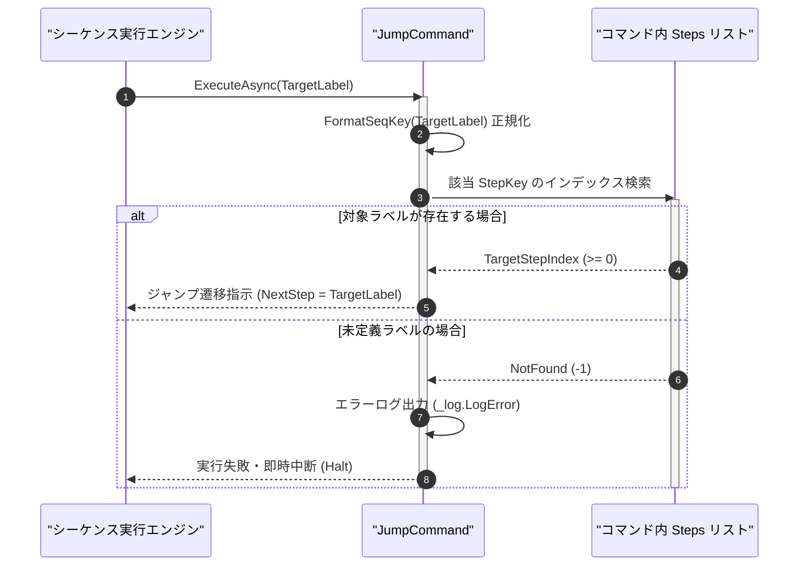

# コマンドリファレンス：Jump

## 概要

`Jump` は、同一マクロコマンド内の指定されたシーケンス行ラベル（`<TargetLabel>`、例: `#LOOP_START#` や `#ERROR_END#`）へ無条件に実行ポインタを遷移させる共通シーケンス・フロー制御系コマンドです。  
条件分岐後の合流点への遷移や、ポーリング監視ループの繰り返し制御などに使用します。

> 💡 **補足**  
> 本コマンドは 共通基盤コマンドです。パース時の静的 Lint（`LINT001`）および実行時の双方でジャンプ先ラベルの存在検証が行われます。

---

## 💡 書式・パラメータ仕様

### コマンド構文

```csv
,SEQUENCE, [ステップキー], Jump, "[ジャンプ先行ラベル(TargetLabel)]"
```

### パラメータ（引数）一覧

| 引数位置 | 引数名 | 説明 | 指定方法 / 有効な入力値 |
| :--- | :--- | :--- | :--- |
| 引数1 | TargetLabel | 遷移先となるシーケンス行のステップキー（行ラベルまたは行番号・必須）。 | `#ラベル名#` 形式（例: `"#FINISH#"`, `"#RETRY#"`）または `$PARAM$` 置換 |

---

## 🔄 特殊置換規約・分岐規約の適用

本コマンドの引数における特殊記法および解釈ルールです。
* **動的置換（`$`）**: 引数内で `$PARAMキー$` のように記述すると、実行時に変数プール（PARAM）の値（`Label` 型パラメータ等）へ動的置換されます。（適用可能な引数: 引数 1 `TargetLabel`）
* **ジャンプ先指定（`#`）**: ジャンプ先となるステップキーを `#ラベル名#` のように `#` で囲んで指定します（内部の `FormatSeqKey` により前後の `#` 有無は正規化照合されます）。（適用可能な引数: 引数 1 `TargetLabel`）
* **共通コマンド指定（`@`）**: 本コマンドは同一コマンド内の行遷移を行うため `@` は適用されません（別コマンドの呼出には [`Call`](../Param/Call.Md) を使用します）。（適用可能な引数: 非適用）
* **カンマのエスケープ**: 引数文字列自体にカンマを含める場合は、必ず `","` と二重引用符で囲んで記述します。
* **エイリアス（別名）**: `Goto`, `GpibJump`, `Analysis_Term_Jump`

---

## 💡 動作例（正しい構文での記述例）

### スクリプト記述例

※COMMAND ブロック配下の子要素行（PARAM, SEQUENCE）は必ず行頭カンマから開始し、スペースインデントや行末コメント（`;`）は記述しないでください。

```csv
COMMAND, "JUMP_SAMPLE", "STATUS"
,PARAM, "MODE", List, "実行モード", "SKIP_INIT", "NORMAL", "SKIP_INIT"
,PARAM, "STATUS", Work, "状態", "READY"
; MODE が "SKIP_INIT" と等しくない場合のみ初期化を実行し、等しい場合は #MAIN_PROC# へジャンプ
,SEQUENCE, 010, Judge, NEQ, "$MODE$", "SKIP_INIT", #MAIN_PROC#
,SEQUENCE, 020, Gpib_Send, "*RST"
,SEQUENCE, 030, Wait, 500
,SEQUENCE, 040, Jump, #MAIN_PROC#
,SEQUENCE, #MAIN_PROC#, Param_Set, "JUMP_SAMPLE", "DONE", "STATUS"
,SEQUENCE, 060, Exit
```

### 実行時の挙動・変数変化

* **実行前の状態**: ステップ `040`（または `010` の条件分岐）に到達した状態。
* **実行後の状態**: `Jump, #MAIN_PROC#` により、実行ポインタが即座に `#MAIN_PROC#` 行へ移動し、`"STATUS"` に `"DONE"` が設定されます。

---

## 🔄 動作フロー（シーケンス図）

本コマンド実行時における、シーケンス実行エンジンおよびコマンドクラス（`JumpCommand`）間のインタラクションを示すシーケンス図です。



---

## 🚫 エラーハンドリング・安全設計（仕様制限）

入力データの異常や実行時エラーに対し、解析・実行エンジンが実行するセーフティ規約です。

1. **未定義のジャンプ先行ラベル指定**:
   - 指定された `<TargetLabel>` が同一コマンドの `SEQUENCE` 内に存在しない場合、構文検証（Lint）または実行時チェックで検出し、`_log.LogError` を出力して直ちに安全停止（Halt）します。
2. **無限ループ時のキャンセルトークン中断保証**:
   - 前方ステップへの `Jump` によるループ中にユーザーから停止要求（`CancellationToken`）または最大ステップ実行上限到達が発生した場合、エンジン側で即座にループを中断し UI フリーズを防止します。

---

## 🧪 ユニットテスト仕様

本コマンドクラス（`JumpCommand.cs`）に実装されている `RunUnitTest()` メソッドが検証するユニットテストの仕様です。

### テスト実行前提条件

* **実行トリガー**: `RunUnitTest()` メソッドの呼び出し
* **有効化条件**: システム全体の最小ログレベル（`ErrorLogger.MinimumLevel`）が `LogLevel.Test` であること（それ以外の場合は無効化ガードにより早期リターン）
* **検証結果出力**: `_log.LogTest` によるログ出力。検証失敗時は `_log.LogError`、予期せぬ例外発生時は `_log.LogCritical` で記録。

### テストケース一覧

| No | テストカテゴリ | テスト条件（入力値） | 期待される結果（出力値） | 検証の目的 / 観点 |
| :---: | :--- | :--- | :--- | :--- |
| **1** | 正常系 | 定義済みラベル指定（`"#FINISH#"`） | `JumpTarget = "#FINISH#"` を持つ `Success` 結果が返る | 無条件ジャンプの基本動作検証 |
| **2** | 正常系 | `#` 省略表記（`"FINISH"`） | `FormatSeqKey` により `"#FINISH#"` に正規化されて一致解決される | ラベル表記揺れ正規化の検証 |
| **3** | 異常系 | 存在しないラベル指定（`"#NO_SUCH_STEP#"`） | エラーログが出力され `Failure` で安全停止する | 未定義ジャンプ先の防御検証 |

